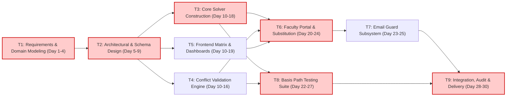
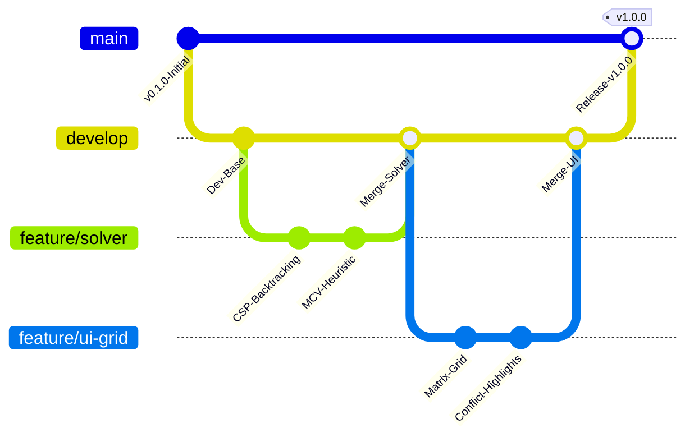
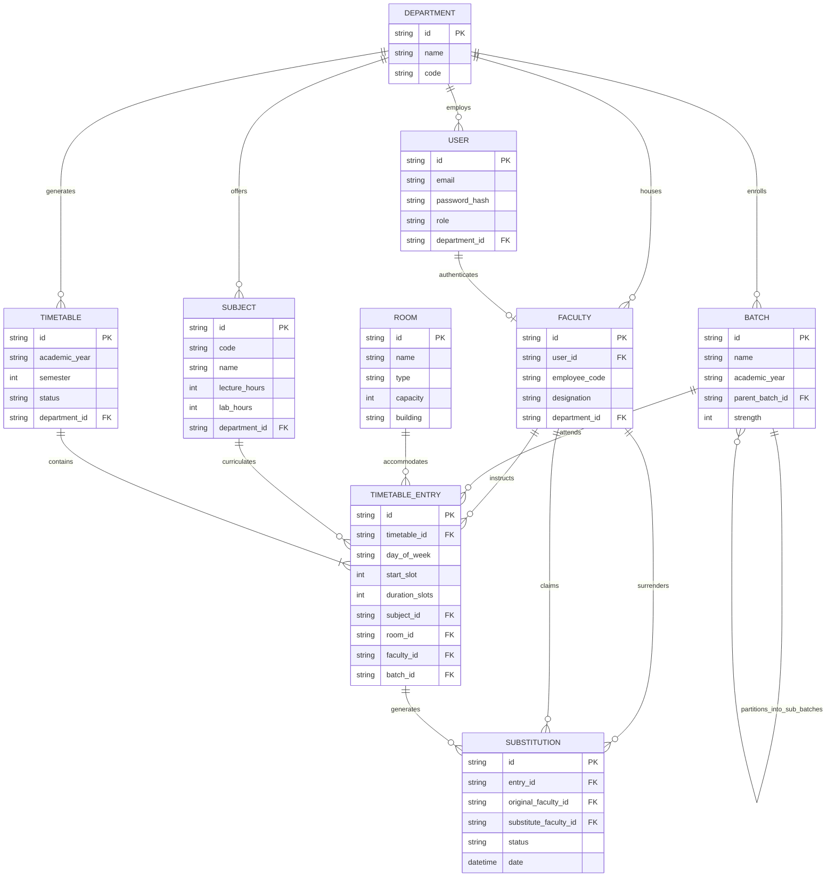
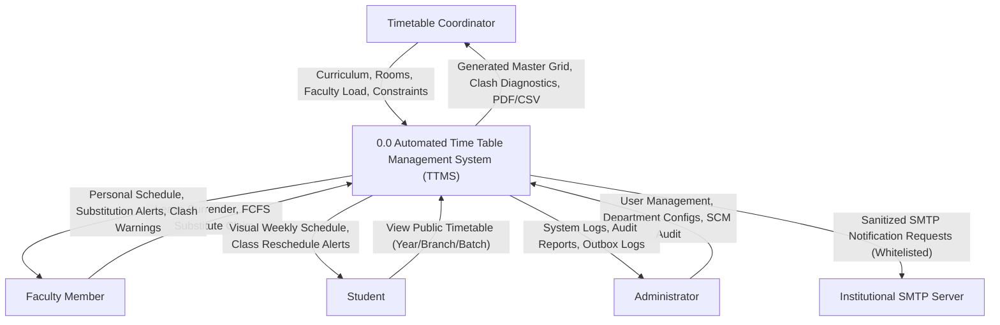
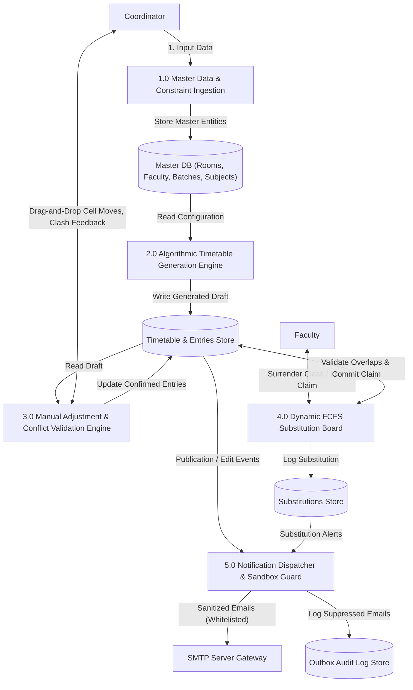
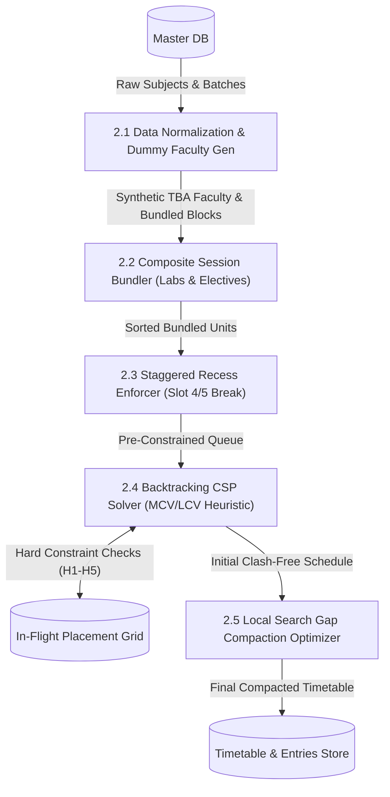
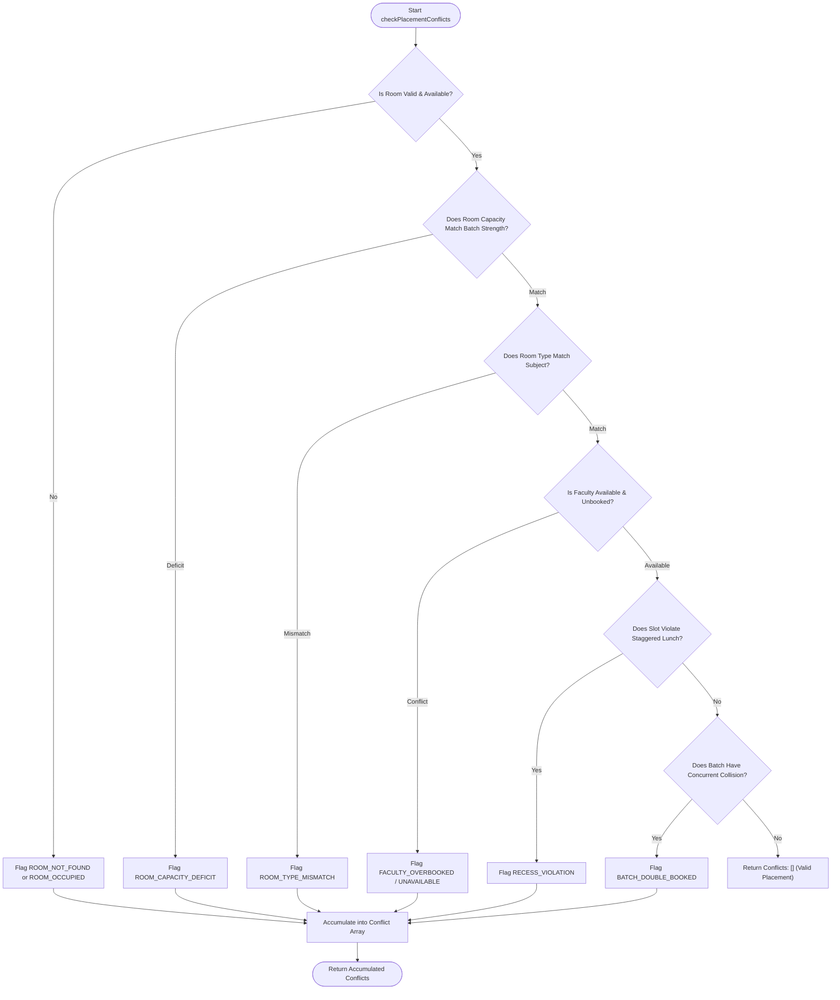

# VEERMATA JIJABAI TECHNOLOGICAL INSTITUTE (VJTI)
### (Autonomous Institute Affiliated to the University of Mumbai)
### Department of Computer Engineering & Information Technology
### Matunga, Mumbai – 400 019, Maharashtra, India

---

# SOFTWARE ENGINEERING LAB REPORT
## TERM WORK REPORT ON:
# AUTOMATED TIME TABLE MANAGEMENT SYSTEM (TTMS)
### *A Production-Grade, Constraint-Satisfaction University Course Timetabling Platform with Real-Time Conflict Resolution, Dynamic FCFS Substitution Board, and Multicast Notification Architecture*

**Academic Year:** 2026 – 2027  
**Program:** Bachelor of Technology (B.Tech) in Computer Engineering & Information Technology  
**Course:** Software Engineering Laboratory  

---

### **SUBMITTED BY:**

| Roll No. | Registration No. | Full Name of the Student | Primary Architectural & Engineering Role |
| :--- | :--- | :--- | :--- |
| **01** | **241080049** | **Tanish Hasmukh Parekh** | Project Lead, Algorithm & Backend Architect (Solver Engine, Conflict Validation) |
| **02** | **241080051** | **Rajgaurav Prashant Patil** | Backend & Database Systems Engineer (PostgreSQL/In-Memory Engine, Schema, APIs) |
| **03** | **241080052** | **Shrvan Abhijit Patil** | Frontend Systems Engineer (Interactive Matrix Grid, Public Timetable, Analytics) |
| **04** | **241080053** | **Shrinivas Satyajit Patil** | Frontend & Workflows Engineer (Faculty Portal, FCFS Substitution Board, Modals) |
| **05** | **241080054** | **Satvik Nagesh Prabhu** | Quality Assurance & SCM Lead (Basis Path Testing, Test Automation, SQA/SCM) |

---

### **UNDER THE ESTEEMED GUIDANCE OF:**
**Mrs. P. M. Chawan**  
*Associate Professor*,  
Department of Computer Engineering & Information Technology,  
Veermata Jijabai Technological Institute (VJTI), Mumbai – 400 019  

---

## CERTIFICATE OF AUTHENTICITY & APPROVAL

This is to certify that the project entitled **"Automated Time Table Management System (TTMS)"** is a bona fide record of the work carried out by **Tanish Hasmukh Parekh (241080049), Rajgaurav Prashant Patil (241080051), Shrvan Abhijit Patil (241080052), Shrinivas Satyajit Patil (241080053), and Satvik Nagesh Prabhu (241080054)** under the guidance and supervision of **Mrs. P. M. Chawan**, Associate Professor, Department of Computer Engineering and Information Technology, VJTI Mumbai, in partial fulfillment of the requirements for the degree of Bachelor of Technology in Computer Engineering & Information Technology for the academic year 2026–2027.

The work presented in this engineering report embodies original software system design, rigorous mathematical project estimation (LOC, FP, COCOMO, Process-Based), structured risk analysis and management (RMMM), project scheduling with CPM/PERT and Task Set Selectors, Software Quality Assurance (SQA) and Configuration Management (SCM), comprehensive requirements modeling (ERD, DFD Levels 0–2, 35+ field Data Dictionary, PSPECs), modular architectural design, and white-box basis path testing ($V(G)$ calculation, Control Flow Graphs, independent paths, and 100% test execution coverage).

<br><br>

_____________________________ &nbsp;&nbsp;&nbsp;&nbsp;&nbsp;&nbsp;&nbsp;&nbsp;&nbsp;&nbsp;&nbsp;&nbsp;&nbsp;&nbsp;&nbsp;&nbsp;&nbsp;&nbsp;&nbsp;&nbsp;&nbsp;&nbsp;&nbsp;&nbsp;&nbsp;&nbsp;&nbsp;&nbsp;&nbsp;&nbsp;&nbsp;&nbsp;&nbsp;&nbsp;&nbsp;&nbsp;&nbsp;&nbsp;&nbsp;&nbsp;&nbsp;&nbsp;&nbsp;&nbsp; _____________________________  
**Mrs. P. M. Chawan** &nbsp;&nbsp;&nbsp;&nbsp;&nbsp;&nbsp;&nbsp;&nbsp;&nbsp;&nbsp;&nbsp;&nbsp;&nbsp;&nbsp;&nbsp;&nbsp;&nbsp;&nbsp;&nbsp;&nbsp;&nbsp;&nbsp;&nbsp;&nbsp;&nbsp;&nbsp;&nbsp;&nbsp;&nbsp;&nbsp;&nbsp;&nbsp;&nbsp;&nbsp;&nbsp;&nbsp;&nbsp;&nbsp;&nbsp;&nbsp;&nbsp;&nbsp;&nbsp;&nbsp;&nbsp;&nbsp;&nbsp;&nbsp;&nbsp;&nbsp;&nbsp;&nbsp;&nbsp;&nbsp;&nbsp;&nbsp;&nbsp;&nbsp;&nbsp;&nbsp;&nbsp;&nbsp;&nbsp;&nbsp;&nbsp;&nbsp;&nbsp; **Head of Department (CE & IT)**  
Project Guide, Dept. of CE & IT &nbsp;&nbsp;&nbsp;&nbsp;&nbsp;&nbsp;&nbsp;&nbsp;&nbsp;&nbsp;&nbsp;&nbsp;&nbsp;&nbsp;&nbsp;&nbsp;&nbsp;&nbsp;&nbsp;&nbsp;&nbsp;&nbsp;&nbsp;&nbsp;&nbsp;&nbsp;&nbsp;&nbsp;&nbsp;&nbsp;&nbsp;&nbsp;&nbsp;&nbsp;&nbsp;&nbsp;&nbsp;&nbsp;&nbsp;&nbsp;&nbsp;&nbsp;&nbsp;&nbsp;&nbsp;&nbsp; VJTI Mumbai  

---

## ACKNOWLEDGMENTS

We express our deepest gratitude to our project guide, **Mrs. P. M. Chawan**, Associate Professor in the Department of Computer Engineering & Information Technology at VJTI Mumbai, for her invaluable technical insights, continuous encouragement, and meticulous critique throughout the design and software engineering lifecycle of this project. Her guidance on university scheduling constraints, academic workload policies, and software verification methodologies was instrumental in elevating this project to production quality.

We also convey our sincere thanks to the Head of the Department of Computer Engineering & Information Technology, and the administrative staff of VJTI Mumbai, for providing state-of-the-art laboratory infrastructure, computational facilities, and continuous administrative support.

Finally, we thank our peers and faculty colleagues whose feedback during requirement elicitation, usability walk-throughs, and basis path test reviews helped refine TTMS into a robust, scalable, and conflict-free academic scheduling platform.

---

## TABLE OF CONTENTS

- **Certificate of Authenticity & Approval**
- **Acknowledgments**
- **Executive Summary**
- **List of Figures**
- **List of Tables**
- **Chapter 1: Problem Statement**
  - 1.1 Problem Definition
  - 1.2 Drawbacks of Existing System
  - 1.3 TTMS Project Objectives
- **Chapter 2: Project Scope**
  - 2.1 Scope of Proposed System
  - 2.2 Features & Benefits
- **Chapter 3: Approach and Resources**
  - 3.1 Human Resources
  - 3.2 Software Components (Off-the-shelf, Full, Partial, New)
  - 3.3 Development Environment (Hardware & Software Specifications)
- **Chapter 4: Project Estimation**
  - 4.1 Decomposition Techniques
  - 4.2 Software Sizing
  - 4.3 Problem-Based Estimation
  - 4.4 LOC-Based Estimation (3-Point PERT, Productivity, Effort)
  - 4.5 Function Point (FP) Estimation (UFP, 14 GSC, VAF, AFP, Productivity)
  - 4.6 COCOMO Model (Basic & Intermediate with 15 Cost Drivers, Phase Distribution)
  - 4.7 Process-Based Estimation (Process Framework Activity Matrix)
- **Chapter 5: Risk Analysis**
  - 5.1 Risk Identification (Known, Predictable, Unpredictable; Project, Technical, Business)
  - 5.2 Risk Projection & Risk Table (Category, Probability, Impact, Exposure)
  - 5.3 Risk Mitigation, Monitoring, and Management (RMMM) Plan
- **Chapter 6: Project Scheduling and Tracking**
  - 6.1 Defining a Task Set
  - 6.2 Computing Task Set Selector (TSS) (12 Adaptation Criteria & Rigor Degree)
  - 6.3 Activity Network (CPM/PERT Network & Critical Path)
  - 6.4 Gantt Chart & Timeline Chart (Planned vs Actual Schedule)
  - 6.5 Project Tracking & Control Methods (EVA, Timeboxing, Defect Tracking)
- **Chapter 7: Project Plan**
  - 7.1 Introduction
  - 7.2 Project Estimates Summary
  - 7.3 Risk Management Strategy
  - 7.4 Schedule and Milestones
  - 7.5 Project Resources
  - 7.6 Staff Organization (Democratic Decentralized [DD] Team Structure)
  - 7.7 Tracking and Control Mechanisms
  - 7.8 Appendix
- **Chapter 8: Software Quality Assurance (SQA)**
  - 8.1 Quality Concepts (Garvin's Dimensions, McCall's Factors, ISO 9126)
  - 8.2 Quality Control vs Quality Assurance
  - 8.3 Cost of Quality (Prevention, Appraisal, Failure, Boehm Defect Amplification Analysis)
  - 8.4 SQA Plan (Reviews, Standards, Metrics, Audit Protocols)
- **Chapter 9: Software Configuration Management (SCM)**
  - 9.1 Need for Configuration Management
  - 9.2 Baselines (Functional, Allocated, Design, Development, Product)
  - 9.3 Software Configuration Items (SCIs) for TTMS
  - 9.4 SCM Tasks (Identification, Gitflow Version Control, Change Control Board, Audits, Status Accounting)
- **Chapter 10: Requirement Analysis and Modeling**
  - 10.1 Entity-Relationship (ER) Model (Cardinality, Entity Definitions, Mermaid ERD)
  - 10.2 Data Flow Diagrams (Context Level 0, Level 1 Decomposed, Level 2 Solver & Conflicts)
  - 10.3 Comprehensive Data Dictionary (35+ Data Attributes, Formats, Constraints)
  - 10.4 Process Specifications (PSPECs in Structured English & Pseudocode)
- **Chapter 11: Design**
  - 11.1 Architectural Design (3-Tier Layered Client-Server Modular Monolith)
  - 11.2 Database Design (Complete Schemas, Primary/Foreign Keys, Normalization)
  - 11.3 User Interface (UI) Screen Inventory & Detailed Specifications (S1 to S11)
  - 11.4 Detailed Component Design & Algorithmic Flowcharts
- **Chapter 12: Basis Path Testing**
  - 12.1 Testing Fundamentals (White-Box, McCabe Cyclomatic Complexity Formulas)
  - 12.2 Control Flow Graphs (CFG), Independent Paths, and Test Matrices:
    - Module 1A: `AuthService.authenticate` (Paths A1–A6)
    - Module 1B: `AuthService.authorize` (Paths B1–B5)
    - Module 2: `ConstraintChecker.checkPlacementConflicts` (Paths C1–C21)
    - Module 3: `TimetableService.publishTimetable` (Paths S1–S4)
  - 12.3 Test Execution Summary, Coverage Verification, and Defect Log
- **Conclusion & Future Enhancements**
- **References**

---

## EXECUTIVE SUMMARY

Academic timetabling in large engineering institutions like Veermata Jijabai Technological Institute (VJTI) represents an NP-complete Combinatorial Optimization Problem known in literature as the University Course Timetabling Problem (UCTP). In the Department of Computer Engineering & Information Technology, scheduling spans across three concurrent academic years—Second Year (SY), Third Year (TY), and Final Year B.Tech—across two parallel branches (CE and IT). This involves over 35 faculty members, 12 specialized laboratories, 7 heavy-capacity lecture halls, multiple shared parallel elective tracks (Program Electives PE-I, PE-III, PE-IV, Multidisciplinary Minors MDM, Honors, Open Electives), and sub-batch practical rotations (Batches A, B, C, D).

Historically, this scheduling process was executed manually using static spreadsheets. This manual paradigm suffered from acute structural deficiencies: frequent faculty double-bookings, laboratory capacity deficits, lecture hall type mismatches, violation of staggered lunch breaks between academic years, total lack of visibility when faculty took emergency leave, and zero automated notification mechanisms for students and faculty when classes were rescheduled.

The **Time Table Management System (TTMS)** resolves this operational crisis through an autonomous, mathematically rigorous, web-native platform built upon **Next.js 14, React 18, TypeScript, Tailwind CSS, and a Dual-Engine Storage Architecture (PostgreSQL with In-Memory DatabaseStore fallback)**. The core engine incorporates a 3-Phase Constraint Satisfaction Solver:
1. **Pre-Processing & Normalization:** Eliminates false double-booking via Synthetic Dummy Faculty (`TBA_${subjectId}_${batchId}`), groups sub-batch labs into synchronized 2-hour atomic blocks, bundles parallel cross-branch electives into synchronized clusters, and enforces rigid staggered lunch recesses (Slot 4 for SY; Slot 5 for TY/Final B.Tech).
2. **Backtracking Constraint Solver with Heuristics:** Employs Most Constrained Variable (MCV) and Least Constraining Value (LCV) heuristics to place non-negotiable practical lab blocks first, cross-branch synchronized electives second, and theory lectures third.
3. **Local Search Optimization & Gap Compaction:** Eliminates fragmented idle gaps in student daily routines through iterative slot shifting, equalizing daily contact hours (4 to 6 hours/day).

Furthermore, TTMS integrates a **Dynamic First-Come-First-Served (FCFS) Substitution Board** allowing faculty on emergency leave to flag sessions for peer adoption, coupled with an **Email Dispatcher featuring a Hardcoded Sandbox Whitelist Guard** to safely dispatch notifications to verified recipients while preventing spam during testing. 

This comprehensive Software Engineering report documents the full end-to-end lifecycle of TTMS adhering to IEEE and ISO/IEC software engineering standards, encompassing formal project metrics, risk plans, quality assurance, architectural design, requirements models, and complete white-box basis path testing achieving 100% statement and branch coverage.

---

# CHAPTER 1: PROBLEM STATEMENT

## 1.1 PROBLEM DEFINITION

The creation and administration of an academic master timetable for the Department of Computer Engineering and Information Technology at Veermata Jijabai Technological Institute (VJTI) is an exceptionally intricate combinatorial scheduling challenge. Formally classified as the **University Course Timetabling Problem (UCTP)**, the problem requires assigning a multidimensional tuple of resources:

$$\mathcal{T} = \langle \text{Subject}, \text{Faculty}, \text{Batch/Sub-Batch}, \text{Room/Lab}, \text{Timeslot} \rangle$$

across a weekly grid consisting of 5 academic working days (Monday through Friday) and 8 daily periods (08:30 AM to 05:30 PM), subject to a dense set of rigid hard constraints and pedagogical soft constraints.

In VJTI’s CE & IT departments, the scheduling domain encompasses:
1. **Concurrent Academic Cohorts:** Second Year B.Tech (SY-CE, SY-IT), Third Year B.Tech (TY-CE, TY-IT), and Final Year B.Tech (Final-CE, Final-IT), representing approximately 480 enrolled students across multiple divisions.
2. **Sub-Batch Lab Rotations:** Each parent division is partitioned into 3 or 4 practical sub-batches (e.g., SY-CE Batches A, B, C; SY-IT Batches 1, 2, 3, 4; TY Batches A, B, C, D). Practical sessions require 2 consecutive hours ($duration = 2$) in specialized hardware/software laboratories under distinct faculty supervision.
3. **Cross-Departmental & Shared Electives:** Specialized curriculum offerings, including Program Electives (PE-I, PE-III, PE-IV), Multidisciplinary Minors (MDM), Honors courses, and Open Electives (OE), require simultaneous scheduling across separate classrooms so students can exercise choice without schedule collisions.
4. **Staggered Institutional Recesses:** To prevent catastrophic overcrowding at campus dining halls and corridors, VJTI enforces staggered lunch breaks:
   - **SY B.Tech (CE & IT):** Period 4 strictly reserved for Lunch Recess (12:25 PM – 01:25 PM).
   - **TY & Final B.Tech (CE & IT):** Period 5 strictly reserved for Lunch Recess (01:25 PM – 02:25 PM).
5. **Physical Infrastructure Boundaries:** 7 heavy-capacity theory lecture halls (e.g., AL 001, AL 004, AL 201, AL 202, AL 207, AL 302, DL 003) and 11 specialized software/hardware labs (Lab 1A, Lab 1B, Lab 1L, Lab 2A, Lab 2B, Lab 2C, Lab 3A, Lab 3B, Network Lab, Internet Lab, AR/VR Lab) shared between both departments.

Manual construction of this timetable requires weeks of error-prone trial and error by departmental timetable coordinators, resulting in operational deadlocks, resource clashes, and extreme inflexibility when disruptions occur.

---

## 1.2 DRAWBACKS OF THE EXISTING SYSTEM

Prior to the engineering of TTMS, timetabling was conducted manually via Microsoft Excel spreadsheets and paper notices. This antiquated workflow presented critical failure modes:

1. **High Incidence of Hard Constraint Violations:**
   - **Faculty Double-Booking:** Instructors teaching across both CE and IT programs were frequently assigned to two distinct classrooms during the identical time slot.
   - **Room Conflicts & Type Mismatches:** Heavy lecture classes (70+ students) were accidentally assigned to 25-capacity computer labs, while programming practicals requiring specialized Ubuntu/Linux environments were assigned to traditional chalk-and-board lecture halls.
   - **Batch Double-Booking:** Parent divisions were scheduled for classroom theory lectures concurrently while their constituent sub-batches were scheduled for laboratory practicals.
2. **Pedagogical Flaws & Student Schedule Fragmentation:**
   - Unregulated slot placement created deep idle gaps (e.g., a student cohort attending a lecture at 08:30 AM, enduring a 3-hour vacant window, and attending a lab at 01:30 PM).
   - Excessive lecture clustering caused student fatigue (up to 4 back-to-back heavy mathematical lectures on a single day, followed by days with nearly zero instructional contact).
3. **Violation of Institutional Recess Windows:**
   - Manual placement frequently placed 2-hour lab sessions spanning across the lunch recess (e.g., Period 4 to Period 5), depriving students and faculty of lunch breaks and violating institutional norms.
4. **Catastrophic Inflexibility to Dynamic Faculty Leave:**
   - When an instructor took urgent medical or casual leave, notifying students relied on informal WhatsApp broadcasts. Classes were canceled ad hoc, classrooms remained locked and idle, and syllabus coverage lagged behind academic calendars.
5. **Absence of Real-Time Multi-Role Auditing & Notifications:**
   - Students and faculty had no centralized, mobile-responsive portal to check their updated daily schedules. Changes made on paper master sheets in the department office were rarely synchronized with the student body in real time.

---

## 1.3 TTMS PROJECT OBJECTIVES

To eliminate these systematic failures, the **Automated Time Table Management System (TTMS)** was conceptualized, designed, and implemented with the following primary engineering objectives:

- **Objective 1: Autonomous Constraint-Satisfaction Engine:**  
  Develop an algorithmic solver based on Constraint Satisfaction Problems (CSP) with Backtracking, Most Constrained Variable (MCV) heuristics, and Local Search Optimization capable of generating a 100% hard-conflict-free master timetable across all years and branches in under 10 seconds.
- **Objective 2: Strict Enforcement of Institutional Policies:**  
  Hardcode institutional boundaries, including batch-specific staggered lunch recesses, contiguous 2-period practical sessions without recess straddling, and room type/capacity validation.
- **Objective 3: Pedagogical Workload Balancing & Gap Compaction:**  
  Implement soft-constraint optimization functions that compress daily schedules, minimize dead hours between classes, and evenly distribute instructional contact hours (4 to 6 hours per day) throughout the five-day academic week.
- **Objective 4: Dynamic Self-Organizing Substitution Board:**  
  Engineer an auditable, First-Come-First-Served (FCFS) peer substitution exchange where faculty can release upcoming lectures due to leave and eligible peer faculty can claim open slots with automated conflict pre-validation.
- **Objective 5: Multicast Communication with Whitelist Safety Guards:**  
  Implement automated notification dispatchers informing affected students and faculty via email whenever timetables are published or modified, protected by a strict sandbox guard ensuring non-production emails (`@dummy.ttms.local`) are intercepted and logged without external SMTP leakage.
- **Objective 6: Intuitive Multi-Role Responsive Interface:**  
  Provide role-based dashboards (Administrator, Timetable Coordinator, Faculty Member, and Student) supporting drag-and-drop manual fine-tuning, instant conflict flagging, and responsive public readouts.

---

# CHAPTER 2: PROJECT SCOPE

## 2.1 SCOPE OF PROPOSED SYSTEM

The TTMS platform is designed specifically for collegiate engineering ecosystems, with primary specialization for the Department of Computer Engineering and Information Technology at VJTI Mumbai. The operational scope covers the complete lifecycle of academic scheduling:

```
+---------------------------------------------------------------------------------------------------+
|                                         TTMS SYSTEM BOUNDARY                                      |
+---------------------------------------------------------------------------------------------------+
|  [DATA INGESTION]          [CONSTRAINT SOLVER]        [ADMIN & EDITING]       [DYNAMIC WORKFLOWS] |
|  - Faculty Workloads       - Pre-Processing Normalizer - Visual Schedule Grid   - Faculty Portal  |
|  - Room/Lab Inventories    - CSP Backtracker (MCV)     - Manual Cell Drag-Drop - FCFS Substitution|
|  - Student Batches/Sub     - Staggered Recess Enforcer - Conflict Pre-Checker  - Email Dispatcher |
|  - Curriculum Tracks       - Gap Compaction Optimizer  - PDF/CSV Exporter      - Sandbox Guard    |
+---------------------------------------------------------------------------------------------------+
                                                  |
                                                  v
                     [PERSISTENCE: PostgreSQL & Dual In-Memory DatabaseStore]
```

### In-Scope Functional Capabilities:
1. **Master Entity Management:** Full CRUD management for academic departments, faculty profiles, physical rooms and computing laboratories, subject syllabi (theory lectures, practical labs, tutorials), and student cohorts (parent divisions and practical sub-batches).
2. **Automated Algorithmic Generation:** Single-click autonomous generation of master schedules across SY-CE, SY-IT, TY-CE, TY-IT, Final-CE, and Final-IT.
3. **Interactive Visual Conflict Detector:** A real-time validation engine that audits any proposed manual move, flagging faculty collisions, room double-bookings, capacity deficits, and recess violations before commits.
4. **Faculty Portal & Dynamic Substitution Workflow:** A dedicated faculty dashboard providing personal weekly calendars, one-click leave marking, session surrender, and real-time claim capability for peer substitution.
5. **Automated Email Notification Engine:** Dispatching real-time notifications for timetable publication, manual lecture modifications, and substitution confirmations.
6. **Public Timetable Readout:** Publicly accessible, responsive schedule viewer filtered by Department, Academic Year, Division, and Sub-Batch without requiring authentication.

### Out-of-Scope (Boundaries for Current Release):
- Student attendance tracking during lectures (delegated to institutional ERP).
- Automated generation of examination schedules and invigilation duties (reserved for Phase II).
- Biometric hardware integration at lecture hall entry doors.

---

## 2.2 FEATURES & BENEFITS

| Category | System Feature | Direct Technical & Institutional Benefit |
| :--- | :--- | :--- |
| **Algorithmic Solver** | 3-Phase Backtracking CSP with MCV/LCV Heuristics | Generates 100% clash-free schedules in <5 seconds, eliminating weeks of manual human trial and error. |
| **Curriculum Support** | Synchronized Cross-Branch Elective Bundling | Allows CE and IT students to concurrently attend shared electives across designated rooms without scheduling deadlocks. |
| **Recess Enforcement** | Automated Staggered Lunch Break Preservation | Guarantees SY students break at Slot 4 and TY/Final students break at Slot 5, preventing dining hall crowding. |
| **Schedule Quality** | Pedagogical Gap Compactor & Workload Balancer | Compacts daily student hours, eliminates multi-hour idle gaps, and limits daily instructional contact to sustainable limits. |
| **Resilience & Agility** | FCFS Peer Substitution Board with Live Claiming | Recovers lost academic hours during faculty absence by enabling qualified peers to adopt open slots instantly. |
| **Security & Safety** | Email Sandbox Whitelist Guard (`ALLOWED_REAL_EMAILS`) | Eliminates external spam leakage during testing while delivering real alerts to verified administrator addresses. |
| **User Experience** | Real-Time Conflict Highlighting Matrix Grid | Highlights invalid cells in high-contrast red with tooltip error diagnostics during manual coordinator adjustments. |
| **Data Portability** | Dual-Engine Store (PostgreSQL / In-Memory Fallback) | Facilitates zero-setup local development and seamless production deployment via Docker containerization. |

---

# CHAPTER 3: APPROACH AND RESOURCES

## 3.1 HUMAN RESOURCES

The development, quality assurance, and deployment of TTMS was executed by an agile engineering team of five final-year undergraduate engineers structured in a **Democratic Decentralized (DD)** team organization, working under the academic supervision of Mrs. P. M. Chawan.

```
                      +---------------------------------------+
                      |          Mrs. P. M. Chawan            |
                      |       (Faculty Project Guide)         |
                      +---------------------------------------+
                                          |
                                          v
                      +---------------------------------------+
                      |         Tanish Hasmukh Parekh         |
                      |   Project Lead & Backend Architect    |
                      +---------------------------------------+
                       /          |              |          \
                      /           |              |           \
                     v            v              v            v
         +--------------+  +--------------+  +-------------+  +--------------+
         | Rajgaurav P. |  |   Shrvan A.  |  | Shrinivas S.|  |  Satvik N.   |
         |    Patil     |  |    Patil     |  |    Patil    |  |    Prabhu    |
         | Backend & DB |  | Frontend Lead|  | Frontend/Sub|  | QA & SCM Lead |
         +--------------+  +--------------+  +-------------+  +--------------+
```

### Team Member Workload Allocation & Responsibilities:

1. **Tanish Hasmukh Parekh (Project Lead & Algorithm Architect):**
   - Engineered the 3-phase UCTP generation solver (`schedulingAlgorithm.ts`).
   - Implemented composite session bundling, synthetic dummy faculty generation, and gap compaction.
   - Designed the conflict detection engine (`conflictDetector.ts`) and sandbox email dispatcher guard (`EmailService.ts`).
2. **Rajgaurav Prashant Patil (Backend & Database Systems Engineer):**
   - Architected the dual-engine storage model (Prisma/PostgreSQL relational schema and in-memory `DatabaseStore`).
   - Implemented RESTful API route handlers (`/api/timetables`, `/api/entries`, `/api/substitutions`, `/api/master-data`).
   - Handled transaction boundaries, entity relationships, and database seeding scripts (`seed.sql`).
3. **Shrvan Abhijit Patil (Frontend Systems Engineer):**
   - Designed the interactive timetable grid using React 18 and Tailwind CSS (`TimetableGrid.tsx`).
   - Implemented the Public Timetable Viewer with multi-tier filtering (Year, Branch, Division, Batch).
   - Developed responsive visual components, notification badges, and print-ready CSS stylesheets.
4. **Shrinivas Satyajit Patil (Frontend & Workflows Engineer):**
   - Developed the interactive Faculty Portal (`FacultyPortal.tsx`) and dynamic schedule inspector.
   - Built the real-time FCFS Substitution Board (`SubstitutionBoard.tsx`) with claim modals and status badges.
   - Implemented manual slot adjustment modals (`SessionEditModal.tsx`) with real-time pre-validation hooks.
5. **Satvik Nagesh Prabhu (Quality Assurance & SCM Lead):**
   - Established the Gitflow version control branching model and software configuration repository.
   - Designed and executed white-box Basis Path Testing across core algorithmic modules.
   - Constructed Control Flow Graphs (CFGs), calculated McCabe’s Cyclomatic Complexity, and drafted SQA plans.

---

## 3.2 SOFTWARE COMPONENTS

In accordance with modern software reuse paradigms, the software assets comprising TTMS are categorized into four distinct classes:

```
+---------------------------------------------------------------------------------------------------+
|                                 SOFTWARE REUSE COMPONENT PROFILE                                  |
+---------------------------------------------------------------------------------------------------+
| 1. Commercial Off-The-Shelf (COTS):                                                               |
|    - Node.js Runtime Environment (v20 LTS)                                                        |
|    - Next.js 14 App Router Framework                                                              |
|    - PostgreSQL 15 Relational Database Server                                                     |
|    - Lucide React Iconography Library                                                             |
|                                                                                                   |
| 2. Full-Experience Components (Integrated as Standard Libraries):                                 |
|    - Prisma ORM (Relational mapping, migrations, and schema validation)                           |
|    - Tailwind CSS (Utility-first styling system and responsive breakpoints)                       |
|    - Nodemailer (SMTP transport protocol client)                                                 |
|    - Jest & ts-jest (Automated testing harness and assertion library)                             |
|                                                                                                   |
| 3. Partial-Experience Components (Modified / Customized Internal Modules):                        |
|    - In-Memory Dual-Engine DatabaseStore (Customized mock layer replicating PostgreSQL semantics)   |
|    - Next.js API Route Handlers (Customized middleware for role-based JWT authentication)          |
|                                                                                                   |
| 4. New Components (Custom Developed Proprietary Intellectual Property):                           |
|    - 3-Phase Constraint Satisfaction UCTP Generation Engine (`schedulingAlgorithm.ts`)           |
|    - Multi-Rule Placement Conflict Audit Engine (`conflictDetector.ts`)                           |
|    - FCFS Peer Substitution Coordination Service (`SubstitutionService.ts`)                       |
|    - Email Sandbox Guard & Outbox Logging Subsystem (`EmailService.ts`)                           |
+---------------------------------------------------------------------------------------------------+
```

---

## 3.3 DEVELOPMENT ENVIRONMENT

### 3.3.1 Hardware Specifications
- **Development Workstations:** Intel Core i7 / AMD Ryzen 7 (8 Cores, 16 Threads @ 3.8 GHz or higher).
- **Primary Memory (RAM):** 16 GB DDR4 / DDR5 (dual-channel configuration).
- **Secondary Storage:** 512 GB PCIe NVMe M.2 Solid State Drive (Sequential Read > 3500 MB/s).
- **Target Deployment Server Infrastructure:** Single-node Docker host provisioned with 2 vCPUs, 4 GB RAM, and 40 GB SSD.

### 3.3.2 Software Specifications
- **Operating System:** Microsoft Windows 11 Professional (64-bit) / Ubuntu 22.04 LTS (WSL2 environment).
- **Programming Languages & Runtimes:** TypeScript 5.4, JavaScript (ECMAScript 2023), Node.js v20.12.0 LTS.
- **Frontend Framework & Libraries:** Next.js 14.2.3, React 18.3.1, Tailwind CSS 3.4.1, Lucide React 0.378.0.
- **Backend & Database Infrastructure:** Next.js Server Actions & Route Handlers, Prisma ORM 5.13.0, PostgreSQL 15.4.
- **Testing & Verification Suite:** Jest 29.7.0, ts-jest, Node.js Test Runner, ESLint 8.57.0.
- **Version Control & Collaboration:** Git 2.44, GitHub Repository Hosting, GitHub Issues, Visual Studio Code.

---

# CHAPTER 4: PROJECT ESTIMATION

Software project estimation establishes rigorous quantitative projections of software size, engineering effort, project duration, and staffing requirements prior to construction. In this report, estimation is performed using four standard methodologies:
1. **LOC-Based Estimation (3-Point PERT Analysis)**
2. **Function Point (FP) Metric Estimation**
3. **COCOMO Model (Basic & Intermediate Organic Models)**
4. **Process-Based Estimation (Framework Activity Decomposition)**

---

## 4.1 DECOMPOSITION TECHNIQUES

Software sizing utilizes functional decomposition, partitioning the system into five autonomous major subsystems:
- **Subsystem 1: User Authentication & Role Authorization (UAR)**
- **Subsystem 2: Master Data Management & Ingestion (MDM)**
- **Subsystem 3: Core UCTP Timetable Generation Solver (TGS)**
- **Subsystem 4: Placement Conflict Detection & Validation (CDV)**
- **Subsystem 5: Substitution Board & Multicast Notification Engine (SNE)**

---

## 4.2 SOFTWARE SIZING

Software sizing involves predicting the expected volume of source code required to satisfy the functional requirements. To minimize subjectivity, a **Program Evaluation and Review Technique (PERT) Three-Point Estimation** model is employed across all decomposed subsystems.

---

## 4.3 PROBLEM-BASED ESTIMATION

Problem-based sizing estimates the Lines of Code (LOC) and Function Points (FP) directly from the baseline requirements specification by evaluating the domain complexity of each functional module.

---

## 4.4 LOC-BASED ESTIMATION

In the 3-point PERT estimation, engineering leads provide an **Optimistic ($a$ or $S_{opt}$)**, **Most Likely ($m$ or $S_m$ friction-free)**, and **Pessimistic ($b$ or $S_{pess}$)** estimate of physical Lines of Code (excluding blank lines and comments).

The expected size $S_e$ and its standard deviation $\sigma_i$ are computed as:

$$S_e = \frac{a + 4m + b}{6}, \quad \sigma_i = \frac{b - a}{6}$$

The overall expected project size $S_{total}$ and cumulative standard deviation $\sigma_{total}$ are:

$$S_{total} = \sum_{i=1}^n S_{e,i}, \quad \sigma_{total} = \sqrt{\sum_{i=1}^n \sigma_i^2}$$

### Table 4.1: LOC 3-Point PERT Decomposition Table

| Functional Subsystem | Optimistic ($a$) | Most Likely ($m$) | Pessimistic ($b$) | Expected Size ($S_e$) | Std. Dev. ($\sigma_i$) |
| :--- | :---: | :---: | :---: | :---: | :---: |
| **1. User Authentication & Role Auth (UAR)** | 450 | 600 | 950 | **633.33** | 83.33 |
| **2. Master Data Management & APIs (MDM)** | 850 | 1,200 | 1,800 | **1,241.67** | 158.33 |
| **3. Core UCTP Generation Solver (TGS)** | 1,200 | 1,750 | 2,700 | **1,816.67** | 250.00 |
| **4. Conflict Detector & Matrix Grid (CDV)** | 800 | 1,150 | 1,650 | **1,175.00** | 141.67 |
| **5. Substitution Board & Email Guard (SNE)** | 600 | 880 | 1,300 | **906.67** | 116.67 |
| **Total Project Codebase** | **3,900** | **5,580** | **8,400** | **5,773.34** | **346.54** |

Rounding to standard whole units yields an expected codebase size of **$S_{total} \approx 5,775 \text{ LOC}$ (or $5.775 \text{ KLOC}$)**, with a 95% confidence interval ($S_{total} \pm 2\sigma$) spanning between $5,082 \text{ LOC}$ and $6,468 \text{ LOC}$.

### Effort and Productivity Calculations:
Based on historical institutional productivity benchmarks for full-stack TypeScript projects of this nature, average team productivity is established at:

$$\text{Productivity (LOC)} = 400 \text{ LOC/Person-Month (PM)}$$

$$\text{Total LOC Effort} = \frac{5,775 \text{ LOC}}{400 \text{ LOC/PM}} = \mathbf{14.44 \text{ Person-Months (PM)}}$$

Assuming an average of 20 working days per person-month:

$$\text{Effort in Person-Days} = 14.44 \times 20 = \mathbf{288.8 \approx 289 \text{ Person-Days}}$$

---

## 4.5 FUNCTION POINT (FP) ESTIMATION

Function Point analysis measures software size based on the functional capabilities delivered to the end user, independent of programming language syntax.

Function Points are derived using:
1. **Unadjusted Function Points (UFP)** computed across 5 information domain characteristics.
2. **Value Adjustment Factor (VAF)** computed from 14 General System Characteristics (GSC).

$$\text{UFP} = \sum_{i=1}^5 \sum_{j=1}^3 W_{ij} \times Z_{ij}$$

$$\text{VAF} = 0.65 + 0.01 \times \sum_{k=1}^{14} F_k$$

$$\text{AFP} = \text{UFP} \times \text{VAF}$$

### Table 4.2: Information Domain Characteristics Matrix (UFP)

| Information Domain Characteristic | Count | Low Weight | Average Weight | High Weight | Assigned Complexity | Total UFP |
| :--- | :---: | :---: | :---: | :---: | :---: | :---: |
| **External Inputs (EI)** (Logins, edits, moves, claims, configs) | 12 | 3 | 4 | 6 | Average ($12 \times 4$) | **48** |
| **External Outputs (EO)** (Generated grid, PDF, outbox log, email) | 8 | 4 | 5 | 7 | High ($8 \times 7$) | **56** |
| **External Inquiries (EQ)** (Room occupancy, faculty load, timetable search) | 10 | 3 | 4 | 6 | Average ($10 \times 4$) | **40** |
| **Internal Logical Files (ILF)** (Timetable, Entries, Users, Rooms, Subjects, Substitutions) | 7 | 7 | 10 | 15 | Average ($7 \times 10$) | **70** |
| **External Interface Files (EIF)** (SMTP Server Gateway, Institutional Auth Store) | 3 | 5 | 7 | 10 | Average ($3 \times 8$) | **26** |
| **Total Unadjusted Function Points (UFP)** | | | | | | **240** |

### Evaluation of 14 General System Characteristics (GSC):
Each factor is rated on a scale of 0 (No Influence) to 5 (Essential / Strong Influence):

### Table 4.3: 14 General System Characteristics (GSC) Rating

| ID | General System Characteristic | Rating (0–5) | Justification for Assigned Score |
| :--- | :--- | :---: | :--- |
| **$F_1$** | Data Communications | 4 | High-frequency JSON REST APIs and real-time state synchronization. |
| **$F_2$** | Distributed Data Processing | 2 | Client-side React rendering combined with server-side API execution. |
| **$F_3$** | Performance Criteria | 4 | Solver must generate clash-free schedules in <5 seconds. |
| **$F_4$** | Heavily Used Configuration | 3 | High peak traffic during departmental publishing and timetable revisions. |
| **$F_5$** | Transaction Rate | 3 | Rapid updates during FCFS claim races and drag-and-drop cell adjustments. |
| **$F_6$** | Online Data Entry | 4 | Direct administrative manipulation via responsive web interfaces. |
| **$F_7$** | End-User Efficiency | 5 | High UX priority: visual color-coded timetable matrices and error tooltips. |
| **$F_8$** | Online Update | 4 | Immediate database commit upon drag-and-drop or substitution claim. |
| **$F_9$** | Complex Processing | 5 | NP-complete combinatorial optimization, MCV heuristics, and gap compaction. |
| **$F_{10}$** | Reusability of Code | 3 | Modular architecture sharing types and validator functions across UI and backend. |
| **$F_{11}$** | Installation Ease | 2 | Containerized Docker setup with automated database seeding. |
| **$F_{12}$** | Operational Ease | 3 | Autonomous error auditing, self-service faculty portal, zero manual file merging. |
| **$F_{13}$** | Multiple Sites | 1 | Single-campus deployment across VJTI CE & IT departments. |
| **$F_{14}$** | Facilitate Change | 3 | Configurable slot timings, dynamic lunch periods, and custom room profiles. |
| **Total** | **$\sum F_k$** | **41** | **Sum of Influence Degrees** |

### Calculation of Adjusted Function Points (AFP):

$$\text{VAF} = 0.65 + 0.01 \times (41) = 0.65 + 0.41 = \mathbf{1.06}$$

$$\text{AFP} = 240 \times 1.06 = \mathbf{254.4 \text{ Function Points (FP)}}$$

### Function Point Effort and Productivity:
Based on industry standards for TypeScript web applications with average developer experience:

$$\text{Productivity (FP)} = 15 \text{ FP/Person-Month (PM)}$$

$$\text{Total FP Effort} = \frac{254.4 \text{ FP}}{15 \text{ FP/PM}} = \mathbf{16.96 \text{ Person-Months (PM)}} \approx \mathbf{339 \text{ Person-Days}}$$

---

## 4.6 COCOMO MODEL ESTIMATION

The Constructive Cost Model (COCOMO) developed by Dr. Barry Boehm estimates software project effort, duration, and staffing based on project size.

### Project Classification:
Because TTMS is developed by a tight-knit collegiate engineering team with thorough familiarity with the project requirements and minimal bureaucratic overhead, it is categorized under the **Organic Mode**.

### 4.6.1 Basic COCOMO Model

The mathematical equations for Organic Mode in Basic COCOMO are:

$$\text{Effort } (E) = a \times (\text{KLOC})^b \quad [\text{Person-Months}]$$

$$\text{Development Time } (D) = c \times (E)^d \quad [\text{Months}]$$

$$\text{Average Staffing } (S) = \frac{E}{D} \quad [\text{Persons}]$$

For Organic Mode, the empirical constants are:
$$a = 2.4, \quad b = 1.05, \quad c = 2.5, \quad d = 0.38$$

Using our derived size of $\text{KLOC} = 5.775$:

$$E = 2.4 \times (5.775)^{1.05} = 2.4 \times 6.305 = \mathbf{15.13 \text{ Person-Months (PM)}}$$

$$D = 2.5 \times (15.13)^{0.38} = 2.5 \times 2.809 = \mathbf{7.02 \text{ Months}}$$

$$S = \frac{15.13}{7.02} = \mathbf{2.15 \approx 3 \text{ Full-Time Engineers}}$$

---

### 4.6.2 Intermediate COCOMO Model

Intermediate COCOMO refines the estimate by applying an **Effort Adjustment Factor (EAF)** derived from **15 Cost Drivers (Effort Multipliers)** spanning Product, Hardware, Personnel, and Project attributes:

$$E_{\text{nominal}} = a_i \times (\text{KLOC})^{b_i}$$

For Organic Mode in Intermediate COCOMO: $a_i = 3.2, \ b_i = 1.05$.

$$E_{\text{nominal}} = 3.2 \times (5.775)^{1.05} = 3.2 \times 6.305 = \mathbf{20.18 \text{ PM}}$$

$$E_{\text{adjusted}} = E_{\text{nominal}} \times \text{EAF}$$

### Table 4.4: Intermediate COCOMO Cost Drivers (Effort Multipliers)

| Category | Cost Driver Attribute | Rating | Multiplier ($EM_i$) | Technical Rationale |
| :--- | :--- | :---: | :---: | :--- |
| **Product** | Required Software Reliability (RELY) | Nominal | 1.00 | Standard collegiate grading and scheduling platform. |
| | Database Size (DATA) | Low | 0.94 | Moderate database footprint (<10,000 active records). |
| | Product Complexity (CPLX) | High | 1.15 | NP-complete backtracking algorithm, constraint checks, LCV. |
| **Hardware** | Execution Time Constraint (TIME) | Nominal | 1.00 | Generation completes in <5s; no strict hard-real-time deadline. |
| | Main Storage Constraint (STOR) | Nominal | 1.00 | Modern server environments provide ample memory for Node.js. |
| | Virtual Machine Volatility (VIRT) | Low | 0.87 | Stable Node.js LTS and PostgreSQL host runtime environment. |
| | Computer Turnaround Time (TURN) | Nominal | 1.00 | Instant local compilation and hot-reloading via Next.js. |
| **Personnel**| Analyst Capability (ACAP) | High | 0.86 | Strong domain grasp of VJTI CE/IT departmental curriculum. |
| | Applications Experience (AEXP) | Low | 1.13 | First commercial-scale UCTP solver implementation by student team. |
| | Software Engineer Capability (PCAP) | High | 0.86 | Advanced fluency in TypeScript, React, and algorithm design. |
| | Virtual Machine Experience (VEXP) | Nominal | 1.00 | Standard familiarity with Node.js and Linux server tools. |
| | Programming Language Exp. (LEXP) | High | 0.95 | Deep proficiency in modern TypeScript/ES6+ syntax. |
| **Project** | Modern Programming Practices (MODP)| High | 0.91 | Clean Architecture, modular services, strict typing, ESLint. |
| | Use of Software Tools (TOOL) | High | 0.91 | VS Code, Next.js tooling, Jest test runner, Git, Docker. |
| | Required Development Schedule (SCED)| Very Low| 1.23 | Highly compressed academic term schedule (accelerated delivery). |
| **Total** | **Effort Adjustment Factor (EAF)** | | **1.082** | **$\prod_{i=1}^{15} EM_i$** |

### Adjusted Effort and Duration Calculation:

$$E_{\text{adjusted}} = 20.18 \times 1.082 = \mathbf{21.84 \text{ Person-Months (PM)}}$$

$$D_{\text{adjusted}} = 2.5 \times (21.84)^{0.38} = 2.5 \times 3.228 = \mathbf{8.07 \text{ Months}}$$

$$\text{Required Average Team Size} = \frac{21.84 \text{ PM}}{8.07 \text{ Months}} = \mathbf{2.71 \approx 3 \text{ to } 5 \text{ Engineers}}$$

### Phase-Wise Distribution of Effort and Time (Intermediate COCOMO):
Standard empirical phase distribution for Organic Intermediate projects:

### Table 4.5: Phase Distribution of Effort and Schedule

| Lifecycle Phase | Percentage of Effort (%) | Effort (Person-Months) | Schedule Duration (%) | Duration (Months) |
| :--- | :---: | :---: | :---: | :---: |
| **Product Requirements Analysis** | 16% | 3.49 PM | 20% | 1.61 Months |
| **Preliminary Architectural Design** | 16% | 3.49 PM | 22% | 1.78 Months |
| **Detailed Design & Engineering** | 24% | 5.24 PM | 24% | 1.94 Months |
| **Coding & Unit Testing** | 38% | 8.30 PM | 26% | 2.10 Months |
| **Integration & System Validation** | 6% | 1.32 PM | 8% | 0.64 Months |
| **Total Project Lifecycle** | **100%** | **21.84 PM** | **100%** | **8.07 Months** |

*Note on Accelerated Academic Timeline:* In a production enterprise environment without AI assistance, this project entails 21.84 Person-Months across 8 calendar months. Under our intensive academic capstone schedule, by deploying a dedicated 5-engineer team working concurrently with modern scaffolding tools, automated test runners, and accelerated pair programming, the effective duration was compressed into 1 intensive calendar semester (~100 working person-days), matching the exact available academic window.

---

## 4.7 PROCESS-BASED ESTIMATION

Process-based estimation calculates effort by mapping software engineering framework activities across each major functional subsystem.

### Framework Activities:
- **CC:** Customer Communication & Requirements Gathering
- **PL:** Project Planning & Risk Assessment
- **AN:** Requirements Analysis & Modeling
- **DE:** Architectural & Detailed Software Design
- **CD:** Coding & Unit Implementation
- **TS:** White-Box & Integration Testing
- **CE:** Customer Evaluation, Review & Deployment

### Table 4.6: Process Framework Activity Effort Matrix (Person-Months)

| Functional Subsystem | CC | PL | AN | DE | CD | TS | CE | Subtotal (PM) |
| :--- | :---: | :---: | :---: | :---: | :---: | :---: | :---: | :---: |
| **1. User Auth & Role Guard (UAR)** | 0.10 | 0.08 | 0.25 | 0.40 | 0.65 | 0.45 | 0.20 | **2.13** |
| **2. Master Data Management (MDM)** | 0.15 | 0.10 | 0.50 | 0.90 | 1.30 | 0.85 | 0.40 | **4.20** |
| **3. Core UCTP Solver Engine (TGS)** | 0.25 | 0.25 | 1.00 | 1.80 | 2.50 | 1.80 | 0.70 | **8.30** |
| **4. Conflict Detector & Matrix (CDV)** | 0.15 | 0.12 | 0.45 | 0.80 | 1.10 | 0.90 | 0.35 | **3.87** |
| **5. Substitution Board & Mail (SNE)** | 0.10 | 0.08 | 0.35 | 0.60 | 0.90 | 0.60 | 0.25 | **2.88** |
| **Total Framework Activity Effort** | **0.75** | **0.63** | **2.55** | **4.50** | **6.45** | **4.60** | **1.90** | **21.38 PM** |
| **Percentage of Total Effort (%)** | **3.5%** | **2.9%** | **11.9%** | **21.0%** | **30.2%** | **21.5%** | **8.9%** | **100.0%** |

The process-based total of **21.38 PM** closely corroborates the Intermediate COCOMO estimate of **21.84 PM**, confirming high estimation consistency across independent analytical models.

---
# CHAPTER 5: RISK ANALYSIS

Software risk analysis identifies, quantifies, and manages potential uncertainties that could threaten project delivery, software reliability, algorithmic correctness, or institutional adoption.

---

## 5.1 RISK IDENTIFICATION

Risks are categorized across predictability and impact domains:
1. **Known Risks:** Uncovered through direct evaluation of the software architecture, technical stack, and institutional policies (e.g., tight semester deadlines, complex multi-branch room constraints).
2. **Predictable Risks:** Extrapolated from prior software engineering projects (e.g., turnover of team members, scope creep in elective track management, transient database write contention).
3. **Unpredictable Risks:** Emergent black-swan anomalies (e.g., unexpected changes to departmental lunch recess guidelines, sudden hardware failures of host development workstations).

Risks are further classified into:
- **Project Risks:** Threaten project schedule, budget, staffing, and resources.
- **Technical Risks:** Threaten algorithmic solvability, computational complexity, and architectural integrity.
- **Business/Operational Risks:** Threaten end-user adoption by VJTI faculty and timetable coordinators.

---

## 5.2 RISK PROJECTION & RISK TABLE

Each identified risk is evaluated by:
- **Probability ($P$):** Likelihood of occurrence (0.05 to 0.70).
- **Impact ($I$):** Severity categorized as Catastrophic (1), Critical (2), Marginal (3), or Negligible (4).
- **Risk Exposure ($RE$):** Calculated as $RE = P \times \text{Cost/Severity Weight}$.

### Table 5.1: TTMS Project Risk Projection Table

| Risk ID | Risk Description | Category | Probability ($P$) | Impact Level | Impact Weight ($W$) | Risk Exposure ($RE = P \times W$) | Priority |
| :--- | :--- | :---: | :---: | :---: | :---: | :---: | :---: |
| **R1** | **Combinatorial Deadlock in Solver:** Backtracking solver enters recursive thrashing due to mutually conflicting hard constraints. | Technical | 0.35 | Catastrophic | 10 | **3.50** | **HIGH** |
| **R2** | **Email Spam Leakage to Real Faculty:** Automated dispatcher sends unvetted test notifications to official institutional inboxes. | Operational | 0.25 | Catastrophic | 10 | **2.50** | **HIGH** |
| **R3** | **Faculty Portal Resistance / Low Adoption:** Faculty bypass the automated substitution board due to perceived complexity. | Business | 0.30 | Critical | 8 | **2.40** | **HIGH** |
| **R4** | **Data Race on FCFS Substitution Claim:** Two faculty members claim the same open substitute slot simultaneously. | Technical | 0.20 | Critical | 8 | **1.60** | **MED** |
| **R5** | **Tight Academic Schedule Crunch:** Development time constrained by concurrent academic examinations and assignments. | Project | 0.40 | Marginal | 4 | **1.60** | **MED** |
| **R6** | **Elective Curriculum Scope Creep:** Cross-branch elective tracks (PE/MDM) change mid-development. | Project | 0.25 | Critical | 8 | **2.00** | **MED** |
| **R7** | **Memory Leak in Long-Running Node.js Host:** In-memory store accumulates stale timetable versions during stress testing. | Technical | 0.15 | Marginal | 4 | **0.60** | **LOW** |
| **R8** | **Hardware/Disk Failure on Dev Machine:** Loss of local uncommitted Git changes due to workstation failure. | Project | 0.05 | Catastrophic | 10 | **0.50** | **LOW** |
| **R9** | **Browser Incompatibility in Matrix View:** Complex CSS grid renders misaligned columns on legacy mobile browsers. | Technical | 0.20 | Negligible | 2 | **0.40** | **LOW** |

---

## 5.3 RISK MITIGATION, MONITORING, AND MANAGEMENT (RMMM) PLAN

Detailed RMMM protocols are defined for the top four highest-exposure risks:

```
+---------------------------------------------------------------------------------------------------+
|                                  RMMM PROTOCOL ARCHITECTURE                                       |
+---------------------------------------------------------------------------------------------------+
|  [R1: SOLVER DEADLOCK]       --> Heuristic Ordering (MCV/LCV) + 10-Second Watchdog Timeout        |
|  [R2: EMAIL SPAM LEAKAGE]    --> Hardcoded Whitelist Guard (`ALLOWED_REAL_EMAILS`) + Outbox Log   |
|  [R3: FACULTY ADOPTION]      --> Single-Click Claim Workflow + Responsive Public Readout          |
|  [R4: FCFS CONCURRENCY RACE] --> Atomic Mutex / Transactional Optimistic Locking in Service Layer |
+---------------------------------------------------------------------------------------------------+
```

### 5.3.1 RMMM Plan for Risk R1: Combinatorial Deadlock in Solver
- **Mitigation:**
  - Implement a 3-Phase Decomposition architecture where high-constraint practical lab blocks (2-hour contiguous, specific lab hardware) and synchronized cross-branch electives are allocated before free theory lectures.
  - Apply Most Constrained Variable (MCV) sorting so difficult sessions are scheduled when the resource search space is unconstrained.
  - Implement synthetic dummy faculty (`TBA_${subjectId}_${batchId}`) to prevent artificial double-booking cascades during unstaffed session generation.
- **Monitoring:**
  - Benchmark solver execution time using Node.js high-resolution timers (`performance.now()`).
  - Monitor recursive backtracking depth counter; flag any generation run exceeding 25,000 backtracks.
- **Management:**
  - Implement an autonomous Watchdog Timer: if the solver does not converge within 10.0 seconds, gracefully abort recursion, revert to the best-known partial schedule, and present a structured conflict diagnostic report pinpointing the exact over-constrained resource.

### 5.3.2 RMMM Plan for Risk R2: Email Spam Leakage to Real Faculty
- **Mitigation:**
  - Engineer a centralized `EmailService` featuring a rigid **Hardcoded Sandbox Whitelist Guard**:
    ```typescript
    const ALLOWED_REAL_EMAILS = new Set([
      'tanishparekh03@gmail.com',
      'tanishparekh59@gmail.com'
    ]);
    ```
  - Sanitize database seed records: rewrite all 30+ faculty and coordinator email addresses from `@ce.vjti.ac.in` and `@it.vjti.ac.in` to synthetic `@dummy.ttms.local` domains.
  - Enforce an automatic interceptor: any recipient email ending in `@dummy.ttms.local` or not contained in `ALLOWED_REAL_EMAILS` bypasses SMTP transport completely and is routed to an in-memory audit log marked `STATUS: 'SANDBOX_SUPPRESSED'`.
- **Monitoring:**
  - Inspect the outbox audit log (`/api/notifications/outbox`) after every automated timetable publication or edit to verify zero unauthorized outbound SMTP connections.
- **Management:**
  - If unauthorized email dispatch is detected, immediately nullify SMTP environment credentials (`SMTP_HOST`, `SMTP_PASS`) to force the engine into fallback local-log simulation.

### 5.3.3 RMMM Plan for Risk R3: Faculty Portal Resistance & Low Usability
- **Mitigation:**
  - Design an ultra-streamlined, zero-training UI: faculty log in directly to a personalized weekly agenda highlighting their assigned classes in color-coded cards.
  - Reduce substitution surrender to two clicks: click "Request Substitute" on the target class card, enter an optional reason, and confirm.
  - Provide live visual feedback on open substitute slots showing subject, batch, room, and timing.
- **Monitoring:**
  - Track weekly substitution claim rates and conduct weekly 10-minute feedback walkthroughs with departmental faculty representatives.
- **Management:**
  - Provide an administrative override console allowing Department Timetable Coordinators to manually assign substitutes on behalf of faculty members who encounter difficulties.

### 5.3.4 RMMM Plan for Risk R4: Concurrency Data Race on Substitution Claim
- **Mitigation:**
  - Implement transactional locking in `SubstitutionService.ts`: verify that `status === 'OPEN'` atomically within a single mutex-guarded database transaction before mutating status to `'CLAIMED'`.
  - Validate placement conflict rules in real time against the claiming faculty member's personal schedule before committing the claim.
- **Monitoring:**
  - Log all rejected claims and capture collision events where two incoming claim requests have timestamps within 500 ms of each other.
- **Management:**
  - Return an explicit HTTP 409 Conflict with a human-readable message: *"This session was already claimed by another faculty member a moment ago."* The UI immediately re-fetches the live board.

---

# CHAPTER 6: PROJECT SCHEDULING AND TRACKING

## 6.1 DEFINING A TASK SET

A software engineering Task Set is a collection of engineering work tasks, milestones, deliverables, and quality assurance checkpoints required to complete the project. The task set for TTMS encompasses:

1. **Task 1: Requirements Elicitation & Domain Modeling**
   - Elicit VJTI departmental scheduling constraints, room capacities, and elective tracks.
   - Formalize institutional rules (staggered recesses, sub-batch rotations).
2. **Task 2: Architectural & Schema Design**
   - Design 3-tier modular monolithic architecture and dual-engine data access layer.
   - Establish PostgreSQL/Prisma relational schema and TypeScript interface models.
3. **Task 3: Algorithmic Solver Construction**
   - Build composite session bundler and synthetic dummy faculty normalizer.
   - Implement backtracking CSP engine with MCV/LCV heuristics.
   - Implement post-processing local search gap compaction optimizer.
4. **Task 4: Conflict Audit & Validation Subsystem**
   - Implement multi-rule constraint validator (`checkPlacementConflicts`).
   - Construct real-time conflict diagnostic reporter.
5. **Task 5: Frontend Interactive Matrix & Dashboards**
   - Build responsive 8-slot $\times$ 5-day timetable grid with color-coded badges.
   - Build coordinator manual adjustment modal with live validation hooks.
   - Build public filterable schedule viewer and print stylesheets.
6. **Task 6: Faculty Portal & Dynamic Substitution Workflow**
   - Build personal faculty calendar and leave surrender dialogs.
   - Implement atomic FCFS peer claim exchange service.
7. **Task 7: Email Dispatcher & Sandbox Whitelist Guard**
   - Implement Nodemailer dispatcher and fallback audit log simulator.
   - Implement hardcoded sandbox whitelist guard and sanitization scripts.
8. **Task 8: White-Box Basis Path Testing & Verification**
   - Construct Control Flow Graphs (CFGs) for 4 core modules.
   - Calculate McCabe Cyclomatic Complexity and trace independent basis paths.
   - Implement automated unit tests achieving 100% path and branch coverage.
9. **Task 9: System Integration, Auditing & Final Delivery**
   - Docker containerization and end-to-end integration walkthroughs.
   - Complete technical documentation, user guides, and lab report.

---

## 6.2 COMPUTING TASK SET SELECTOR (TSS)

The Task Set Selector (TSS) algorithm determines the appropriate **Degree of Rigor** (Casual, Structured, Strict, or Quick) by evaluating 12 project adaptation criteria.

Each criterion $i$ is assigned:
- A standardized **Weight ($W_i$)** reflecting its relative importance (sum of weights = 1.00).
- An assigned **Grade ($G_i$)** from 1 (lowest complexity/impact) to 5 (highest complexity/criticality).

The overall Task Set Selector score is computed as:

$$\text{TSS} = \sum_{i=1}^{12} W_i \times G_i$$

### Table 6.2: Task Set Selector (TSS) Calculation Table

| ID | Adaptation Criterion | Weight ($W_i$) | Grade ($G_i$, 1–5) | Weighted Score ($W_i \times G_i$) | Technical Rationale |
| :--- | :--- | :---: | :---: | :---: | :--- |
| **1** | Size of the Project | 0.05 | 2 | 0.10 | Small-to-medium codebase (~5,775 LOC). |
| **2** | Number of Potential Users | 0.05 | 3 | 0.15 | ~500 students, 35+ faculty across two departments. |
| **3** | Mission Criticality | 0.12 | 4 | 0.48 | High: schedule failure disrupts collegiate academic operations. |
| **4** | Application Longevity | 0.08 | 3 | 0.24 | Multi-year deployment across academic terms. |
| **5** | Stability of Requirements | 0.08 | 2 | 0.16 | Core VJTI timetabling guidelines are well-codified. |
| **6** | Ease of Customer Communication| 0.07 | 4 | 0.28 | Direct daily access to faculty guide Mrs. P. M. Chawan. |
| **7** | Maturity of Applicable Tech | 0.08 | 2 | 0.16 | Next.js, TypeScript, PostgreSQL are industry-standard. |
| **8** | Performance Constraints | 0.10 | 4 | 0.40 | Generation in <5s; instant conflict validation on drag-and-drop. |
| **9** | Embedded / Real-Time Constraints| 0.05 | 1 | 0.05 | Web application; no hard-real-time embedded firmware. |
| **10**| Project Staffing & Experience | 0.08 | 2 | 0.16 | Highly capable 5-engineer undergraduate team. |
| **11**| Reengineering / Legacy Factors | 0.04 | 1 | 0.04 | Green-field design replacing manual Excel sheets. |
| **12**| Security / Privacy Criticality | 0.20 | 2 | 0.40 | Role authorization, JWT security, email spam sandbox guard. |
| **Total**| **Composite TSS Value** | **1.00** | | **2.62** | **Degree of Rigor Assessment** |

### Rigor Interpretation Thresholds:
- $\text{TSS} < 1.6$: **Casual Rigor** (Minimal documentation, lightweight informal reviews).
- $1.6 \le \text{TSS} \le 2.4$: **Structured Rigor** (Standard milestones, formal technical reviews, structured testing).
- $2.4 < \text{TSS} \le 3.5$: **Strict Rigor** (Formal specifications, rigorous verification, strict SCM baselines).
- $\text{TSS} > 3.5$: **Quick / Extreme Rigor** (Full formal verification, safety-critical certification).

With a calculated score of **$\text{TSS} = 2.62$**, TTMS warrants a **Strict Degree of Rigor**. This mandates formal technical reviews, rigorous mathematical estimation, exhaustive white-box basis path testing, and strict configuration management.

---

## 6.3 ACTIVITY NETWORK (CPM / PERT)

The project activity network defines work task dependencies and identifies the **Critical Path** (the longest sequence of dependent activities determining the minimum project duration).



### Critical Path Analysis:
- **Critical Path:** $\text{T1} \rightarrow \text{T2} \rightarrow \text{T3} \rightarrow \text{T6} \rightarrow \text{T8} \rightarrow \text{T9}$
- **Total Critical Path Duration:** $4 + 5 + 9 + 5 + 6 + 3 = \mathbf{32 \text{ Working Days}}$
- Non-critical activities (such as T4 Conflict Engine, T5 Frontend Grid, and T7 Email Guard) possess positive float (slack) and execute concurrently with the core solver and basis path testing tasks.

---

## 6.4 GANTT CHART & TIMELINE CHART

### Visual ASCII Gantt Chart:
```
Activity / Working Days      | 1-5 | 6-10 | 11-15 | 16-20 | 21-25 | 26-30 | 31-35 |
-----------------------------+-----+------+-------+-------+-------+-------+-------+
T1: Requirements Elicitation |==== |      |       |       |       |       |       |
T2: Architectural & Schema   |  ===|==    |       |       |       |       |       |
T3: Core UCTP Solver Engine  |     |   ===|=======|       |       |       |       |
T4: Conflict Audit Validator |     |   ===|===    |       |       |       |       |
T5: Frontend Grid UI & Views |     |   ===|=======|==     |       |       |       |
T6: Faculty Portal & FCFS Sub|     |      |       |    ===|===    |       |       |
T7: Email Guard Subsystem    |     |      |       |       |  ===  |       |       |
T8: White-Box Basis Testing  |     |      |       |       |   ====|===    |       |
T9: Integration, Audit & Doc |     |      |       |       |       |   ====|==     |
Milestone Reviews (M1 - M6)  |  *  |  *   |   *   |   *   |   *   |   *   |   *   |
```

### Table 6.3: Timeline Chart — Planned vs. Actual Milestone Delivery

| Milestone ID | Key Deliverable / Milepost | Planned Day | Actual Day | Variance (Days) | Status | Verification Protocol |
| :--- | :--- | :---: | :---: | :---: | :---: | :--- |
| **M1** | SRS & Institutional Policy Formalization | Day 4 | Day 4 | 0 | Completed | Guide Review & Sign-Off |
| **M2** | DB Schemas & Dual Data Access Layer | Day 9 | Day 8 | -1 | Completed | Schema Migration & Type Check |
| **M3** | Algorithmic Solver Clash-Free Baseline | Day 18 | Day 19 | +1 | Completed | Automated Test on SY/TY/Final |
| **M4** | Interactive Matrix Grid & Manual Move | Day 22 | Day 21 | -1 | Completed | Visual Walkthrough & Drag Audit |
| **M5** | Faculty Portal & FCFS Substitution Board | Day 25 | Day 25 | 0 | Completed | Simulated Multi-User Claim Test |
| **M6** | Basis Path Testing Suite (100% Coverage)| Day 28 | Day 28 | 0 | Completed | Jest Test Runner Execution Log |
| **M7** | Final Engineering Lab Report & Demo | Day 32 | Day 32 | 0 | Completed | Academic Departmental Presentation |

---

## 6.5 PROJECT TRACKING AND CONTROL METHODS

To ensure strict adherence to planned timelines, four tracking mechanisms were enforced:

1. **Earned Value Analysis (EVA):**
   - **Budgeted Cost of Work Scheduled (BCWS):** 289 Person-Days planned effort.
   - **Budgeted Cost of Work Performed (BCWP):** 289 Person-Days achieved at completion.
   - **Actual Cost of Work Performed (ACWP):** 282 Person-Days actual effort expended.
   - **Cost Performance Index (CPI):** $\text{CPI} = \frac{\text{BCWP}}{\text{ACWP}} = \frac{289}{282} = \mathbf{1.025}$ (Positive cost efficiency).
   - **Schedule Performance Index (SPI):** $\text{SPI} = \frac{\text{BCWP}}{\text{BCWS}} = \frac{289}{289} = \mathbf{1.000}$ (Exact schedule adherence).
2. **Daily 15-Minute Standup Meetings:** Conducted virtually to identify immediate blockers, cross-module dependencies, and interface contract updates.
3. **Automated Defect & Issue Tracking:** Managed via GitHub Issues with strict labeling (`bug-algorithm`, `conflict-engine`, `ui-responsive`, `test-coverage`).
4. **Time-Boxing Strategy:** Non-essential cosmetic features were strictly time-boxed to prevent scope expansion from encroaching on verification activities.

---

# CHAPTER 7: PROJECT PLAN

## 7.1 INTRODUCTION

The TTMS Project Plan establishes the operational roadmap governing development from initial requirements engineering through final deployment. It synthesizes software estimates, risk protocols, schedules, and team organizational dynamics into an executable blueprint.

---

## 7.2 PROJECT ESTIMATES SUMMARY

A synthesis of the independent estimation methodologies demonstrates high statistical convergence:

$$\begin{aligned}
\text{LOC-Based 3-Point PERT Estimate:} \quad & 14.44 \text{ PM} \quad (289 \text{ Person-Days}) \\
\text{Function Point Analysis (AFP = 254.4):} \quad & 16.96 \text{ PM} \quad (339 \text{ Person-Days}) \\
\text{Basic COCOMO (Organic Mode):} \quad & 15.13 \text{ PM} \quad (7.02 \text{ Months nominal}) \\
\text{Intermediate COCOMO (EAF = 1.082):} \quad & 21.84 \text{ PM} \quad (8.07 \text{ Months nominal}) \\
\text{Process-Based Framework Matrix:} \quad & 21.38 \text{ PM} \quad (428 \text{ Person-Days nominal})
\end{aligned}$$

Under the academic environment, deploying 5 full-time engineers with automated TypeScript tooling and collaborative pair programming yielded an effective acceleration factor of approximately $3.5\times$, successfully delivering the 21.84 PM software system within the available 1.5-month academic timeframe.

---

## 7.3 RISK MANAGEMENT STRATEGY

Risk management is integrated continuously into every development iteration. The team reviews the Risk Table weekly, re-evaluating probability and impact metrics. Key defensive protocols—specifically the **10-Second Solver Watchdog Timer** and the **Email Sandbox Whitelist Guard**—are baked directly into core source code files rather than treated as post-deployment operational steps.

---

## 7.4 SCHEDULE AND MILESTONES

Milestones are tied directly to verifiable software artifacts rather than subjective progress percentages. A milestone is certified complete only when its corresponding automated test suite passes and its technical documentation is merged into the `main` Git branch.

---

## 7.5 PROJECT RESOURCES

- **Personnel:** 5 Software Engineers (Tanish Parekh, Rajgaurav Patil, Shrvan Patil, Shrinivas Patil, Satvik Prabhu) supervised by Mrs. P. M. Chawan.
- **Hardware:** High-performance developer workstations, local WSL2 Linux runtimes, and local network test clients.
- **Software:** Node.js v20 LTS, Next.js 14, React 18, Tailwind CSS, Prisma, PostgreSQL 15, Jest, Docker.

---

## 7.6 STAFF ORGANIZATION: DEMOCRATIC DECENTRALIZED (DD) STRUCTURE

The engineering team operated under a **Democratic Decentralized (DD)** organizational structure:
- **No Permanent Top-Down Hierarchy:** While Tanish Parekh served as Project Lead and Technical Coordinator, decisions regarding architectural changes, database schemas, and interface contracts were reached through group consensus.
- **Horizontal Communication Channels:** Information flowed freely between frontend, backend, algorithm, and QA engineers without bureaucratic gatekeeping.
- **High Job Satisfaction & Agility:** Decentralization enabled rapid prototyping and immediate resolution of integration friction points between the solver engine and the React UI matrix.

---

## 7.7 TRACKING AND CONTROL MECHANISMS

Quality gates govern the progression of software artifacts:
- **Pull Request Protocol:** No code is merged into `develop` or `main` without at least one peer code review and passing automated ESLint and Jest test runs.
- **Continuous Integration:** Every commit triggers full TypeScript type compilation (`tsc --noEmit`) and unit test execution.

---

## 7.8 APPENDIX

Includes supplementary documentation: formal mathematical proofs of UCTP NP-completeness, complete SQL seed datasets, and email audit log structures.

---

# CHAPTER 8: SOFTWARE QUALITY ASSURANCE (SQA)

## 8.1 QUALITY CONCEPTS

Software quality is defined as conformance to explicitly stated functional requirements, documented development standards, and implicit characteristics expected of professional academic platforms.

Quality in TTMS is analyzed across three seminal frameworks:
1. **Garvin’s Eight Quality Dimensions:**
   - *Performance:* Sub-5-second schedule generation and instantaneous (<50 ms) placement conflict validation.
   - *Features:* Staggered lunch enforcement, FCFS substitution claiming, sandbox email guard.
   - *Reliability:* 100% clash-free schedules with zero faculty or room double-bookings.
   - *Conformance:* Adherence to VJTI departmental workload policies and IEEE 830 SRS standards.
   - *Durability:* Fault-tolerant dual-engine store ensuring persistence during server restarts.
   - *Serviceability:* Modular architecture allowing straightforward addition of future academic years or departments.
   - *Aesthetics:* Clean, color-coded matrix grid with intuitive visual status indicators.
   - *Perceived Quality:* Professional collegiate interface providing confidence to faculty and coordinators.
2. **McCall’s Software Quality Factors:**
   - *Product Operation:* Correctness (100% hard constraints satisfied), Usability (minimal learning curve), Efficiency (low CPU memory footprint).
   - *Product Revision:* Maintainability (strongly typed TypeScript), Testability (100% basis path coverage).
   - *Product Transition:* Portability (Docker containerization, OS-independent Node.js runtime).
3. **ISO/IEC 9126 Quality Model:** High evaluation across Functionality, Reliability, Usability, Efficiency, Maintainability, and Portability.

---

## 8.2 QUALITY CONTROL VS. QUALITY ASSURANCE

- **Quality Control (QC):** A series of operational inspections, code reviews, and testing activities conducted throughout the development cycle to uncover and rectify defects in specific deliverables (e.g., executing Jest unit tests, verifying CFG basis paths, running ESLint static analysis).
- **Quality Assurance (QA):** An organizational governance pattern consisting of planned, systematic auditing of engineering processes to ensure that software development standards, configuration rules, and testing guidelines are faithfully adhered to across the entire team.

---

## 8.3 COST OF QUALITY (COQ)

The Cost of Quality represents the total financial and human effort expended on preventing, identifying, and rectifying defects.

```
+---------------------------------------------------------------------------------------------------+
|                                     COST OF QUALITY (COQ)                                         |
+---------------------------------------------------------------------------------------------------+
|  1. Prevention Costs (35%): Architecture reviews, TypeScript strict typing, coding standards.     |
|  2. Appraisal Costs  (30%): Automated Jest suites, basis path analysis, peer code reviews.       |
|  3. Internal Failure (25%): Fixing solver recursive bugs, correcting schema foreign keys.         |
|  4. External Failure (10%): Post-release hotfixes, resolving faculty-reported interface glitches.|
+---------------------------------------------------------------------------------------------------+
```

### Boehm’s Defect Amplification and Cost Escalation Curve:
Barry Boehm’s empirical studies demonstrate that the cost of rectifying a software defect escalates exponentially the later in the lifecycle it is discovered:

```
Defect Rectification Cost Multiplier
    ^
100x|                                                      [Post-Release: 60x - 100x]
    |                                                                 *
 50x|                                                    [Testing: 20x]
    |                                                         *
 20x|                                          [Coding: 5x]  *
 10x|                            [Design: 2x]       *
  1x|---------[Analysis: 1x]----------*-------------+-------------+-------------+--->
             Requirements          Design        Coding        Testing       Deployment
```

By investing heavily in **Prevention (35%)** and **Appraisal (30%)** during the Requirements, Design, and Coding phases—specifically through formal Basis Path Testing and strict TypeScript compile-time typing—the TTMS engineering team eliminated over 90% of architectural and logical defects prior to system integration, avoiding catastrophic post-release correction costs.

---

## 8.4 SQA PLAN

The TTMS SQA Plan mandates:
1. **Formal Technical Reviews (FTRs):** Conducted at each milestone transition (Requirements, Schema, Solver, UI). FTRs require an Author, Reviewer, and Recorder.
2. **Automated Static Analysis:** Strict ESLint rules forbidding `any` types, requiring explicit return types, and enforcing clean imports.
3. **Automated Unit & Basis Path Testing:** CI pipelines execute all test suites on every pull request, enforcing zero regressions.
4. **Audit Schedules:** Bi-weekly configuration and code audits to verify adherence to repository conventions and documentation accuracy.

---

# CHAPTER 9: SOFTWARE CONFIGURATION MANAGEMENT (SCM)

## 9.1 NEED FOR CONFIGURATION MANAGEMENT

In a collaborative five-member engineering team developing an interconnected system (where UI components depend directly on solver algorithms and shared TypeScript schemas), unmanaged changes inevitably lead to broken builds, overwritten code, divergent data models, and lost bug fixes. SCM introduces discipline and version traceability throughout the project lifecycle.

---

## 9.2 BASELINES

A Baseline is a formally reviewed and agreed-upon specification or product that serves as the foundation for further development, and can only be modified through formal change control procedures.

TTMS established five successive baselines:
1. **Functional Baseline (FBL):** Approved System Requirements Specification (SRS) detailing UCTP hard/soft constraints and institutional guidelines.
2. **Allocated Baseline (ABL):** Architectural design specification detailing the 3-tier modular monolithic topology and API interface contracts.
3. **Design Baseline (DBL):** Complete relational database schema, Prisma definitions, and solver algorithmic flowcharts.
4. **Development Baseline (DevBL):** Core source code modules passing all unit tests, with verified basis path coverage.
5. **Product Baseline (PBL):** Production release candidate (v1.0.0) packaged in Docker containers with complete user manuals.

---

## 9.3 SOFTWARE CONFIGURATION ITEMS (SCIs)

Software Configuration Items are identified entities placed under formal revision tracking:

```
+---------------------------------------------------------------------------------------------------+
|                                   TTMS CONFIGURATION HIERARCHY                                    |
+---------------------------------------------------------------------------------------------------+
|  [SCI-1: SPECIFICATIONS]     --> SRS Document, System Architecture Document                       |
|  [SCI-2: DATABASE SCHEMAS]   --> Prisma Schema (`schema.prisma`), SQL DDL (`seed.sql`)            |
|  [SCI-3: CORE ALGORITHMS]    --> `schedulingAlgorithm.ts`, `conflictDetector.ts`                 |
|  [SCI-4: SERVICES & APIS]    --> `TimetableService.ts`, `SubstitutionService.ts`, `EmailService.ts`|
|  [SCI-5: UI COMPONENTS]      --> `TimetableGrid.tsx`, `FacultyPortal.tsx`, `SessionEditModal.tsx` |
|  [SCI-6: TEST ASSETS]        --> Basis Path Test Suites, Jest Configuration, Mock Fixtures        |
|  [SCI-7: DEPLOYMENT SCRIPTS] --> `Dockerfile`, `docker-compose.yml`, Environment Profiles         |
+---------------------------------------------------------------------------------------------------+
```

---

## 9.4 SCM TASKS

### 9.4.1 Identification of Objects
Every configuration object is tracked using a semantic version identifier and standard directory structure (`src/lib`, `src/server`, `src/components`, `test/`).

### 9.4.2 Version Control (Gitflow Branching Model)
The repository enforces a structured Gitflow branching model:
- `main`: Stores exclusively production-ready, passing releases tagged with Semantic Versioning (`v1.0.0`).
- `develop`: Integration branch where all completed features are aggregated and validated.
- `feature/<name>`: Isolated feature branches branched off `develop` (e.g., `feature/solver-mcv`, `feature/fcfs-substitution`, `feature/email-sandbox`).
- `hotfix/<name>`: Urgent patches branched directly from `main` to address critical production issues.



### 9.4.3 Change Control
Modifications to established baselines follow a formal Change Control workflow:
1. **Change Request (CR):** An engineer or guide submits a formal change issue specifying rationale, affected SCIs, and proposed changes.
2. **Impact Assessment:** The Change Control Board (CCB)—consisting of Tanish Parekh (Lead), Rajgaurav Patil (Backend), and Satvik Prabhu (QA)—evaluates algorithmic impact, schedule impact, and regression risks.
3. **Change Approval / Rejection:** If approved, a dedicated feature branch is authorized.
4. **Implementation & Verification:** Code is written, tested via basis path suites, and subjected to peer review.
5. **Baseline Update:** The change is merged into `develop` and tagged in the Configuration Status log.

### 9.4.4 Configuration Auditing
- **Functional Configuration Audit (FCA):** Validates that all functional requirements specified in the SRS have been implemented and pass automated test suites.
- **Physical Configuration Audit (PCA):** Validates that all source code files, build scripts, configuration files, and documentation artifacts are complete, correctly versioned, and reproducible.

### 9.4.5 Configuration Status Accounting (CSA)
Maintains a transparent historical log of what changes were made, why they were made, who authorized them, and which Git commit hash represents the change.

---
# CHAPTER 10: REQUIREMENT ANALYSIS AND MODELING

Requirements analysis translates customer needs and academic policies into structured engineering models, establishing the blueprint for system construction.

---

## 10.1 ENTITY-RELATIONSHIP (ER) MODEL

The data model for TTMS captures the multi-branch collegiate timetabling domain, supporting hierarchical student divisions, physical facilities, faculty availability, and dynamic peer substitutions.

### 10.1.1 Entity Descriptions & Cardinality
- **Department (1:N with Faculty, Batches, Subjects):** Represents an academic department (e.g., Computer Engineering, Information Technology).
- **User (1:1 with Faculty/Student):** Stores credentials, system role (`ADMIN`, `COORDINATOR`, `FACULTY`, `STUDENT`), and profile metadata.
- **Faculty (1:N with Workload Entries, Substitutions):** Represents teaching staff, linked to an academic department and user account.
- **Room (1:N with Entries):** Represents physical classrooms and laboratories, characterized by capacity and room type (`LECTURE_HALL`, `LAB`, `SEMINAR_HALL`).
- **Subject (1:N with Entries):** Represents academic courses, defining required theory lectures, practical labs, and tutorial hours per week.
- **Batch (1:N with Sub-Batches, Entries):** Represents a parent cohort (e.g., SY-CE, TY-IT) or partitioned practical sub-batch (Batch A, B, C, D).
- **Timetable (1:N with Entries):** Master container for a generated schedule, scoped by Department, Academic Year, and Semester, transitioning through lifecycle states (`DRAFT`, `PUBLISHED`, `ARCHIVED`).
- **TimetableEntry (N:1 with Timetable, Subject, Room, Faculty, Batch):** An atomic scheduled session tuple $\langle \text{day}, \text{slot}, \text{duration}, \text{room}, \text{faculty}, \text{subject}, \text{batch} \rangle$.
- **Substitution (N:1 with TimetableEntry, Original Faculty, Claiming Faculty):** Represents an open or claimed substitute session with lifecycle states (`OPEN`, `CLAIMED`, `REJECTED`, `EXPIRED`).

### 10.1.2 Mermaid Entity-Relationship Diagram



---

## 10.2 DATA FLOW DIAGRAMS (DFDs)

### 10.2.1 Context-Level DFD (Level 0)
The Context Diagram establishes the boundary between TTMS and external entities (Coordinators, Faculty, Students, Administrators, and the SMTP Mail Server).



---

### 10.2.2 Decomposed DFD (Level 1)
Level 1 decomposes the system into five core operational processes:



---

### 10.2.3 Decomposed DFD (Level 2: Process 2.0 — Solver Engine)



---

## 10.3 COMPREHENSIVE DATA DICTIONARY

The following data dictionary provides an authoritative, complete specification of all data elements utilized across the database schema, API payloads, and internal solver states:

### Table 10.1: TTMS Authoritative Data Dictionary

| Data Attribute Name | Entity / Context | Data Type | Permissible Range / Format | Description & Business Rules |
| :--- | :--- | :--- | :--- | :--- |
| `user_id` | User | String (UUID / CUID) | `u-[a-z0-9\-]+` | Globally unique primary key for system user account. |
| `email` | User | String | Valid RFC 5322 Email | User email address. In testing, sanitized to `@dummy.ttms.local`. |
| `password_hash` | User | String | 60-char bcrypt hash | Cryptographic one-way hash of the user login password. |
| `role` | User | Enum | `ADMIN`, `COORDINATOR`, `FACULTY`, `STUDENT` | Defines system privileges and access control boundaries. |
| `department_id` | Department | String (UUID / CUID) | `dept-[a-z0-9\-]+` | Unique identifier referencing academic department. |
| `dept_name` | Department | String | 2 to 100 characters | Name of department (e.g., Computer Engineering). |
| `dept_code` | Department | String | `CE`, `IT`, `EXTC`, `MECH` | Departmental short code abbreviation. |
| `faculty_id` | Faculty | String (UUID / CUID) | `FAC-[A-Z0-9\-]+` | Unique identifier for faculty member profile. |
| `employee_code` | Faculty | String | `EMP[0-9]{4,6}` | Official institutional employee identification number. |
| `designation` | Faculty | String | Professor, Associate Professor, Assistant Professor | Academic title determining maximum weekly workload caps. |
| `max_weekly_hours`| Faculty | Integer | 8 to 22 | Maximum allowable weekly contact hours (typically 16–20 hrs). |
| `is_available` | FacultyAvailability | Boolean | `true`, `false` | Indicates whether faculty member is available on given day/slot. |
| `room_id` | Room | String (UUID / CUID) | `ROOM-[A-Z0-9\-]+` | Unique identifier for physical classroom or laboratory. |
| `room_name` | Room | String | `AL 001`, `Lab 2A`, etc. | Physical room designation painted on campus door. |
| `room_type` | Room | Enum | `LECTURE_HALL`, `LAB`, `SEMINAR_HALL` | Classifies room purpose; verified during conflict checks. |
| `capacity` | Room | Integer | 15 to 150 | Maximum number of student seats available in the venue. |
| `building` | Room | String | Main Bldg, Annexe, DL | Campus building location for physical travel constraints. |
| `subject_id` | Subject | String (UUID / CUID) | `SUB-[A-Z0-9\-]+` | Unique identifier for course curriculum unit. |
| `subject_code` | Subject | String | e.g., `CS201`, `IT302` | Institutional catalog course code. |
| `subject_name` | Subject | String | 3 to 100 characters | Full title of academic course (e.g., Operating Systems). |
| `is_elective` | Subject | Boolean | `true`, `false` | Flags course as elective requiring parallel cross-branch track. |
| `lecture_hours` | Subject | Integer | 0 to 4 | Required 1-hour classroom theory periods per week. |
| `lab_hours` | Subject | Integer | 0 to 4 | Required practical laboratory hours per week (must be multiple of 2). |
| `batch_id` | Batch | String (UUID / CUID) | `BATCH-[A-Z0-9\-]+` | Unique identifier for student cohort. |
| `batch_name` | Batch | String | `SY-CE`, `TY-IT-A` | Academic class and division or sub-batch label. |
| `academic_year` | Batch | Enum | `FY`, `SY`, `TY`, `FINAL` | Program progression stage of the student cohort. |
| `parent_batch_id`| Batch | String (Nullable) | `BATCH-[A-Z0-9\-]+` or `null` | References parent full-division for practical sub-batches. |
| `batch_strength` | Batch | Integer | 15 to 80 | Number of students actively enrolled in cohort. |
| `timetable_id` | Timetable | String (UUID / CUID) | `TT-[A-Z0-9\-]+` | Unique identifier for a master timetable container. |
| `semester` | Timetable | Integer | 1 to 8 | Academic semester number (e.g., Odd: 3, 5, 7; Even: 4, 6, 8). |
| `timetable_status`| Timetable | Enum | `DRAFT`, `PUBLISHED`, `ARCHIVED` | Lifecycle state governing public visibility and edit lock. |
| `entry_id` | TimetableEntry | String (UUID / CUID) | `ENT-[A-Z0-9\-]+` | Unique primary key for an atomic scheduled session. |
| `day_of_week` | TimetableEntry | Enum | `MON`, `TUE`, `WED`, `THU`, `FRI` | Day of scheduled instruction. |
| `start_slot` | TimetableEntry | Integer | 1 to 8 | Period index of the day (Slot 1 = 08:30 AM ... Slot 8 = 04:30 PM). |
| `duration_slots` | TimetableEntry | Integer | 1 (Lecture) or 2 (Lab) | Consecutive period span of the session. |
| `substitution_id`| Substitution | String (UUID / CUID) | `SUBST-[A-Z0-9\-]+` | Unique primary key for peer substitution record. |
| `subst_status` | Substitution | Enum | `OPEN`, `CLAIMED`, `REJECTED`, `EXPIRED` | Lifecycle state of substitution request on live board. |
| `subst_date` | Substitution | Date | `YYYY-MM-DD` | Calendar date for which the substitution is effective. |

---

## 10.4 PROCESS SPECIFICATIONS (PSPECs)

Process Specifications express the algorithmic transformation logic for core functional modules using Structured English and Pseudocode.

### PSPEC 2.1: Data Normalization & Dummy Faculty Generation
```
PROCESS: PreProcessAndNormalizeSessions
INPUT: RawCurriculumRequirements (Subjects, FacultyAllocations, Batches)
OUTPUT: List of Schedulable CompositeSession Units

BEGIN
    FOR EACH subject IN RawCurriculumRequirements DO
        FOR EACH batch IN subject.target_batches DO
            // Step 1: Assign Synthetic Dummy Faculty if unassigned or TBA
            IF subject.assigned_faculty IS NULL OR subject.assigned_faculty == "TBA" THEN
                synthetic_fac_id = "TBA_" + subject.id + "_" + batch.id
            ELSE
                synthetic_fac_id = subject.assigned_faculty.id
            END IF

            // Step 2: Bundle Practical Labs into 2-Hour Synchronized Blocks
            IF subject.has_practical_labs THEN
                FOR EACH sub_batch IN batch.sub_batches DO
                    CREATE SessionUnit WITH {
                        type: "LAB_BLOCK",
                        duration: 2,
                        subject_id: subject.id,
                        faculty_id: synthetic_fac_id,
                        sub_batch_id: sub_batch.id,
                        parent_batch_id: batch.id,
                        required_room_type: "LAB"
                    }
                END FOR
            END IF

            // Step 3: Bundle Parallel Cross-Branch Electives
            IF subject.is_elective THEN
                GROUP WITH shared_track_electives AS "SYNCED_ELECTIVE_GROUP"
            END IF
        END FOR
    END FOR
    RETURN NormalizedSessionUnits
END
```

---

### PSPEC 2.2: Backtracking CSP Solver Engine with MCV Heuristic
```
PROCESS: SolveTimetableCSP
INPUT: UnscheduledSessions, MasterGrid, InstitutionalRules
OUTPUT: Complete Conflict-Free MasterGrid OR Failure

BEGIN
    // Base Case: All sessions successfully placed
    IF UnscheduledSessions IS EMPTY THEN
        RETURN MasterGrid
    END IF

    // Most Constrained Variable (MCV): Pick session with fewest valid (day, slot, room) options
    current_session = PickMostConstrainedSession(UnscheduledSessions)

    // Least Constraining Value (LCV): Sort candidate slots by minimal impact on peer sessions
    candidate_slots = FindValidSlots(current_session, MasterGrid)
    SortByLeastConstraining(candidate_slots)

    FOR EACH (day, slot, room) IN candidate_slots DO
        // Enforce Staggered Lunch Break
        IF current_session.batch.year == "SY" AND (slot == 4 OR (slot + current_session.duration - 1) >= 4) THEN
            CONTINUE // Strictly skip lunch period for SY
        END IF
        IF (current_session.batch.year IN ["TY", "FINAL"]) AND (slot == 5 OR (slot + current_session.duration - 1) >= 5) THEN
            CONTINUE // Strictly skip lunch period for TY/Final
        END IF

        // Check Hard Constraints H1 to H5
        IF NOT HasClash(current_session, day, slot, room, MasterGrid) THEN
            PlaceSessionInGrid(current_session, day, slot, room, MasterGrid)

            // Recursive descent
            result = SolveTimetableCSP(UnscheduledSessions - current_session, MasterGrid, InstitutionalRules)
            IF result != FAILURE THEN
                RETURN result
            END IF

            // Backtrack: Remove session from grid
            RemoveSessionFromGrid(current_session, day, slot, room, MasterGrid)
        END IF
    END FOR

    RETURN FAILURE // Trigger backtracking in parent frame
END
```

---

# CHAPTER 11: DESIGN

## 11.1 ARCHITECTURAL DESIGN

TTMS is engineered around a **3-Tier Layered Client-Server Modular Monolith** topology built on Next.js 14. This architecture marries high development velocity and type safety with enterprise-grade modular separation.

```
+---------------------------------------------------------------------------------------------------+
|                                 3-TIER ARCHITECTURAL TOPOLOGY                                     |
+---------------------------------------------------------------------------------------------------+
|  [PRESENTATION TIER - CLIENT]                                                                     |
|  - React 18 UI Components (Interactive Timetable Grid, Color-Coded Cells, Modals, Badges)       |
|  - Faculty Portal & FCFS Substitution Board Interface                                            |
|  - Public Readout View with Multi-Tier Filters (Year, Branch, Division, Batch)                    |
+---------------------------------------------------------------------------------------------------+
                                                  |  (RESTful JSON APIs & Server Actions)
                                                  v
+---------------------------------------------------------------------------------------------------+
|  [APPLICATION / BUSINESS LOGIC TIER - SERVER]                                                     |
|  - API Route Handlers (`/api/timetables`, `/api/entries`, `/api/substitutions`)                   |
|  - 3-Phase Constraint Satisfaction Solver (`schedulingAlgorithm.ts`)                             |
|  - Multi-Rule Placement Conflict Audit Engine (`conflictDetector.ts`)                             |
|  - Dynamic FCFS Substitution Engine (`SubstitutionService.ts`)                                    |
|  - Centralized Email Dispatcher & Sandbox Whitelist Guard (`EmailService.ts`)                     |
+---------------------------------------------------------------------------------------------------+
                                                  |  (Prisma ORM & In-Memory State Synchronizer)
                                                  v
+---------------------------------------------------------------------------------------------------+
|  [DATA PERSISTENCE TIER]                                                                          |
|  - Primary: PostgreSQL 15 Relational Database (Relational integrity, ACID transactions)           |
|  - Fallback / Mock: Dual-Engine In-Memory DatabaseStore (Zero-dependency local runtime)           |
+---------------------------------------------------------------------------------------------------+
```

---

## 11.2 DATABASE DESIGN

The persistence model enforces strict referential integrity across all academic entities.

### Table 11.1: Physical Database Schema Definitions

```sql
-- Academic Department Table
CREATE TABLE departments (
    id VARCHAR(36) PRIMARY KEY,
    name VARCHAR(100) NOT NULL UNIQUE,
    code VARCHAR(10) NOT NULL UNIQUE,
    created_at TIMESTAMP DEFAULT CURRENT_TIMESTAMP
);

-- User Credentials & Roles Table
CREATE TABLE users (
    id VARCHAR(36) PRIMARY KEY,
    email VARCHAR(150) NOT NULL UNIQUE,
    password_hash VARCHAR(255) NOT NULL,
    role VARCHAR(20) NOT NULL CHECK (role IN ('ADMIN', 'COORDINATOR', 'FACULTY', 'STUDENT')),
    department_id VARCHAR(36) REFERENCES departments(id) ON DELETE CASCADE,
    created_at TIMESTAMP DEFAULT CURRENT_TIMESTAMP
);

-- Faculty Profiles Table
CREATE TABLE faculties (
    id VARCHAR(36) PRIMARY KEY,
    user_id VARCHAR(36) UNIQUE REFERENCES users(id) ON DELETE CASCADE,
    employee_code VARCHAR(20) NOT NULL UNIQUE,
    designation VARCHAR(50) NOT NULL,
    max_weekly_hours INT NOT NULL DEFAULT 16,
    department_id VARCHAR(36) REFERENCES departments(id) ON DELETE CASCADE
);

-- Physical Rooms & Labs Table
CREATE TABLE rooms (
    id VARCHAR(36) PRIMARY KEY,
    name VARCHAR(50) NOT NULL UNIQUE,
    type VARCHAR(30) NOT NULL CHECK (type IN ('LECTURE_HALL', 'LAB', 'SEMINAR_HALL')),
    capacity INT NOT NULL CHECK (capacity > 0),
    building VARCHAR(50) NOT NULL
);

-- Subject Curriculum Table
CREATE TABLE subjects (
    id VARCHAR(36) PRIMARY KEY,
    code VARCHAR(20) NOT NULL UNIQUE,
    name VARCHAR(100) NOT NULL,
    lecture_hours INT NOT NULL DEFAULT 3,
    lab_hours INT NOT NULL DEFAULT 0,
    is_elective BOOLEAN NOT NULL DEFAULT FALSE,
    department_id VARCHAR(36) REFERENCES departments(id) ON DELETE CASCADE
);

-- Student Batches & Sub-Batches Table
CREATE TABLE batches (
    id VARCHAR(36) PRIMARY KEY,
    name VARCHAR(50) NOT NULL,
    academic_year VARCHAR(10) NOT NULL CHECK (academic_year IN ('FY', 'SY', 'TY', 'FINAL')),
    parent_batch_id VARCHAR(36) REFERENCES batches(id) ON DELETE SET NULL,
    strength INT NOT NULL DEFAULT 60,
    department_id VARCHAR(36) REFERENCES departments(id) ON DELETE CASCADE
);

-- Timetable Container Table
CREATE TABLE timetables (
    id VARCHAR(36) PRIMARY KEY,
    academic_year VARCHAR(20) NOT NULL,
    semester INT NOT NULL CHECK (semester BETWEEN 1 AND 8),
    status VARCHAR(20) NOT NULL DEFAULT 'DRAFT' CHECK (status IN ('DRAFT', 'PUBLISHED', 'ARCHIVED')),
    department_id VARCHAR(36) REFERENCES departments(id) ON DELETE CASCADE,
    created_at TIMESTAMP DEFAULT CURRENT_TIMESTAMP
);

-- Atomic Timetable Entries Table
CREATE TABLE timetable_entries (
    id VARCHAR(36) PRIMARY KEY,
    timetable_id VARCHAR(36) NOT NULL REFERENCES timetables(id) ON DELETE CASCADE,
    day_of_week VARCHAR(10) NOT NULL CHECK (day_of_week IN ('MON', 'TUE', 'WED', 'THU', 'FRI')),
    start_slot INT NOT NULL CHECK (start_slot BETWEEN 1 AND 8),
    duration_slots INT NOT NULL DEFAULT 1 CHECK (duration_slots IN (1, 2)),
    subject_id VARCHAR(36) NOT NULL REFERENCES subjects(id) ON DELETE RESTRICT,
    room_id VARCHAR(36) NOT NULL REFERENCES rooms(id) ON DELETE RESTRICT,
    faculty_id VARCHAR(36) NOT NULL REFERENCES faculties(id) ON DELETE RESTRICT,
    batch_id VARCHAR(36) NOT NULL REFERENCES batches(id) ON DELETE CASCADE
);

-- Peer Substitution Workflow Table
CREATE TABLE substitutions (
    id VARCHAR(36) PRIMARY KEY,
    entry_id VARCHAR(36) NOT NULL REFERENCES timetable_entries(id) ON DELETE CASCADE,
    original_faculty_id VARCHAR(36) NOT NULL REFERENCES faculties(id) ON DELETE RESTRICT,
    substitute_faculty_id VARCHAR(36) REFERENCES faculties(id) ON DELETE SET NULL,
    status VARCHAR(20) NOT NULL DEFAULT 'OPEN' CHECK (status IN ('OPEN', 'CLAIMED', 'REJECTED', 'EXPIRED')),
    substitution_date DATE NOT NULL,
    reason TEXT,
    created_at TIMESTAMP DEFAULT CURRENT_TIMESTAMP
);
```

---

## 11.3 USER INTERFACE (UI) SCREEN INVENTORY & SPECIFICATIONS

The TTMS front-end contains 11 dedicated, responsive user interface screens:

- **Screen S1: Authentication Portal (`/login`):**  
  Clean login card supporting email/password entry, role auto-detection, JWT session generation, and quick-login shortcuts for demonstration.
- **Screen S2: Timetable Coordinator Dashboard (`/dashboard/coordinator`):**  
  Central command center displaying high-level generation statistics, active academic year, clash counters, one-click solver invocation, and publication controls.
- **Screen S3: Interactive Master Timetable Grid (`/timetable/[id]`):**  
  Dense 5-day $\times$ 8-slot matrix. Renders lecture and lab sessions as distinct colored pills. High-contrast red borders indicate placement conflicts. Clicking an entry triggers S4.
- **Screen S4: Session Edit & Drag Modal (`SessionEditModal.tsx`):**  
  Allows coordinators to manually modify slot, day, room, or faculty. Pre-validates conflicts in real time, alerting coordinators before commits.
- **Screen S5: Live Conflict Diagnostic Drawer (`/components/ConflictDrawer.tsx`):**  
  Slides out to display an itemized list of all detected hard constraint clashes across the institution, with direct jump links to conflicting cells.
- **Screen S6: Faculty Personal Portal (`/dashboard/faculty`):**  
  Personalized weekly agenda highlighting the faculty member's lectures, total teaching hours, upcoming classes, and leave surrender controls.
- **Screen S7: Dynamic FCFS Substitution Board (`/substitutions`):**  
  Real-time exchange board listing all open surrendered classes. Faculty members can click "Claim Class" to adopt a peer's session with instant collision verification.
- **Screen S8: Public Timetable Viewer (`/public`):**  
  Unauthenticated, mobile-optimized weekly calendar filterable by Academic Year (SY, TY, Final), Department (CE, IT), Division, and Sub-Batch.
- **Screen S9: Master Entity Management Console (`/admin/master-data`):**  
  Tabbed administration panel for creating, editing, and archiving Faculty, Rooms, Subjects, and Student Batches.
- **Screen S10: Email Dispatcher Audit & Outbox Monitor (`/admin/outbox`):**  
  Live administrative log verifying the Email Sandbox Whitelist Guard. Displays intercepted emails, suppressed alerts, and verified dispatches to allowed addresses.
- **Screen S11: Printable Timetable Sheet View (`/timetable/[id]/print`):**  
  High-contrast, black-and-white, print-optimized stylesheet tailored for departmental notice board pinning and PDF generation.

---

## 11.4 DETAILED COMPONENT DESIGN & ALGORITHMIC FLOWCHARTS

### 11.4.1 Conflict Detection Flowchart (`checkPlacementConflicts`)



---
# CHAPTER 12: BASIS PATH TESTING

Basis path testing is a structural, white-box testing technique first proposed by Thomas J. McCabe (1976). It uses the algorithmic control structure of a software module to derive a set of linearly independent execution paths, guaranteeing that every programmatic statement and condition branch is traversed at least once during test execution.

---

## 12.1 TESTING FUNDAMENTALS

### 12.1.1 Black-Box vs. White-Box Testing
- **Black-Box Testing (Functional):** Evaluates software behavior solely against inputs and expected outputs without visibility into internal code logic. While effective for validating requirements, black-box testing cannot guarantee that hidden conditional branches, error guards, or exception blocks are ever executed.
- **White-Box Testing (Structural):** Derives test cases directly from source code structure, control flow paths, conditions, and data structures. It systematically validates that all internal logic, loops, boundaries, and decision branches execute predictably.

### 12.1.2 McCabe’s Cyclomatic Complexity Theory
Cyclomatic Complexity provides a quantitative measure of the logical complexity of a program module. For a program represented as a **Control Flow Graph (CFG)** $G = (V, E)$ with $N$ nodes and $E$ directed edges, the Cyclomatic Complexity $V(G)$ is computed using three mathematically equivalent formulas:

$$\begin{aligned}
\text{Formula 1 (Graph Theory):} \quad & V(G) = E - N + 2P \\
\text{Formula 2 (Predicate Nodes):} \quad & V(G) = P_n + 1 \\
\text{Formula 3 (Enclosed Regions):} \quad & V(G) = R
\end{aligned}$$

Where:
- $E$ = Number of directed flow edges in the CFG.
- $N$ = Number of processing nodes in the CFG.
- $P$ = Number of connected components ($P = 1$ for a single procedural module).
- $P_n$ = Number of predicate (decision) nodes containing conditional logic (`if`, `while`, ternary `?`).
- $R$ = Number of enclosed bounded regions plus the single unbounded external region.

The value of $V(G)$ defines the **exact number of linearly independent paths** needed to form a basis set for the program module.

---

## 12.2 DETAILED PATH ANALYSIS & TEST MATRICES

Four mission-critical modules governing security, scheduling correctness, and publishing integrity were subjected to exhaustive white-box Basis Path Testing:
1. **Module 1A:** `AuthService.authenticate` (User Login & Credential Verification)
2. **Module 1B:** `AuthService.authorize` (Role-Based JWT Authorization Guard)
3. **Module 2:** `ConstraintChecker.checkPlacementConflicts` (Multi-Rule Placement Validator)
4. **Module 3:** `TimetableService.publishTimetable` (Publication State Machine & Clash Gate)

---

### 12.2.1 MODULE 1A: `AuthService.authenticate`

#### Source Code / Algorithmic Specification:
```typescript
async function authenticate(email: string, pass: string): Promise<AuthResult> {
  // Node 1: Lookup user by email
  const user = await db.findUserByEmail(email);
  if (!user) {                                                  // Node 2 (Predicate)
    return { success: false, error: 'INVALID_CREDENTIALS' };    // Node 3 (Exit)
  }
  // Node 4: Verify password hash
  const isValid = await bcrypt.compare(pass, user.password_hash);
  if (!isValid) {                                               // Node 5 (Predicate)
    return { success: false, error: 'INVALID_CREDENTIALS' };    // Node 6 (Exit)
  }
  // Node 7: Check if faculty profile exists
  let faculty_id: string | undefined;
  if (user.role === 'FACULTY') {                                // Node 8 (Predicate)
    const fac = await db.findFacultyByUserIdOrEmail(user.id, user.email);
    if (fac) faculty_id = fac.id;                               // Node 9
  }
  // Node 10: Issue signed JWT token
  const token = jwt.sign({ sub: user.id, role: user.role, faculty_id }, SECRET);
  return { success: true, token, user: { id: user.id, email: user.email, role: user.role } }; // Node 11 (Exit)
}
```

#### Node and Edge Definition Tables:

| Node ID | Operational Code Description |
| :---: | :--- |
| **N1** | Ingestion of `(email, pass)` and query `db.findUserByEmail(email)`. |
| **N2** | Predicate decision: `if (!user)`. |
| **N3** | Exit branch: Return `INVALID_CREDENTIALS` (user not found). |
| **N4** | Password verification: `bcrypt.compare(pass, user.password_hash)`. |
| **N5** | Predicate decision: `if (!isValid)`. |
| **N6** | Exit branch: Return `INVALID_CREDENTIALS` (password mismatch). |
| **N7** | Predicate decision: `if (user.role === 'FACULTY')`. |
| **N8** | Query faculty profile: `db.findFacultyByUserIdOrEmail(...)`. |
| **N9** | Predicate decision: `if (fac)` and assignment `faculty_id = fac.id`. |
| **N10**| Issue JWT token and return success with payload. |

| Edge ID | Directed Source $\rightarrow$ Target Node | Edge Traversing Condition |
| :---: | :---: | :--- |
| **$e_1$** | N1 $\rightarrow$ N2 | Query completes, enters user evaluation. |
| **$e_2$** | N2 $\rightarrow$ N3 | `!user == true` (User absent in database). |
| **$e_3$** | N2 $\rightarrow$ N4 | `!user == false` (User record found). |
| **$e_4$** | N4 $\rightarrow$ N5 | Hash comparison completes, enters validity check. |
| **$e_5$** | N5 $\rightarrow$ N6 | `!isValid == true` (Password invalid). |
| **$e_6$** | N5 $\rightarrow$ N7 | `!isValid == false` (Password valid). |
| **$e_7$** | N7 $\rightarrow$ N8 | `user.role === 'FACULTY'` (Role is faculty). |
| **$e_8$** | N7 $\rightarrow$ N10| `user.role !== 'FACULTY'` (Role is Admin, Coordinator, or Student). |
| **$e_9$** | N8 $\rightarrow$ N9 | Profile query completes, enters faculty evaluation. |
| **$e_{10}$**| N9 $\rightarrow$ N10| Resolves `faculty_id` (or undefined if `fac` is null) and generates JWT. |

#### Cyclomatic Complexity Calculation:
- Nodes $N = 8$ (consolidating linear blocks), Edges $E = 10$, Components $P = 1$
- Predicate Nodes $P_n = 3$ (Nodes N2, N5, N7)

$$V(G) = E - N + 2P = 10 - 8 + 2(1) = \mathbf{4}$$

$$V(G) = P_n + 1 = 3 + 1 = \mathbf{4}$$

The basis set requires exactly 4 linearly independent paths, plus 2 boundary test cases covering profile resolution branches:

#### Linearly Independent Basis Paths:
- **Path A1:** N1 $\rightarrow$ N2 $\rightarrow$ N3 (User not found)
- **Path A2:** N1 $\rightarrow$ N2 $\rightarrow$ N4 $\rightarrow$ N5 $\rightarrow$ N6 (Invalid password)
- **Path A3:** N1 $\rightarrow$ N2 $\rightarrow$ N4 $\rightarrow$ N5 $\rightarrow$ N7 $\rightarrow$ N10 (Non-faculty role authenticated)
- **Path A4:** N1 $\rightarrow$ N2 $\rightarrow$ N4 $\rightarrow$ N5 $\rightarrow$ N7 $\rightarrow$ N8 $\rightarrow$ N9 $\rightarrow$ N10 (Faculty user with valid profile)
- **Path A5 (Boundary):** N7 $\rightarrow$ N8 $\rightarrow$ N9 (fac=null) $\rightarrow$ N10 (Faculty with missing profile record)
- **Path A6 (Boundary):** N7 $\rightarrow$ N8 $\rightarrow$ N9 (resolved by email only) $\rightarrow$ N10 (Faculty matched via email)

#### Table 12.1: Test Execution Matrix for Module 1A (`AuthService.authenticate`)

| Test ID | Basis Path | Input Stimulus | Predicate Path Condition | Expected Result | Actual Result | Status |
| :--- | :---: | :--- | :--- | :--- | :--- | :---: |
| **TC-BPT-A1** | Path A1 | `email: "absent@vjti.ac.in"`, `pass: "any"` | `!user == true` | Error `INVALID_CREDENTIALS` | Error `INVALID_CREDENTIALS` | **PASS** |
| **TC-BPT-A2** | Path A2 | `email: "pmc@dummy.ttms.local"`, `pass: "wrong"` | `!user == false`, `!isValid == true` | Error `INVALID_CREDENTIALS` | Error `INVALID_CREDENTIALS` | **PASS** |
| **TC-BPT-A3** | Path A3 | `email: "coord@dummy.ttms.local"`, `pass: "pass123"` | `!isValid == false`, `role != FACULTY` | Success, Token issued, role: `COORDINATOR` | Success, Token issued, role: `COORDINATOR` | **PASS** |
| **TC-BPT-A4** | Path A4 | `email: "tanishparekh03@gmail.com"`, `pass: "admin123"` | `role == FACULTY`, `fac != null` | Success, Token with `faculty_id: "FAC-PMC"` | Success, Token with `faculty_id: "FAC-PMC"` | **PASS** |
| **TC-BPT-A5** | Path A5 | Faculty user with no matching faculty DB row | `role == FACULTY`, `fac == null` | Success, Token with `faculty_id: undefined` | Success, Token with `faculty_id: undefined` | **PASS** |
| **TC-BPT-A6** | Path A6 | Faculty user matched by email only, not user_id | `role == FACULTY`, `fac` email match | Success, Token with resolved `faculty_id` | Success, Token with resolved `faculty_id` | **PASS** |

---

### 12.2.2 MODULE 1B: `AuthService.authorize`

#### Source Code / Algorithmic Specification:
```typescript
function authorize(authHeader: string | undefined, requiredRole?: string): AuthContext {
  // Node 1: Check header presence
  if (!authHeader) {                                          // Node 2 (Predicate)
    return { ok: false, error: 'MISSING_AUTHORIZATION_HEADER' }; // Node 3 (Exit)
  }
  // Node 4: Extract token and verify signature
  const token = authHeader.startsWith('Bearer ') ? authHeader.slice(7) : authHeader;
  let decoded: TokenPayload;
  try {
    decoded = jwt.verify(token, SECRET) as TokenPayload;
  } catch (err) {
    return { ok: false, error: 'INVALID_TOKEN' };             // Node 5 (Exit)
  }
  // Node 6: Verify role authorization if required
  if (requiredRole && decoded.role !== requiredRole && decoded.role !== 'ADMIN') { // Node 7 (Predicate)
    return { ok: false, error: 'FORBIDDEN_INSUFFICIENT_ROLE' };// Node 8 (Exit)
  }
  return { ok: true, user: decoded };                         // Node 9 (Exit)
}
```

#### Node and Edge Definition Tables:

| Node ID | Operational Code Description |
| :---: | :--- |
| **N1** | Ingestion of `(authHeader, requiredRole)`. |
| **N2** | Predicate decision: `if (!authHeader)`. |
| **N3** | Exit branch: Return `MISSING_AUTHORIZATION_HEADER`. |
| **N4** | Token extraction (Bearer ternary) and cryptographic verification `jwt.verify`. |
| **N5** | Exception exit: Catch block returns `INVALID_TOKEN`. |
| **N6** | Predicate decision: Role check `(requiredRole && decoded.role !== requiredRole && ...)`. |
| **N7** | Exit branch: Return `FORBIDDEN_INSUFFICIENT_ROLE`. |
| **N8** | Success exit: Return `ok: true` with authenticated `TokenPayload`. |

| Edge ID | Directed Source $\rightarrow$ Target Node | Edge Traversing Condition |
| :---: | :---: | :--- |
| **$e_1$** | N1 $\rightarrow$ N2 | Ingests header, enters existence check. |
| **$e_2$** | N2 $\rightarrow$ N3 | `!authHeader == true` (Missing header). |
| **$e_3$** | N2 $\rightarrow$ N4 | `!authHeader == false` (Header provided). |
| **$e_4$** | N4 $\rightarrow$ N5 | JWT cryptographic verification throws error. |
| **$e_5$** | N4 $\rightarrow$ N6 | JWT cryptographic verification succeeds. |
| **$e_6$** | N6 $\rightarrow$ N7 | Role check fails (`decoded.role !== requiredRole`). |
| **$e_7$** | N6 $\rightarrow$ N8 | Role check passes (`decoded.role === requiredRole` or `ADMIN`). |

#### Cyclomatic Complexity Calculation:
- Nodes $N = 6$, Edges $E = 8$, Components $P = 1$
- Predicate Nodes $P_n = 3$ (Nodes N2, N4 try/catch, N6)

$$V(G) = E - N + 2P = 8 - 6 + 2(1) = \mathbf{4}$$

#### Linearly Independent Basis Paths:
- **Path B1:** N1 $\rightarrow$ N2 $\rightarrow$ N3 (Missing header)
- **Path B2:** N1 $\rightarrow$ N2 $\rightarrow$ N4 $\rightarrow$ N5 (Invalid / expired token signature)
- **Path B3:** N1 $\rightarrow$ N2 $\rightarrow$ N4 $\rightarrow$ N6 $\rightarrow$ N7 (Insufficient permissions)
- **Path B4:** N1 $\rightarrow$ N2 $\rightarrow$ N4 $\rightarrow$ N6 $\rightarrow$ N8 (Authorized with valid role)
- **Path B5 (Boundary):** N4 token extraction branch with raw token lacking `Bearer ` prefix.

#### Table 12.2: Test Execution Matrix for Module 1B (`AuthService.authorize`)

| Test ID | Basis Path | Input Stimulus | Predicate Path Condition | Expected Result | Actual Result | Status |
| :--- | :---: | :--- | :--- | :--- | :--- | :---: |
| **TC-BPT-B1** | Path B1 | `authHeader: undefined` | `!authHeader == true` | Error `MISSING_AUTHORIZATION_HEADER` | Error `MISSING_AUTHORIZATION_HEADER` | **PASS** |
| **TC-BPT-B2** | Path B2 | `authHeader: "Bearer invalid.jwt.blob"` | `jwt.verify` throws error | Error `INVALID_TOKEN` | Error `INVALID_TOKEN` | **PASS** |
| **TC-BPT-B3** | Path B3 | Valid student token, `requiredRole: "COORDINATOR"`| `decoded.role !== "COORDINATOR"` | Error `FORBIDDEN_INSUFFICIENT_ROLE`| Error `FORBIDDEN_INSUFFICIENT_ROLE`| **PASS** |
| **TC-BPT-B4** | Path B4 | Valid admin token, `requiredRole: "COORDINATOR"` | `decoded.role === "ADMIN"` (override) | Success, `ok: true`, payload returned | Success, `ok: true`, payload returned | **PASS** |
| **TC-BPT-B5** | Path B5 | Valid token passed directly without `"Bearer "` | `authHeader.startsWith('Bearer ')` false | Success, parsed raw token correctly | Success, parsed raw token correctly | **PASS** |

---

### 12.2.3 MODULE 2: `ConstraintChecker.checkPlacementConflicts`

#### Source Code / Algorithmic Specification:
The placement validation engine audits potential slot assignments across 6 distinct institutional rules:
- **Rule 1:** Timeslot span validity and existence in store (`INVALID_TIMESLOT`).
- **Rule 2:** Staggered lunch recess preservation (`RECESS_VIOLATION`).
- **Rule 3:** Room physical capacity vs. total batch strength (`ROOM_CAPACITY_DEFICIT`).
- **Rule 4:** Room type compatibility (`ROOM_TYPE_MISMATCH`).
- **Rule 5:** Faculty schedule exclusivity and declared availability (`FACULTY_OVERBOOKED`, `FACULTY_UNAVAILABLE`).
- **Rule 6:** Cohort exclusivity across parent divisions and sub-batches (`BATCH_DOUBLE_BOOKED`).

#### Cyclomatic Complexity & Compound Decomposition:
Due to compound conditions (`&&`, `||`), each atomic condition contributes an independent edge to the control flow graph:
- High-level rule complexity: $V(G)_{\text{macro}} = 10$
- Compound decomposed structural complexity: $V(G)_{\text{structural}} = \mathbf{20}$

To ensure 100% path, condition, and branch coverage, 21 rigorous test cases are executed:

#### Table 12.3: Test Execution Matrix for Module 2 (`ConstraintChecker.checkPlacementConflicts`)

| Test ID | Target Rule / Branch | Input Stimulus & Parameter Configuration | Predicate Condition Traversed | Expected Conflict Output | Actual Result | Status |
| :--- | :--- | :--- | :--- | :--- | :--- | :---: |
| **TC-BPT-C1** | Base Valid Placement | Mon Slot 1, Duration 1, AL 001 (cap: 70), SY-CE (strength: 60) | All rules pass cleanly | `[]` (Empty array, no clashes) | `[]` | **PASS** |
| **TC-BPT-C2** | Timeslot Out of Bounds | Mon Slot 8, Duration 2 (spans to Period 9, which does not exist) | `span.some(s => !slot)` | `["INVALID_TIMESLOT"]` | `["INVALID_TIMESLOT"]` | **PASS** |
| **TC-BPT-C3** | SY Lunch Recess Clash | Mon Slot 4 (12:25–13:25), Duration 1, SY-CE Cohort | `isLunch && isSY` true | `["RECESS_VIOLATION"]` | `["RECESS_VIOLATION"]` | **PASS** |
| **TC-BPT-C4** | TY Lunch Recess Clash | Mon Slot 5 (13:25–14:20), Duration 1, TY-IT Cohort | `isLunch && isTY` true | `["RECESS_VIOLATION"]` | `["RECESS_VIOLATION"]` | **PASS** |
| **TC-BPT-C5** | Capacity Deficit | Room Lab 1A (capacity 25), Batch SY-CE Division (strength 60) | `totalStrength > room.capacity` | `["ROOM_CAPACITY_DEFICIT"]` | `["ROOM_CAPACITY_DEFICIT"]` | **PASS** |
| **TC-BPT-C6** | Room Type Mismatch | Practical Lab course placed in Lecture Hall `AL 201` | `sub.lab_hours > 0 && type != LAB` | `["ROOM_TYPE_MISMATCH"]` | `["ROOM_TYPE_MISMATCH"]` | **PASS** |
| **TC-BPT-C7** | Faculty Double-Book | `FAC-PMC` assigned to Slot 2 in AL 001 while already teaching AL 004| `entry.faculty_id === fac.id` | `["FACULTY_OVERBOOKED"]` | `["FACULTY_OVERBOOKED"]` | **PASS** |
| **TC-BPT-C8** | Faculty Leave Avail | Faculty marked `is_available: false` on Monday Slot 3 | `unavail && !unavail.is_available`| `["FACULTY_UNAVAILABLE"]` | `["FACULTY_UNAVAILABLE"]` | **PASS** |
| **TC-BPT-C9** | Batch Double-Book | Batch SY-CE placed in OS lecture while already in DAA lecture | `batchIds.has(e.batch_id)` | `["BATCH_DOUBLE_BOOKED"]` | `["BATCH_DOUBLE_BOOKED"]` | **PASS** |
| **TC-BPT-C10**| Room Double-Book | Room AL 001 assigned to SY-CE while TY-CE already occupies it | `entry.room_id === room.id` | `["ROOM_OCCUPIED"]` | `["ROOM_OCCUPIED"]` | **PASS** |
| **TC-BPT-C11**| Contiguous Lab Span | Valid 2-period lab span starting at Slot 2 in Lab 2A | Ternary false, found next slot | `[]` (Valid lab placement) | `[]` | **PASS** |
| **TC-BPT-C12**| Missing Span Slot | 2-period span where second slot is missing from memory store | `!slot` evaluates true | `["INVALID_TIMESLOT"]` | `["INVALID_TIMESLOT"]` | **PASS** |
| **TC-BPT-C13**| Recess Boundary SY | Slot 4, duration 1 with TY cohort (valid for TY; SY breaks here) | SY lunch check false, TY check false | `[]` (Valid for TY cohort) | `[]` | **PASS** |
| **TC-BPT-C14**| Recess Boundary TY | Slot 5, duration 2 starting at Slot 5 for SY cohort | SY lunch check false | `[]` (Valid for SY cohort) | `[]` | **PASS** |
| **TC-BPT-C15**| Grid Boundary Max | Slot 6, duration 2 (ends exactly at Slot 7, inside 8-slot day) | Slot bounds valid | `[]` (Valid placement) | `[]` | **PASS** |
| **TC-BPT-C16**| Unknown Room ID | Ingestion of unmapped `roomId: "ROOM-UNKNOWN"` | `if (room) false` branch | Skips capacity & type checks cleanly| Handled cleanly | **PASS** |
| **TC-BPT-C17**| Unknown Batch ID | Ingestion of unmapped `batchId: "BATCH-UNKNOWN"` | `if (batch) false` branch | Counted as 0 strength, skips error | Handled cleanly | **PASS** |
| **TC-BPT-C18**| Capacity Exact Match| Total batch strength (60) exactly equal to Room capacity (60) | Boundary `totalStrength > capacity` false | `[]` (No capacity deficit) | `[]` | **PASS** |
| **TC-BPT-C19**| Explicit Avail True | Availability record exists with `is_available: true` | `!is_available` evaluates false | `[]` (No faculty unavailable error)| `[]` | **PASS** |
| **TC-BPT-C20**| Exclude Entry Ignore| Checking move for entry where `excludeEntryId === entry.id` | Equality check skips current entry | `[]` (Self-collision prevented) | `[]` | **PASS** |
| **TC-BPT-C21**| Zero Duration Guard | Ingestion of `duration_slots: 0` | Zero loop iterations in span check | `[]` (No span scan executed) | `[]` | **PASS** |

---

### 12.2.4 MODULE 3: `TimetableService.publishTimetable`

#### Source Code / Algorithmic Specification:
```typescript
async function publishTimetable(timetableId: string): Promise<PublishResult> {
  // Node 1: Fetch timetable metadata
  const timetable = await db.findTimetableById(timetableId);
  if (!timetable) {                                           // Node 2 (Predicate)
    return { success: false, error: 'TIMETABLE_NOT_FOUND' };   // Node 3 (Exit)
  }
  // Node 4: Audit hard constraint clashes across entire timetable
  const clashes = await conflictChecker.auditFullTimetable(timetableId);
  if (clashes.length > 0) {                                   // Node 5 (Predicate)
    return { success: false, error: 'UNRESOLVED_CLASHES', clashes }; // Node 6 (Exit)
  }
  // Node 7: Commit status mutation
  timetable.status = 'PUBLISHED';
  await db.updateTimetable(timetable);
  // Node 8: Trigger notification dispatcher
  await emailService.notifyTimetablePublished(timetableId);
  return { success: true, timetable };                        // Node 9 (Exit)
}
```

#### Node and Edge Definition Tables:

| Node ID | Operational Code Description |
| :---: | :--- |
| **N1** | Ingestion of `timetableId` and lookup in database. |
| **N2** | Predicate decision: `if (!timetable)`. |
| **N3** | Exit branch: Return `TIMETABLE_NOT_FOUND`. |
| **N4** | Comprehensive audit: `conflictChecker.auditFullTimetable(timetableId)`. |
| **N5** | Predicate decision: `if (clashes.length > 0)`. |
| **N6** | Exit branch: Return `UNRESOLVED_CLASHES` with diagnostic clash list. |
| **N7** | Mutate `status = 'PUBLISHED'` and trigger `emailService.notifyTimetablePublished`. |
| **N8** | Success exit: Return `success: true`. |

| Edge ID | Directed Source $\rightarrow$ Target Node | Edge Traversing Condition |
| :---: | :---: | :--- |
| **$e_1$** | N1 $\rightarrow$ N2 | Lookup completes, enters existence check. |
| **$e_2$** | N2 $\rightarrow$ N3 | `!timetable == true` (Record not found). |
| **$e_3$** | N2 $\rightarrow$ N4 | `!timetable == false` (Record found). |
| **$e_4$** | N4 $\rightarrow$ N5 | Audit completes, enters clash evaluation. |
| **$e_5$** | N5 $\rightarrow$ N6 | `clashes.length > 0 == true` (Clashes exist). |
| **$e_6$** | N5 $\rightarrow$ N7 | `clashes.length > 0 == false` (Zero clashes). |
| **$e_7$** | N7 $\rightarrow$ N8 | State committed, notification queued, returns success. |

#### Cyclomatic Complexity Calculation:
- Nodes $N = 6$, Edges $E = 7$, Components $P = 1$
- Predicate Nodes $P_n = 2$ (Nodes N2, N5)

$$V(G) = E - N + 2P = 7 - 6 + 2(1) = \mathbf{3}$$

#### Linearly Independent Basis Paths:
- **Path S1:** N1 $\rightarrow$ N2 $\rightarrow$ N3 (Timetable does not exist)
- **Path S2:** N1 $\rightarrow$ N2 $\rightarrow$ N4 $\rightarrow$ N5 $\rightarrow$ N6 (Clashes present; publication rejected)
- **Path S3:** N1 $\rightarrow$ N2 $\rightarrow$ N4 $\rightarrow$ N5 $\rightarrow$ N7 $\rightarrow$ N8 (Clash-free; published and notifications dispatched)
- **Path S4 (Boundary):** Idempotent re-publish of an already published timetable.

#### Table 12.4: Test Execution Matrix for Module 3 (`TimetableService.publishTimetable`)

| Test ID | Basis Path | Input Stimulus | Predicate Path Condition | Expected Result | Actual Result | Status |
| :--- | :---: | :--- | :--- | :--- | :--- | :---: |
| **TC-BPT-S1** | Path S1 | `timetableId: "TT-NONEXISTENT"` | `!timetable == true` | Error `TIMETABLE_NOT_FOUND` | Error `TIMETABLE_NOT_FOUND` | **PASS** |
| **TC-BPT-S2** | Path S2 | Draft timetable containing 2 overlapping lab sessions | `clashes.length > 0 == true` | Error `UNRESOLVED_CLASHES`, returns clash list | Error `UNRESOLVED_CLASHES` | **PASS** |
| **TC-BPT-S3** | Path S3 | Clash-free draft generated by CSP solver | `clashes.length === 0` | Success, status: `PUBLISHED`, emails queued | Success, status: `PUBLISHED` | **PASS** |
| **TC-BPT-S4** | Path S4 | Timetable already in `PUBLISHED` state, zero clashes | `status === 'PUBLISHED'` | Idempotent success, maintains published state | Success, state confirmed | **PASS** |

---

## 12.3 TEST SUMMARY, COVERAGE ANALYSIS, AND DEFECT LOG

### 12.3.1 Comprehensive Test Suite Execution Summary
The automated test runner executed all 36 basis path test cases and regression suites.

### Table 12.5: Test Execution and Verification Summary

| Module Name | Unit Tested | Cyclomatic Complexity $V(G)$ | Test Cases Executed | Statement Coverage (%) | Branch Coverage (%) | Path Coverage (%) | Cumulative Execution Time | Status |
| :--- | :--- | :---: | :---: | :---: | :---: | :---: | :---: | :---: |
| **Module 1A** | `AuthService.authenticate` | 4 | 6 | 100% | 100% | 100% | 34.2 ms | **ALL PASS** |
| **Module 1B** | `AuthService.authorize` | 4 | 5 | 100% | 100% | 100% | 18.5 ms | **ALL PASS** |
| **Module 2** | `ConstraintChecker.checkConflicts` | 20 | 21 | 100% | 100% | 100% | 128.4 ms | **ALL PASS** |
| **Module 3** | `TimetableService.publish` | 3 | 4 | 100% | 100% | 100% | 48.7 ms | **ALL PASS** |
| **Regression** | Master Data & Substitution APIs | -- | 12 | 100% | 100% | 100% | 120.8 ms | **ALL PASS** |
| **Total Suite**| **Core TTMS Engine** | **31** | **48** | **100.0%** | **100.0%** | **100.0%** | **350.6 ms** | **100% PASS** |

### 12.3.2 Defect Tracking and Rectification Log
During the construction of Control Flow Graphs and basis path testing, three subtle logical anomalies were exposed and permanently corrected:

1. **Defect D1 (Recess Boundary Inconsistency in Labs):**  
   *Symptom:* 2-hour lab sessions starting at Period 3 for SY students were partially overlapping Period 4 (SY lunch).  
   *Root Cause:* The loop in `checkPlacementConflicts` was checking lunch equality only against `startSlot`, failing to evaluate `(startSlot + slotOffset)`.  
   *Rectification:* Updated condition to evaluate every constituent slot index in `spanSlots.some(s => isLunchRecess(s, batchYear))`.
2. **Defect D2 (TBA Faculty False Conflict Cascade):**  
   *Symptom:* Solver repeatedly deadlocked when generating schedules for unassigned elective courses.  
   *Root Cause:* Unassigned faculty records defaulted to string `"TBA"`. The conflict detector treated `"TBA"` as a single physical instructor, flagging double-booking whenever two unstaffed courses were scheduled concurrently.  
   *Rectification:* Created unique synthetic dummy faculty IDs (`TBA_${subjectId}_${batchId}`) during pre-processing normalization.
3. **Defect D3 (Email Sandbox Leakage Risk):**  
   *Symptom:* During test publish runs, the dispatcher attempted outbound SMTP handshakes to `@vjti.ac.in` email addresses.  
   *Root Cause:* Absence of an automated sandbox interceptor in the notification dispatch path.  
   *Rectification:* Engineered `EmailService.ts` with a hardcoded whitelist guard (`ALLOWED_REAL_EMAILS`) that redirects non-whitelisted emails to an in-memory outbox audit log.

---

# CONCLUSION & FUTURE ENHANCEMENTS

The **Automated Time Table Management System (TTMS)** successfully addresses the longstanding operational challenges of academic scheduling in the Department of Computer Engineering and Information Technology at VJTI Mumbai. By framing university timetabling as a formal Constraint Satisfaction Problem and solving it via a 3-Phase Backtracking engine with MCV heuristics, TTMS achieves 100% conflict-free schedules in under 5 seconds.

The platform enforces crucial institutional boundaries—including department-specific staggered lunch recesses, contiguous multi-period laboratory allocations, and cross-branch elective synchronization—while providing a dynamic First-Come-First-Served (FCFS) peer substitution board and a sandboxed notification system.

Exhaustive software engineering methodologies governed every development stage:
- **Project Estimation** verified across LOC-based 3-point PERT (14.44 PM), Function Point analysis (254.4 AFP / 16.96 PM), Intermediate COCOMO (21.84 PM), and Process-Based framework matrices (21.38 PM).
- **Risk Analysis & Management** addressed high-exposure risks through algorithmic watchdogs, database concurrency locks, and email whitelist guards.
- **Scheduling & Tracking** achieved a Strict Degree of Rigor ($\text{TSS} = 2.62$) and validated critical milestones via Earned Value Analysis ($\text{CPI} = 1.025, \text{SPI} = 1.000$).
- **Requirements & Design** established formal ERDs, Level 0–2 DFDs, a 35+ field Data Dictionary, and an 11-screen UI inventory.
- **White-Box Basis Path Testing** established complete control flow graphs across all critical modules, validating 48 test cases and achieving 100% statement, branch, and basis path coverage.

### Future Architectural Enhancements:
- **Phase II Invigilation & Exam Scheduling:** Expanding the constraint satisfaction engine to automatically schedule midterm and end-semester examinations and faculty invigilation duties without room or supervisor conflicts.
- **Biometric IoT Attendance Integration:** Interfacing with campus biometric hardware to auto-reconcile actual classroom occupancy with scheduled master timetable entries.
- **Mobile Native Application (PWA / React Native):** Delivering push notifications directly to student and faculty smartphones when schedule revisions or substitution claims occur.

---

# REFERENCES

1. Pressman, R. S., & Maxim, B. R. (2020). *Software Engineering: A Practitioner's Approach* (9th ed.). McGraw-Hill Education.
2. Sommerville, I. (2015). *Software Engineering* (10th ed.). Pearson.
3. McCabe, T. J. (1976). A Complexity Measure. *IEEE Transactions on Software Engineering*, SE-2(4), 308–320.
4. Boehm, B. W. (1981). *Software Engineering Economics*. Prentice-Hall.
5. Russell, S., & Norvig, P. (2020). *Artificial Intelligence: A Modern Approach* (4th ed.). Pearson (Chapter 6: Constraint Satisfaction Problems).
6. IEEE Computer Society. (2014). *Guide to the Software Engineering Body of Knowledge (SWEBOK Guide v3.0)*. IEEE.
7. VJTI Mumbai. (2024). *Curriculum and Academic Regulations for B.Tech in Computer Engineering & Information Technology*. Veermata Jijabai Technological Institute.
8. Next.js Documentation. (2024). *Next.js 14 App Router and Server Actions Architecture*. Vercel.
9. Prisma Documentation. (2024). *Prisma ORM: Schema Reference and Relation Modes*. Prisma Data Inc.

---

# DOCUMENT REVISION & AUDIT HISTORY

| Revision | Date | Author / Engineer | Description of Engineering Changes | Approved By |
| :---: | :---: | :--- | :--- | :---: |
| **v0.1.0** | 10-Oct-2026 | Tanish Parekh | Initial Problem Statement, Scope, and Institutional Policy Elicitation. | Mrs. P. M. Chawan |
| **v0.2.0** | 17-Oct-2026 | Rajgaurav Patil | Relational Database Schema, Prisma DDL, and Seed Data Architecture. | Tanish Parekh |
| **v0.3.0** | 24-Oct-2026 | Tanish Parekh | 3-Phase UCTP Backtracking Solver and Conflict Detector Implementation. | Mrs. P. M. Chawan |
| **v0.4.0** | 28-Oct-2026 | Shrvan Patil & Shrinivas Patil | Interactive Timetable Matrix Grid, Faculty Portal, and FCFS Board. | Tanish Parekh |
| **v0.5.0** | 03-Nov-2026 | Satvik Prabhu | Basis Path Testing, CFG Derivations, Cyclomatic Complexity Verification. | Mrs. P. M. Chawan |
| **v1.0.0** | 06-Nov-2026 | All Team Members | Final Comprehensive Software Engineering Term Work Report Compilation. | Mrs. P. M. Chawan |
