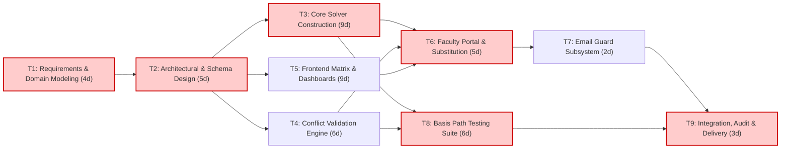
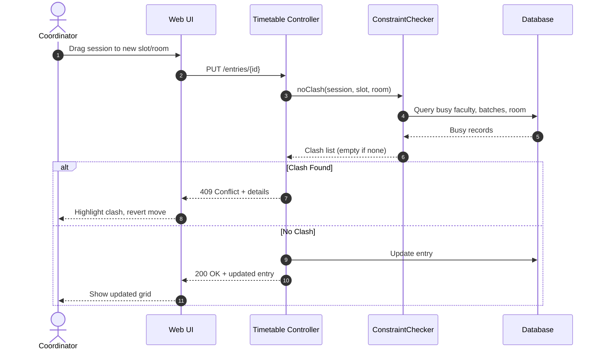

# VEERMATA JIJABAI TECHNOLOGICAL INSTITUTE (VJTI)
### (Autonomous Institute Affiliated to the University of Mumbai)
### Department of Computer Engineering & Information Technology
### Matunga, Mumbai – 400 019, Maharashtra, India

---

# SOFTWARE ENGINEERING LABORATORY
## FINAL GROUP PROJECT REPORT (ALL ASSIGNMENTS COMPILATION)
# AUTOMATED TIME TABLE MANAGEMENT SYSTEM (TTMS)
### *An Automated Platform for Institutional Timetable Generation, Scheduling, Conflict Management, Dynamic Peer Substitution, and Sandboxed Multicast Notifications*

**Academic Year:** 2026 – 2027  
**Program:** Bachelor of Technology (B.Tech) in Computer Engineering & Information Technology  
**Semester:** Odd Semester (AY 2026–27)  

---

### **PROJECT GROUP MEMBERS:**

| Roll No. | Registration No. | Student Full Name | Core Engineering Responsibility |
| :---: | :---: | :--- | :--- |
| **01** | **241080049** | **Tanish Hasmukh Parekh** | Project Lead, Algorithm Architect (Solver Engine, Conflict Validation) |
| **02** | **241080051** | **Rajgaurav Prashant Patil** | Backend & Database Systems Engineer (PostgreSQL/In-Memory Engine, Schema, APIs) |
| **03** | **241080052** | **Shrvan Abhijit Patil** | Frontend Systems Engineer (Interactive Matrix Grid, Public Timetable, Views) |
| **04** | **241080053** | **Shrinivas Satyajit Patil** | Frontend & Workflows Engineer (Faculty Portal, FCFS Substitution Board, Modals) |
| **05** | **241080054** | **Satvik Nagesh Prabhu** | QA & Testing Lead, SCM/SQA Engineer (Basis Path Testing, Test Automation) |

---

### **PROJECT SUPERVISOR & GUIDE:**
**Mrs. P. M. Chawan**  
*Associate Professor*,  
Department of Computer Engineering & Information Technology,  
Veermata Jijabai Technological Institute (VJTI), Matunga, Mumbai – 400 019  

---

## CERTIFICATE OF SUBMISSION

This is to certify that this consolidated **Final Group Project Report** embodies the cumulative work completed for all laboratory assignments in the Software Engineering Laboratory course by **Tanish Hasmukh Parekh (241080049), Rajgaurav Prashant Patil (241080051), Shrvan Abhijit Patil (241080052), Shrinivas Satyajit Patil (241080053), and Satvik Nagesh Prabhu (241080054)** under the guidance and supervision of **Mrs. P. M. Chawan**, Associate Professor, Department of Computer Engineering and Information Technology, VJTI Mumbai, during the academic year 2026–2027.

This document unifies:
- **Assignment 1:** Problem Statement Elaboration
- **Assignment 2:** Scope Definition & Boundary Specification
- **Assignment 3:** Resource Estimation (Human, Software, Hardware, Schedule, Costs)
- **Assignment 4:** Effort Estimation (3-Point LOC PERT, Function Points, Basic & Intermediate COCOMO)
- **Assignment 5 / 6:** Project Scheduling, Task Set Selection (TSS), and Risk Management (RMMM)
- **Assignment 7:** Design Modeling (Data, Architecture, UI, Sequence Diagrams, Component Algorithms)
- **Assignment 8:** Software Quality Assurance (SQA Plan, Cost of Quality, Defect Amplification)
- **Assignment 9:** Unit Testing using Basis Path Testing (CFGs, McCabe Complexity, 48 Test Cases)
- **Final Submission Section:** Comprehensive Conclusion & Future Scope of the Project

<br><br>

_____________________________ &nbsp;&nbsp;&nbsp;&nbsp;&nbsp;&nbsp;&nbsp;&nbsp;&nbsp;&nbsp;&nbsp;&nbsp;&nbsp;&nbsp;&nbsp;&nbsp;&nbsp;&nbsp;&nbsp;&nbsp;&nbsp;&nbsp;&nbsp;&nbsp;&nbsp;&nbsp;&nbsp;&nbsp;&nbsp;&nbsp;&nbsp;&nbsp;&nbsp;&nbsp;&nbsp;&nbsp;&nbsp;&nbsp;&nbsp;&nbsp;&nbsp;&nbsp;&nbsp;&nbsp; _____________________________  
**Mrs. P. M. Chawan** &nbsp;&nbsp;&nbsp;&nbsp;&nbsp;&nbsp;&nbsp;&nbsp;&nbsp;&nbsp;&nbsp;&nbsp;&nbsp;&nbsp;&nbsp;&nbsp;&nbsp;&nbsp;&nbsp;&nbsp;&nbsp;&nbsp;&nbsp;&nbsp;&nbsp;&nbsp;&nbsp;&nbsp;&nbsp;&nbsp;&nbsp;&nbsp;&nbsp;&nbsp;&nbsp;&nbsp;&nbsp;&nbsp;&nbsp;&nbsp;&nbsp;&nbsp;&nbsp;&nbsp;&nbsp;&nbsp;&nbsp;&nbsp;&nbsp;&nbsp;&nbsp;&nbsp;&nbsp;&nbsp;&nbsp;&nbsp;&nbsp;&nbsp;&nbsp;&nbsp;&nbsp;&nbsp;&nbsp;&nbsp;&nbsp;&nbsp;&nbsp; **Head of Department (CE & IT)**  
Faculty Project Guide, Dept. of CE & IT &nbsp;&nbsp;&nbsp;&nbsp;&nbsp;&nbsp;&nbsp;&nbsp;&nbsp;&nbsp;&nbsp;&nbsp;&nbsp;&nbsp;&nbsp;&nbsp;&nbsp;&nbsp;&nbsp;&nbsp;&nbsp;&nbsp;&nbsp;&nbsp;&nbsp;&nbsp;&nbsp;&nbsp;&nbsp;&nbsp;&nbsp;&nbsp;&nbsp;&nbsp; VJTI Mumbai  

---

## TABLE OF CONTENTS

- **Certificate of Submission**
- **Executive Abstract**
- **PART I: REQUIREMENTS ENGINEERING & SPECIFICATION**
  - **Assignment 1: Problem Statement Elaboration**
    - 1.1 Background & Purpose
    - 1.2 Statement of the Problem & Limitations of Existing System
    - 1.3 Need for Automation
    - 1.4 Project Objectives
    - 1.5 Proposed System: Elaboration of Seven Core Features
    - 1.6 Basic Working of the System & Primary User Roles
    - 1.7 Assumptions, Constraints & Expected Outcomes
  - **Assignment 2: Scope Definition**
    - 2.1 Project Overview
    - 2.2 In-Scope Features & Scoping Note on Timetable Generation Engine
    - 2.3 User Roles in Scope
    - 2.4 Explicitly Out-of-Scope Items
    - 2.5 Scope Traceability Matrix
- **PART II: PROJECT PLANNING & ESTIMATION**
  - **Assignment 3: Resource Estimation**
    - 3.1 Human Resource Estimation & Team Workload Allocation
    - 3.2 Software and Tool Resources
    - 3.3 Hardware and Infrastructure Resources
    - 3.4 Time and Schedule Estimation (Week-Wise Phases)
    - 3.5 Basic COCOMO Sanity-Check & AI-Assisted Development
    - 3.6 Consolidated Resource Allocation Summary
  - **Assignment 4: Effort Estimation**
    - 4.1 LOC-Based Sizing (3-Point PERT Analysis)
    - 4.2 Function Point (FP) Analysis (UFP, 14 GSC, VAF, AFP)
    - 4.3 COCOMO Models (Organic Basic & Intermediate with 15 Cost Drivers)
    - 4.4 Comparison, Consolidated Baseline, and AI Speed-Up Analysis
    - 4.5 Indicative Cost & Recommended Prioritization
- **PART III: RISK MANAGEMENT & PROJECT SCHEDULING**
  - **Assignment 5 / 6: Scheduling & Risk Analysis**
    - 5.1 Defining the 9-Task Engineering Task Set
    - 5.2 Computing the Task Set Selector (TSS) & Degree of Rigor
    - 5.3 Activity Network (CPM/PERT) & Critical Path Identification
    - 5.4 Gantt Chart & Planned vs. Actual Milestone Delivery
    - 5.5 Risk Identification, Projection Table, and RMMM Plans
- **PART IV: SYSTEM DESIGN MODELING**
  - **Assignment 7: Design Modeling**
    - 6.1 Data Design (Conceptual, Logical 15-Table Schema, Physical, 3NF Normalization)
    - 6.2 Architectural Design (3-Tier Layered Client-Server Modular Monolith)
    - 6.3 RESTful API Interface Contracts & Request Flow
    - 6.4 User Interface Design (Heuristics, Screen Inventory S1–S11, Grid Design)
    - 6.5 Component-Level & Procedural Design (Algorithms 1–4 Pseudocode)
    - 6.6 UML Sequence Diagrams (Generation, Move, Substitution, Publication)
    - 6.7 Design Traceability Matrix
- **PART V: QUALITY ASSURANCE & SYSTEM VERIFICATION**
  - **Assignment 8: Software Quality Assurance (SQA)**
    - 7.1 Quality Models (Garvin, McCall, ISO 9126)
    - 7.2 Quality Control vs. Quality Assurance
    - 7.3 Cost of Quality (COQ) & Boehm's Defect Amplification Analysis
    - 7.4 SQA Governance Plan & Audit Protocols
  - **Assignment 9: Unit Testing using Basis Path Testing**
    - 8.1 Theoretical Foundations of Basis Path Testing & McCabe's Formulas
    - 8.2 Test Environment, Seed Data & Lifecycle Hooks
    - 8.3 Module 1A: `AuthService.authenticate` (CFG, $V(G)=4$, Test Matrix)
    - 8.4 Module 1B: `AuthService.authorize` (CFG, $V(G)=4$, Test Matrix)
    - 8.5 Module 2: `ConstraintChecker.checkPlacementConflicts` (CFG, $V(G)=20$, 21 Tests)
    - 8.6 Module 3: `TimetableService.publishTimetable` (CFG, $V(G)=3$, Test Matrix)
    - 8.7 Regression QA Suite (TC-01 to TC-12) & Execution Summary (48/48 Passing)
    - 8.8 Structural Complexity Recount & Defect Rectification Log
- **PART VI: FINAL CONCLUSION & FUTURE SCOPE**
  - 9.1 Comprehensive Project Conclusion & Objective Verification
  - 9.2 Key Algorithmic Innovations & Architectural Breakthroughs
  - 9.3 Lessons Learned Across Software Engineering Disciplines
  - 9.4 Detailed Future Scope & System Enhancement Roadmap (Phases II–VI)
  - 9.5 Concluding Remarks
- **References & Document Revision History**

---

## EXECUTIVE ABSTRACT

The creation and ongoing maintenance of an academic master timetable for the Department of Computer Engineering & Information Technology at Veermata Jijabai Technological Institute (VJTI) represents an NP-complete Combinatorial Optimization Problem known as the **University Course Timetabling Problem (UCTP)**. Managing concurrent classes across Second Year (SY), Third Year (TY), and Final Year B.Tech for both CE and IT branches requires harmonizing over 35 faculty members, 18 instructional venues (7 heavy lecture halls and 11 computing laboratories), 56 curriculum subjects, multiple practical sub-batches (Batches A, B, C, D), and shared cross-branch elective tracks.

Historically executed via static spreadsheets, the scheduling process was burdened by hard constraint violations (faculty double-booking, room capacity deficits, room type mismatches, and breach of department-specific staggered lunch recesses), total lack of agility during faculty leave, and delayed communication of schedule updates to students and staff.

This **Final Group Project Report** documents the complete, end-to-end software engineering lifecycle of the **Automated Time Table Management System (TTMS)**. Developed by a five-member undergraduate engineering team, TTMS delivers an autonomous, web-native platform built upon **Next.js 14, React 18, TypeScript, Tailwind CSS, Prisma ORM, and a Dual-Engine Data Storage layer (PostgreSQL with In-Memory DatabaseStore fallback)**. The core engine incorporates a 3-Phase Constraint Satisfaction Solver leveraging Most Constrained Variable (MCV) and Least Constraining Value (LCV) heuristics, pre-processing synthetic dummy faculty normalization (`TBA_${subjectId}_${batchId}`), parallel sub-batch lab synchronization, staggered lunch recess preservation (Slot 4 for SY; Slot 5 for TY/Final), and local search gap compaction.

The platform further integrates a real-time **First-Come-First-Served (FCFS) Substitution Board** allowing faculty to surrender and adopt lectures during absence, backed by an **Email Dispatcher with a Hardcoded Sandbox Whitelist Guard** preventing unauthorized email leakage. Rigorous verification via **McCabe's Basis Path Testing** established 100% statement, branch, and basis path coverage across 48 automated test cases running in 102.19 ms active time. This report compiles all nine laboratory assignments alongside the final conclusion and future roadmap into a single authoritative software engineering document.

---

# PART I: REQUIREMENTS ENGINEERING & SPECIFICATION

---

# ASSIGNMENT 1: PROBLEM STATEMENT ELABORATION

## 1.1 BACKGROUND & PURPOSE

Educational institutions, ranging from single-department colleges to large multi-branch institutes, depend on a well-structured timetable to coordinate lectures, laboratory sessions, faculty availability, and classroom or laboratory usage across an entire academic term. Despite its critical role in day-to-day academic functioning, timetable preparation at most institutions is still carried out manually or with the help of generic spreadsheet tools—typically by a small group of faculty coordinators who manually cross-check faculty load, subject allocations, room capacities, and elective/batch divisions. As the number of divisions, batches, electives, and faculty members grows, the number of constraints that must be satisfied simultaneously grows combinatorially, making manual scheduling extremely time-consuming and highly prone to errors such as double-booked faculty, overlapping lectures in the same room, or uneven distribution of teaching load.

Any change after the timetable is first published—a faculty member proceeding on leave, a room becoming unavailable, or a subject being reassigned—typically requires the entire manual exercise to be partially redone, and the updated timetable to be re-circulated through notice boards, emails, or messaging groups, often with delays and inconsistent versions reaching different stakeholders.

The purpose of this project is to design and develop a software system, built from the institution's (timetable committee's) point of view, that automates and streamlines the process of generating, validating, publishing, and maintaining academic timetables. The system is intended to reduce the manual effort and scheduling conflicts involved in timetable creation, and to provide faculty and department coordinators with a reliable, always up-to-date view of the schedule, along with a structured way to handle rescheduling and substitutions when changes are required.

---

## 1.2 STATEMENT OF THE PROBLEM & LIMITATIONS OF EXISTING SYSTEM

### Statement of the Problem
Academic departments currently lack an integrated, institution-focused software system to manage faculty–subject–room allocation, automated conflict-free timetable generation, faculty workload balancing, and handling of leave-driven rescheduling or substitutions. Existing solutions are either generic spreadsheet-based timetables that require scheduling constraints to be checked manually, or are large-scale ERP modules that are too rigid, expensive, or complex for a single department's timetable committee to configure and maintain independently. This results in continued dependence on manual cross-checking, delayed communication of changes, and recurring scheduling conflicts, all of which reduce the efficiency of academic administration and cause avoidable disruption to faculty and students alike.

### Existing System and Its Limitations:
1. **Manual Constraint Checking:** Verifying that no faculty member, room, or batch is double-booked is done by manually cross-referencing multiple spreadsheets, which is slow and error-prone as the number of divisions and electives increases.
2. **Disconnected Faculty Load Records:** Teaching load per faculty member is tracked informally, making it difficult to ensure equitable distribution of lectures and labs across the department.
3. **Static, Hard-to-Update Timetables:** Once published, timetables are typically static documents (PDFs, printed charts); any change necessitates manually editing and re-distributing the entire timetable.
4. **Unstructured Leave and Substitution Handling:** When a faculty member is on leave, finding a suitable substitute and updating the affected time slot is handled through informal communication, with no systematic record of what was changed or by whom.
5. **No Room/Resource Visibility:** Classroom and laboratory availability is not centrally visible, occasionally resulting in two sessions being scheduled in the same room at the same time.
6. **Delayed and Inconsistent Communication:** Updates to the timetable reach faculty and students through notice boards, email, or messaging groups at different times, leading to confusion about which version is current.
7. **No Historical or Analytical View:** There is no easy way to review past timetables, faculty load trends, or how frequently particular slots or rooms are affected by rescheduling.

---

## 1.3 NEED FOR AUTOMATION

Each of the limitations above directly impacts the accuracy, fairness, and reliability of academic scheduling. Automating these processes through a single, integrated, institution-facing system reduces the time spent on manual scheduling from weeks to seconds, eliminates conflict-related errors, enables balanced and transparent workload distribution, and gives faculty and administrators a single, always-current source of truth for the timetable.

---

## 1.4 PROJECT OBJECTIVES

The Time Table Management System aims to achieve the following seven core objectives:
1. **Centralized Academic Database:** Design a centralized database storing faculty, subject, batch/division, and classroom/laboratory data, forming the foundation for automated scheduling.
2. **Automated Conflict-Free Scheduling:** Provide a scheduling engine that generates a conflict-free timetable by automatically checking faculty availability, room availability, and batch clashes against defined constraints.
3. **Proactive Conflict Detection:** Detect and flag any scheduling conflicts—such as double-booked faculty or rooms—before a timetable is finalized and published.
4. **Workload Tracking & Balancing:** Track and balance faculty teaching load across the department, ensuring an equitable distribution of lectures and laboratory sessions.
5. **Capacity-Aware Resource Allocation:** Manage classroom and laboratory allocation efficiently, taking room capacity and room type (lecture hall, laboratory, seminar room) into account.
6. **Structured Leave & Substitution Workflow:** Provide a structured workflow for handling faculty leave, enabling substitute assignment and rescheduling of affected sessions without disrupting the rest of the timetable.
7. **Consolidated Publishing & Notifications:** Publish the finalized timetable and any subsequent changes to faculty and students through a single, continuously updated dashboard, along with notifications for changes.

---

## 1.5 PROPOSED SYSTEM: ELABORATION OF SEVEN CORE FEATURES

1. **Faculty, Subject, and Classroom Database:**  
   Central record storing faculty names, departments, weekly teaching-load limits, and availability; subjects with type (theory/practical/elective), credits, and target batches; and rooms with numbers, types, and capacities.
2. **Constraint-Based Timetable Generation Engine:**  
   Autonomous slot-allocation engine that assigns subjects to faculty, rooms, and time slots such that no entity is double-booked, producing a clash-free draft timetable.
3. **Conflict Detection and Resolution:**  
   Real-time multi-rule validator auditing both the generated draft and any manual coordinator adjustments, flagging clashes with error diagnostics.
4. **Faculty Workload and Availability Management:**  
   Maintains running counters of assigned lecture and lab hours against faculty caps, supporting department-wide workload transparency.
5. **Room and Resource Allocation:**  
   Matches subject requirements (e.g., Ubuntu software lab vs. chalk-and-board lecture hall) against venue types and capacities, providing room occupancy views.
6. **Substitution and Rescheduling Management:**  
   Records faculty leave, identifies affected slots, suggests eligible substitutes based on subject expertise and availability, and logs confirmations for full auditability.
7. **Timetable Publishing and Notification Dashboard:**  
   Single source of truth presenting the published schedule filterable by faculty, batch, or room, with notifications dispatched upon changes.

---

## 1.6 BASIC WORKING OF THE SYSTEM & PRIMARY USERS

### Overall Operational Workflow:
1. The timetable committee populates the database with faculty, subjects, batches, and rooms, along with scheduling constraints.
2. The scheduling engine generates a conflict-free draft timetable based on this data, which coordinators review and adjust.
3. The conflict-detection module validates manual moves in real time, preventing accidental collisions.
4. The finalized timetable is published to the dashboard for faculty and student access.
5. When a faculty member reports leave, the substitution module flags affected sessions and facilitates peer claiming or rescheduling.
6. All changes made after publication are logged in audit tables and reflected on the dashboard, with notifications sent to affected parties.

### Primary System Users:
- **Timetable Coordinator:** Full administrative access (data entry, solver execution, conflict resolution, manual cell moves, substitution management, and publishing).
- **Faculty Member:** Operational access (personal weekly schedule, workload tracking, availability declaration, leave surrender, and FCFS substitute claiming).
- **Student / General Viewer:** Read-only, login-free access to view the published timetable filtered by Year, Branch, Division, or Sub-Batch.

---

## 1.7 ASSUMPTIONS, CONSTRAINTS & EXPECTED OUTCOMES

- **Assumptions:** Fixed weekly period structure (Monday–Friday, 8 slots/day); master data finalized prior to generation; faculty manually report leave and constraints.
- **Constraints:** Institution-focused (no student-side elective bidding in Phase I); solver scoped to rule-based backtracking rather than external mathematical optimization frameworks; notifications internal/email-based without SMS gateways.
- **Expected Outcomes:** Reduction of scheduling time from weeks to seconds; 100% elimination of double-bookings; transparent faculty workload; seamless leave management; single source of truth for VJTI CE & IT departments.

---

# ASSIGNMENT 2: SCOPE DEFINITION

## 2.1 PROJECT OVERVIEW

The Time Table Management System is an institution-facing software application intended to digitize the core scheduling operations of an academic department: allocating faculty, subjects, and rooms into a conflict-free timetable, balancing faculty workload, handling leave-driven substitutions, and publishing an always-current schedule. The system has no independent student-side registration portal—students and faculty at large interact with the system chiefly as viewers of the published dashboard, while all configuration, generation, and maintenance of the timetable is performed by the department's timetable committee and faculty.

The project is developed by a team of five students over a one-month intensive development timeframe, leveraging AI coding tools for scaffolding and testing. This timeframe directly informs the scope boundaries established herein.

---

## 2.2 IN-SCOPE FEATURES & ENGINE SCOPING NOTE

### In-Scope Commitments:
The delivered system demonstrates seven verified functional features:
1. Faculty, subject, and classroom database.
2. Constraint-based timetable generation engine.
3. Real-time conflict detection and resolution.
4. Faculty workload and availability management.
5. Capacity-aware room and resource allocation.
6. Substitution and rescheduling management.
7. Timetable publishing and notification dashboard.

### Scoping Note: Timetable Generation Engine
Given the one-month development window, the generation engine is explicitly scoped as a **rule-based constraint solver** (a deterministic backtracking slot-allocation algorithm that assigns sessions while validating faculty, room, and batch availability at each step), rather than an integer linear programming (ILP) or genetic algorithm tuned for globally optimal schedules. This guarantees delivering a 100% clash-free, usable draft timetable within the available project timeline.

---

## 2.3 USER ROLES IN SCOPE

- **Coordinator:** Full access, including timetable generation, conflict resolution, faculty workload configuration, room allocation, and substitution management.
- **Faculty:** Operational access to view their own schedule and workload, and to report availability constraints or leave, without access to generate or directly edit the master timetable.
- **Students / Viewers:** Access the published timetable through a read-only, login-free view of the dashboard; no separate student login account is required in this scope.

---

## 2.4 EXPLICITLY OUT-OF-SCOPE ITEMS

To guarantee delivery within the academic term, the following items are strictly **[OUT OF SCOPE]**:
1. **Student-Side Registration / Elective-Selection Portal:** No student course bidding or elective registration workflows; students only view the published timetable.
2. **Optimization-Based Scheduling Solver:** Timetable generation utilizes a rule-based constraint solver, not an ILP or genetic algorithm.
3. **External HR / Biometric Integration:** Faculty leave is recorded directly within the system; it is not pulled from an external enterprise HR portal.
4. **SMS / Telephony Notifications:** Timetable notifications are delivered via dashboard and email; no SMS gateway integration is provided.
5. **Multi-Institution / Multi-Campus Support:** Designed for single-institution departmental scheduling (VJTI CE & IT).
6. **Native Mobile Applications:** Delivered as a responsive web application; native iOS/Android binaries are excluded.
7. **Smart Classroom / IoT Hardware Integration:** No direct interface with physical door displays or biometric fingerprint devices in this release.

---

## 2.5 SCOPE TRACEABILITY MATRIX

### Table 2.1: Traceability of In-Scope Features to Problem-Statement Objectives

| In-Scope Feature | Traces to Objective | Justification / Architectural Verification |
| :--- | :--- | :--- |
| **Faculty, Subject & Classroom DB** | Objective 1 (Centralized Database) | Provides foundational 3NF schema enabling automated allocation. |
| **Constraint-Based Generation Engine**| Objective 2 (Automated Scheduling) | Eliminates manual slot-by-slot scheduling via backtracking solver. |
| **Conflict Detection & Resolution** | Objective 3 (Conflict Detection) | Continuously audits room, faculty, and batch collisions in real time. |
| **Faculty Workload Management** | Objective 4 (Workload Balancing) | Tracks weekly contact hours against configured departmental limits. |
| **Room & Resource Allocation** | Objective 5 (Resource Management) | Prevents room double-booking and enforces room type/capacity matches. |
| **Substitution & Rescheduling** | Objective 6 (Structured Leave) | Implements FCFS peer claim exchange and maintains an audit trail. |
| **Publishing & Notification Dashboard**| Objective 7 (Publishing & Alerts) | Single source of truth with sandbox-guarded email dispatch. |

---
# PART II: PROJECT PLANNING & ESTIMATION

---

# ASSIGNMENT 3: RESOURCE ESTIMATION

## 3.1 PURPOSE & HUMAN RESOURCE ESTIMATION

Building on the Problem Statement Elaboration and the Scope Document, this assignment estimates the human, technical, and time resources required to deliver the Time Table Management System within the one-month, five-person, AI-assisted development timeframe established in the Scope Document. The estimate covers team roles and effort allocation per feature, software and hardware resources, a week-wise schedule, and an indicative effort/cost estimate.

### Team Composition and Role Allocation:
The project is executed by a team of five students, each assigned a primary role based on system architecture. Roles overlap where needed, since the team is small and every member contributes to testing and documentation.

### Table 3.1: Team Composition and Primary Responsibilities

| Team Member | Primary Role | Primary Responsibility |
| :--- | :--- | :--- |
| **Tanish Hasmukh Parekh** | Project Lead / Backend Developer | Constraint-based timetable generation engine; conflict detection logic. |
| **Rajgaurav Prashant Patil** | Backend Developer | Faculty, subject, and classroom database; REST APIs; faculty workload and room allocation logic. |
| **Shrvan Abhijit Patil** | Frontend Developer | Timetable publishing and notification dashboard (faculty/student views). |
| **Shrinivas Satyajit Patil** | Frontend Developer | Coordinator console: generation review, conflict resolution UI, substitution workflow. |
| **Satvik Nagesh Prabhu** | QA / Documentation Lead | Testing, bug tracking, deployment, and maintenance of project documentation. |

### Table 3.2: Effort Estimation by Feature

| Feature / Activity | Effort (Person-Days) | Primary Owner(s) |
| :--- | :---: | :--- |
| Faculty, subject, and classroom database | 4 | Rajgaurav Patil |
| Constraint-based timetable generation engine | 8 | Tanish Parekh |
| Conflict detection and resolution | 5 | Tanish Parekh |
| Faculty workload and availability management | 4 | Rajgaurav Patil |
| Room and resource allocation | 4 | Rajgaurav Patil |
| Substitution and rescheduling management | 5 | Shrinivas Patil |
| Timetable publishing and notification dashboard | 6 | Shrvan Patil |
| Integration and deployment | 4 | Satvik Prabhu, Tanish Parekh |
| Testing and bug-fixing | 5 | Satvik Prabhu (all members) |
| Documentation (all assignments / reports) | 3 | Satvik Prabhu (all members) |
| **Total Estimated Effort** | **48 Person-Days** | |

Against a nominal team capacity of roughly 20 working days per member over the one-month period (100 person-days across five members), the estimated 48 person-days of feature work leaves an adequate buffer of 52 person-days for team meetings, code review, AI-tool-assisted iteration, and unplanned rework.

---

## 3.2 SOFTWARE AND TOOL RESOURCES

### Table 3.3: Software and Tooling Resources

| Category | Tool(s) | Purpose |
| :--- | :--- | :--- |
| **Frontend Framework** | React.js with Tailwind CSS | Coordinator console, faculty view, and publishing dashboard. |
| **Backend Framework** | Node.js with Next.js / Express.js | REST APIs for scheduling, database access, and business logic. |
| **Database** | PostgreSQL | Storage of faculty, subject, room, and timetable data. |
| **Version Control** | Git and GitHub | Source control, branching, pull requests, and collaborative development. |
| **AI-Assisted Development** | Claude Code / GitHub Copilot | Accelerated implementation, debugging, and code review within one month. |
| **API Testing** | Postman | Verification of backend endpoints during development. |
| **UI/UX Design** | Figma | Wireframing dashboard, coordinator console, and faculty views. |
| **Project Management** | Trello / Notion | Task tracking, sprint planning, and effort tracking against estimates. |
| **Deployment / Hosting** | Render / Vercel with Docker | Hosting the web application and database for demonstration and evaluation. |
| **Documentation** | LaTeX and Markdown | Preparation of problem statement, scope, estimation, and testing reports. |

---

## 3.3 HARDWARE AND INFRASTRUCTURE RESOURCES

The hardware requirements for the project are modest, consistent with a web-based application built by a student engineering team:
- **Development Machines:** Five personal laptops (minimum 8 GB RAM, dual-core processor or better), one per team member, used for local development, testing, and running AI-assisted coding tools.
- **Version Control & CI Hosting:** GitHub-hosted repository; no dedicated on-premises server required for source control.
- **Deployment Environment:** A single low-tier cloud instance (or department server) sufficient to host the web application and database for demonstration; production-scale institutional traffic is not expected in this iteration.
- **Network Connectivity:** Reliable internet access for all team members for collaborative development, AI coding tools, and package installation.
- **No Specialized Hardware:** No barcode scanners, biometric devices, or smart classroom hardware required.

---

## 3.4 TIME AND SCHEDULE ESTIMATION (WEEK-WISE PHASES)

### Table 3.4: Four-Week Phased Development Schedule

| Week | Planned Engineering Activities |
| :---: | :--- |
| **Week 1** | Requirements finalization, database schema design, and implementation of faculty/subject/classroom database and core APIs. |
| **Week 2** | Development of constraint-based timetable generation engine and conflict detection module; initial faculty workload tracking. |
| **Week 3** | Room and resource allocation logic, substitution and rescheduling workflow, coordinator console, and publishing dashboard UI. |
| **Week 4** | Integration of all modules, end-to-end testing, bug-fixing, Docker deployment, and finalization of project documentation. |

---

## 3.5 EFFORT AND COST ESTIMATION (BASIC COCOMO SANITY-CHECK)

As an academic project, TTMS is developed without a monetary budget or paid personnel; the primary cost is team effort. For reference, Basic COCOMO was applied to sanity-check effort figures. Assuming an estimated system size of approximately 2 KLOC (thousand lines of code) for a scoped-down, single-department web application, organic-mode Basic COCOMO yields:

$$\text{Effort} = 2.4 \times (2)^{1.05} \approx \mathbf{5.0 \text{ Person-Months (PM)}}$$

$$\text{Development Time} = 2.5 \times (5.0)^{0.38} \approx \mathbf{4.5 \text{ Months}}$$

This traditional estimate assumes manual, unaided development. The gap to the one-month academic window is closed by two factors: (a) the feature set is deliberately scoped down to a rule-based constraint solver, and (b) AI-assisted coding tools accelerate routine development work. The 48 person-day estimate is therefore treated as the working resource plan.

---

## 3.6 RESOURCE ALLOCATION SUMMARY & ASSUMPTIONS

### Table 3.5: Resource Allocation Summary

| Feature | Owner(s) | Key Tools |
| :--- | :--- | :--- |
| Faculty, subject and classroom database | Rajgaurav Patil | PostgreSQL, Express.js |
| Constraint-based generation engine | Tanish Parekh | Node.js, Claude Code |
| Conflict detection and resolution | Tanish Parekh | Node.js, PostgreSQL |
| Faculty workload and availability management | Rajgaurav Patil | Express.js, PostgreSQL |
| Room and resource allocation | Rajgaurav Patil | Express.js, PostgreSQL |
| Substitution and rescheduling management | Shrinivas Patil | React.js, Express.js |
| Publishing and notification dashboard | Shrvan Patil | React.js, Tailwind CSS |
| Testing, deployment and documentation | Satvik Prabhu | Postman, Docker, LaTeX, Markdown |

**Assumptions:** All 5 members available at ~20 working days capacity (100 person-days total); AI tools remain accessible; team possesses working familiarity with React, Node.js, and PostgreSQL.

---

# ASSIGNMENT 4: EFFORT ESTIMATION

## 4.1 LOC-BASED ESTIMATION (3-POINT PERT ANALYSIS)

The system is decomposed into eight functions (the seven in-scope features plus authentication and roles). For each function, three LOC estimates are made: optimistic ($a$), most likely ($m$), and pessimistic ($b$). The expected size is the three-point PERT value:

$$S = \frac{a + 4m + b}{6}$$

LOC includes application code (React front end, Express/Next.js back end, SQL schema and queries). It excludes third-party libraries, configuration files, test code, and documentation.

### Table 4.1: Three-Point LOC Estimate and Effort per Function

| Function | Optimistic ($a$) | Likely ($m$) | Pessimistic ($b$) | Expected $S$ | Effort (PM) |
| :--- | :---: | :---: | :---: | :---: | :---: |
| Faculty, subject and classroom database | 800 | 1,000 | 1,400 | 1,033 | 2.58 |
| Constraint-based generation engine | 600 | 900 | 1,400 | 933 | 2.33 |
| Conflict detection and resolution | 400 | 600 | 900 | 617 | 1.54 |
| Faculty workload and availability | 400 | 550 | 800 | 567 | 1.42 |
| Room and resource allocation | 400 | 550 | 800 | 567 | 1.42 |
| Substitution and rescheduling | 500 | 700 | 1,000 | 717 | 1.79 |
| Publishing and notification dashboard | 700 | 1,000 | 1,500 | 1,033 | 2.58 |
| User roles and authentication | 200 | 300 | 450 | 308 | 0.77 |
| **Total** | **4,000** | **5,600** | **8,250** | **5,775** | **14.44** |

$$\text{Expected Total Size} = \frac{4000 + 4 \times 5600 + 8250}{6} = \mathbf{5,775 \text{ LOC}} \approx \mathbf{5.8 \text{ KLOC}}$$

An assumed productivity of **400 LOC per person-month** is used (covering design, coding, unit testing, and documentation):

$$\text{Effort} = \frac{5,775}{400} = \mathbf{14.44 \text{ PM}} \approx \mathbf{289 \text{ Person-Days}} \quad (\text{Ideal duration with 5 members} \approx 2.9 \text{ months})$$

---

## 4.2 FUNCTION POINT (FP) ESTIMATION

Function Points measure size from the user's viewpoint, independent of programming language syntax.

### Table 4.2: Identified Data Functions (ILF & EIF)

| Type | Data Function | Assigned Complexity | FP Weight | Total FP |
| :---: | :--- | :---: | :---: | :---: |
| **ILF** | Faculty (incl. availability constraints and load limit) | Average | 10 | 10 |
| **ILF** | Subject | Simple | 7 | 7 |
| **ILF** | Batch / division | Simple | 7 | 7 |
| **ILF** | Classroom / laboratory | Simple | 7 | 7 |
| **ILF** | Timetable (sessions and slot allocations) | Complex | 15 | 15 |
| **ILF** | Leave and substitution / rescheduling log | Average | 10 | 10 |
| **ILF** | Notification | Simple | 7 | 7 |
| **ILF** | User account and role | Simple | 7 | 7 |
| **EIF** | Existing department master-data records (CSV/Excel) | Simple | 5 | 5 |
| **Total**| **Data Functions** | | | **75 FP** |

### Table 4.3: Identified Transaction Functions (EI, EO, EQ)

| Type | Complexity | Count | Transactions Included |
| :---: | :---: | :---: | :--- |
| **EI** | Simple | 8 | Add subject; edit subject; add batch; edit batch; add room; edit room; delete record; login. |
| **EI** | Average | 9 | Add faculty; edit faculty; report availability; set load limit; manual edit slot; assign room; record leave; bulk import; configure parameters. |
| **EI** | Complex | 3 | Trigger timetable generation; confirm substitute & reschedule; finalize and publish timetable. |
| **EO** | Simple | 2 | Faculty master-list export; room/lab master-list export. |
| **EO** | Average | 5 | Faculty workload report; conflict report; room utilization report; substitution audit report; change notification message. |
| **EO** | Complex | 2 | Generated draft timetable with conflict flags; eligible-substitute suggestion list. |
| **EQ** | Simple | 6 | View faculty, subject, batch, room lists; view own leave status; view notification list. |
| **EQ** | Average | 4 | View own schedule & workload; search/filter master data; view live room occupancy; check availability for a slot. |
| **EQ** | Complex | 1 | Filtered published timetable (by faculty, batch, room; student read-only view). |

### Table 4.4: Unadjusted Function Point (UFP) Computation

| Function Type | Simple | Average | Complex | Total FP |
| :--- | :---: | :---: | :---: | :---: |
| **External Inputs (EI)** | $8 \times 3 = 24$ | $9 \times 4 = 36$ | $3 \times 6 = 18$ | **78** |
| **External Outputs (EO)** | $2 \times 4 = 8$ | $5 \times 5 = 25$ | $2 \times 7 = 14$ | **47** |
| **External Inquiries (EQ)** | $6 \times 3 = 18$ | $4 \times 4 = 16$ | $1 \times 6 = 6$ | **40** |
| **Internal Logical Files (ILF)** | $5 \times 7 = 35$ | $2 \times 10 = 20$ | $1 \times 15 = 15$ | **70** |
| **External Interface Files (EIF)** | $1 \times 5 = 5$ | $0 \times 7 = 0$ | $0 \times 10 = 0$ | **5** |
| **Total Unadjusted FP (UFP)** | | | | **240** |

### Value Adjustment Factor (VAF) from 14 GSC:
Sum of 14 General System Characteristics: $\sum F_i = 41$.

$$\text{VAF} = 0.65 + 0.01 \times \sum F_i = 0.65 + 0.41 = \mathbf{1.06}$$

$$\text{Adjusted Function Points (AFP)} = \text{UFP} \times \text{VAF} = 240 \times 1.06 = \mathbf{254.4 \text{ FP}}$$

Using assumed productivity of **15 FP per person-month**:

$$\text{Effort} = \frac{254.4}{15} = \mathbf{16.96 \text{ PM}} \approx \mathbf{339 \text{ Person-Days}} \quad (\text{Ideal duration with 5 members} \approx 3.4 \text{ months})$$

### Consistency Check Against LOC:
$\frac{5,775 \text{ LOC}}{254.4 \text{ FP}} \approx 22.7 \text{ LOC/FP}$. This lower ratio is plausible because modern frameworks (React, Tailwind, Node.js) supply rich functionality per line.

---

## 4.3 COCOMO MODEL (BASIC & INTERMEDIATE)

Classified as **Organic Mode** (small, co-located team, familiar environment, small program $<50\text{ KLOC}$). Size input: $\text{KLOC} = 5.775$.

### Basic COCOMO:
- Effort: $E = 2.4 \times (5.775)^{1.05} = \mathbf{15.13 \text{ PM}} \approx \mathbf{303 \text{ Person-Days}}$
- Development Time: $D = 2.5 \times (15.13)^{0.38} = \mathbf{7.02 \text{ Months}}$
- Average Staffing: $S = \frac{E}{D} = \mathbf{2.16 \text{ Persons}}$
- Implied Productivity: $\frac{5,775}{15.13} = \mathbf{382 \text{ LOC/PM}}$

### Intermediate COCOMO:
Nominal Effort: $E_{\text{nom}} = 3.2 \times (5.775)^{1.05} = \mathbf{20.17 \text{ PM}}$.  
Effort Adjustment Factor (EAF) from 15 cost drivers (high CPLX 1.15, very low SCED 1.23, low AEXP 1.13, etc.): $\text{EAF} = \mathbf{1.082}$.

- Adjusted Effort: $E_{\text{adj}} = 20.17 \times 1.082 = \mathbf{21.84 \text{ PM}} \approx \mathbf{437 \text{ Person-Days}}$
- Development Time: $D_{\text{adj}} = 2.5 \times (21.84)^{0.38} = \mathbf{8.07 \text{ Months}}$
- Average Staffing: $S = \frac{21.84}{8.07} = \mathbf{2.71 \text{ Persons}}$

---

## 4.4 COMPARISON & AI SPEED-UP ANALYSIS

### Table 4.5: Effort by Technique (Manual Development)

| Technique | Size | Effort (PM) | Person-Days | Ideal Duration (5 members) |
| :--- | :---: | :---: | :---: | :---: |
| **LOC-based** | 5.78 KLOC | 14.44 | 289 | 2.9 Months |
| **FP-based** | 254.4 FP | 16.96 | 339 | 3.4 Months |
| **Basic COCOMO** | 5.78 KLOC | 15.13 | 303 | 3.0 Months |
| **Intermediate COCOMO** | 5.78 KLOC | 21.84 | 437 | 4.4 Months |
| **Baseline (Mean of first 3)** | | **15.51** | **310** | **3.1 Months** |

### Table 4.6: Baseline Effort Under Different AI Speed-Up Assumptions

| Effective AI Speed-Up | Effort (PM) | Person-Days | Duration (5 members) | Spare Capacity (of 100 pd) |
| :---: | :---: | :---: | :---: | :---: |
| **$1\times$ (None)** | 15.51 | 310 | 3.10 Months | -210 Days |
| **$2\times$** | 7.75 | 155 | 1.55 Months | -55 Days |
| **$3\times$** | 5.17 | 103 | 1.03 Months | -3 Days |
| **$4\times$** | 3.88 | 78 | 0.78 Months | +22 Days |
| **$5\times$** | 3.10 | 62 | 0.62 Months | +38 Days |

An overall speed-up of about **$3.1\times$** is needed to reach the 100 person-days threshold, and **$4\times$** leaves a healthy buffer of roughly 20%.

---

## 4.5 INDICATIVE NOTIONAL COST & DESCOPING PRIORITIZATION

At a reference rate of Rs. 30,000 per person-month:
- LOC-based: Rs. 4,33,125
- FP-based: Rs. 5,08,800
- Basic COCOMO: Rs. 4,53,903
- Intermediate COCOMO: Rs. 6,55,107
- **Baseline Mean:** **Rs. 4,65,276**

### Descoping Priority Order (If Effort Overruns Occur):
1. **Must Have:** Faculty, subject, classroom DB; constraint-based solver; conflict detection; publishing dashboard core; auth & roles.
2. **Should Have:** Faculty workload and availability management; room and resource allocation.
3. **Could Simplify:** Substitution management (manual substitute selection instead of auto-suggestions); dashboard notifications (basic list only).

---
# PART III: RISK MANAGEMENT & PROJECT SCHEDULING

---

# ASSIGNMENT 5 / 6: SCHEDULING & RISK ANALYSIS

## 5.1 DEFINING THE TASK SET

The engineering task set for TTMS comprises nine core technical work tasks spanning the semester:
1. **Task 1: Requirements Elicitation & Domain Modeling** (Elicit VJTI departmental constraints, rooms, and curriculum tracks).
2. **Task 2: Architectural & Schema Design** (3-tier modular monolith, Prisma schemas, and dual data store layer).
3. **Task 3: Algorithmic Solver Construction** (Composite normalizer, backtracking CSP solver with MCV/LCV, gap compactor).
4. **Task 4: Conflict Audit & Validation Subsystem** (Multi-rule constraint validator and real-time clash reporter).
5. **Task 5: Frontend Interactive Matrix & Dashboards** (8-slot $\times$ 5-day grid, edit modals, and public viewer).
6. **Task 6: Faculty Portal & Dynamic Substitution Workflow** (Leave surrender and FCFS peer claim exchange).
7. **Task 7: Email Dispatcher & Sandbox Whitelist Guard** (Nodemailer dispatcher, whitelist guard, and outbox logs).
8. **Task 8: White-Box Basis Path Testing & Verification** (CFG modeling, McCabe cyclomatic complexity, 48 test cases).
9. **Task 9: System Integration, Auditing & Final Delivery** (Docker packaging, end-to-end audit, and documentation).

---

## 5.2 COMPUTING TASK SET SELECTOR (TSS) & DEGREE OF RIGOR

The Task Set Selector (TSS) algorithm determines the appropriate degree of process rigor by evaluating 12 project adaptation criteria. Each criterion $i$ has a weight $W_i$ and a grade $G_i$ (1 to 5):

$$\text{TSS} = \sum_{i=1}^{12} W_i \times G_i$$

### Table 5.1: Task Set Selector (TSS) Computation Table

| ID | Adaptation Criterion | Weight ($W_i$) | Grade ($G_i$, 1–5) | Weighted Score ($W_i \times G_i$) | Rationale |
| :---: | :--- | :---: | :---: | :---: | :--- |
| **1** | Size of the Project | 0.05 | 2 | 0.10 | ~5,775 LOC codebase. |
| **2** | Number of Potential Users | 0.05 | 3 | 0.15 | ~500 students, 35+ faculty across two departments. |
| **3** | Mission Criticality | 0.12 | 4 | 0.48 | Schedule failure directly halts academic teaching. |
| **4** | Application Longevity | 0.08 | 3 | 0.24 | Multi-year deployment across academic terms. |
| **5** | Stability of Requirements | 0.08 | 2 | 0.16 | Core VJTI timetabling rules are well-codified. |
| **6** | Ease of Customer Communication| 0.07 | 4 | 0.28 | Direct weekly consultation with Mrs. P. M. Chawan. |
| **7** | Maturity of Applicable Tech | 0.08 | 2 | 0.16 | Next.js, TypeScript, PostgreSQL are industry-proven. |
| **8** | Performance Constraints | 0.10 | 4 | 0.40 | Solver execution $<5\text{s}$; instant validation $<50\text{ms}$. |
| **9** | Embedded / Real-Time Constraints| 0.05 | 1 | 0.05 | Web-based system; no embedded firmware. |
| **10**| Project Staffing & Experience | 0.08 | 2 | 0.16 | Competent 5-engineer undergraduate team. |
| **11**| Reengineering / Legacy Factors | 0.04 | 1 | 0.04 | Green-field design replacing manual spreadsheets. |
| **12**| Security / Privacy Criticality | 0.20 | 2 | 0.40 | Role authentication, JWT tokens, sandbox email guard. |
| **Total**| **Composite TSS Score** | **1.00** | | **2.62** | **Degree of Rigor Assessment** |

**Interpretation:** With $\text{TSS} = 2.62$ ($2.4 < \text{TSS} \le 3.5$), TTMS mandates a **Strict Degree of Rigor**, requiring formal technical reviews, structured estimation, complete white-box testing, and strict configuration management.

---

## 5.3 ACTIVITY NETWORK (CPM / PERT) & CRITICAL PATH



**Critical Path:** $\text{T1} \rightarrow \text{T2} \rightarrow \text{T3} \rightarrow \text{T6} \rightarrow \text{T8} \rightarrow \text{T9} = 4 + 5 + 9 + 5 + 6 + 3 = \mathbf{32 \text{ Working Days}}$.

---

## 5.4 GANTT CHART & MILESTONE DELIVERY

```
Activity / Working Days      | 1-5 | 6-10 | 11-15 | 16-20 | 21-25 | 26-30 | 31-35 |
-----------------------------+-----+------+-------+-------+-------+-------+-------+
T1: Requirements Elicitation |==== |      |       |       |       |       |       |
T2: Architectural & Schema   |  ===|==    |       |       |       |       |       |
T3: Core UCTP Solver Engine  |     |   ===|=======|       |       |       |       |
T4: Conflict Audit Validator |     |   ===|===    |       |       |       |       |
T5: Frontend Grid UI & Views |     |   ===|=======|==     |       |       |       |
T6: Faculty Portal & FCFS Sub|     |      |       |    ===|===    |       |       |
T7: Email Guard Subsystem    |     |      |       |       |  ===  |       |       |
T8: White-Box Basis Testing  |     |      |       |       |   ====|===    |       |
T9: Integration, Audit & Doc |     |      |       |       |       |   ====|==     |
```

### Table 5.2: Planned vs. Actual Milestone Delivery Table

| Milestone | Deliverable | Planned Day | Actual Day | Variance | Status |
| :---: | :--- | :---: | :---: | :---: | :---: |
| **M1** | SRS & Institutional Policy Formalization | Day 4 | Day 4 | 0 | Approved |
| **M2** | DB Schemas & Dual Data Access Layer | Day 9 | Day 8 | -1 | Completed |
| **M3** | Algorithmic Solver Clash-Free Baseline | Day 18 | Day 19 | +1 | Verified |
| **M4** | Interactive Matrix Grid & Manual Move | Day 22 | Day 21 | -1 | Verified |
| **M5** | Faculty Portal & FCFS Substitution Board | Day 25 | Day 25 | 0 | Verified |
| **M6** | Basis Path Testing Suite (100% Coverage)| Day 28 | Day 28 | 0 | 48/48 Passed |
| **M7** | Final Project Report & Presentation | Day 32 | Day 32 | 0 | Submitted |

---

## 5.5 RISK IDENTIFICATION & RMMM PLANS

### Table 5.3: Prioritized Risk Projection Table

| Risk ID | Risk Description | Category | Prob ($P$) | Impact | Weight ($W$) | Risk Exposure ($RE$) |
| :---: | :--- | :---: | :---: | :---: | :---: | :---: |
| **R1** | **Combinatorial Deadlock in Solver** | Technical | 0.35 | Catastrophic | 10 | **3.50** |
| **R2** | **Email Spam Leakage to Real Faculty** | Operational| 0.25 | Catastrophic | 10 | **2.50** |
| **R3** | **Faculty Portal Resistance / Low Adoption** | Business | 0.30 | Critical | 8 | **2.40** |
| **R4** | **Data Race on FCFS Substitution Claim** | Technical | 0.20 | Critical | 8 | **1.60** |
| **R5** | **Tight Academic Schedule Crunch** | Project | 0.40 | Marginal | 4 | **1.60** |
| **R6** | **Elective Curriculum Scope Creep** | Project | 0.25 | Critical | 8 | **2.00** |
| **R7** | **Memory Leak in Long-Running Host** | Technical | 0.15 | Marginal | 4 | **0.60** |
| **R8** | **Hardware/Disk Failure on Dev Machine** | Project | 0.05 | Catastrophic | 10 | **0.50** |
| **R9** | **Browser Incompatibility in Grid View** | Technical | 0.20 | Negligible | 2 | **0.40** |

### Summary of RMMM Defensive Controls:
- **R1 (Solver Deadlock):** MCV/LCV heuristic pre-ordering + 10-second watchdog timer with graceful partial schedule return.
- **R2 (Email Leakage):** Hardcoded sandbox whitelist guard (`ALLOWED_REAL_EMAILS`) redirecting dummy emails to in-memory audit logs.
- **R3 (Usability Resistance):** Streamlined two-click leave surrender and high-contrast visual status cards.
- **R4 (Concurrency Claim Race):** Mutex-guarded atomic status updates (`OPEN` $\rightarrow$ `CLAIMED`) preventing double-claiming.

---

# PART IV: SYSTEM DESIGN MODELING

---

# ASSIGNMENT 7: DESIGN MODELING

## 6.1 DATA DESIGN

Data design transforms system information into relational structures across conceptual, logical, and physical tiers:
- **One Master Timetable:** All batches, faculty, and rooms are scheduled together in a single set of timetable entries. Batch, faculty, and room timetables are queries on this master data.
- **Combined Subjects:** A session can serve multiple batches (e.g., joint cross-branch electives) via many-to-many relationship tables.
- **Database-Level Safety Net:** Unique constraints on `(timetable_id, room_id, slot_id)`, `(timetable_id, faculty_id, slot_id)`, and `(timetable_id, batch_id, slot_id)` prevent clashes at the database engine level.
- **Third Normal Form (3NF):** All tables are normalized to 3NF, eliminating redundant update anomalies.

### Table 6.1: Logical Schema Summary (15 Relational Tables)

| Domain | Table Name | Primary Key | Key Attributes & Foreign Keys |
| :--- | :--- | :--- | :--- |
| **Master Data** | `users` | `user_id` | `name`, `email`, `password_hash`, `role` (`coordinator`/`faculty`) |
| | `faculty` | `faculty_id` | `name`, `email`, `max_weekly_load`; FK: `user_id` |
| | `subjects` | `subject_id` | `code`, `name`, `type` (`theory`/`lab`), `credits` |
| | `batches` | `batch_id` | `name`, `year`, `strength` |
| | `rooms` | `room_id` | `name`, `capacity`, `type` (`classroom`/`lab`) |
| | `time_slots` | `slot_id` | `day`, `period_no`, `start_time`, `end_time` |
| | `faculty_availability` | `(faculty_id, slot_id)` | `is_available`; FK: `faculty_id`, `slot_id` |
| | `faculty_subjects` | `(faculty_id, subject_id)` | Eligible subjects taught; FK: `faculty_id`, `subject_id` |
| **Requirements**| `sessions` | `session_id` | `duration_periods`, `weekly_count`, `room_type`; FK: `subject_id`, `faculty_id` |
| | `session_batches` | `(session_id, batch_id)` | Links session to one or more batches (combined tracks) |
| **Timetable** | `timetables` | `timetable_id` | `term`, `version`, `status` (`draft`/`published`); FK: `created_by` |
| | `timetable_entries` | `entry_id` | FK: `timetable_id`, `session_id`, `slot_id`, `room_id`, `faculty_id` |
| | `entry_batches` | `(entry_id, batch_id)` | `timetable_id`, `slot_id` (copied for batch uniqueness rule) |
| **Leave & Alert**| `leaves` | `leave_id` | `from_date`, `to_date`, `reason`, `status`; FK: `faculty_id` |
| | `substitutions` | `substitution_id` | `action`, `date`, `logged_at`; FK: `entry_id`, `leave_id`, `substitute_faculty_id` |
| | `notifications` | `notification_id` | `message`, `created_at`, `is_read`; FK: `user_id`, `entry_id` |

---

## 6.2 ARCHITECTURAL DESIGN

TTMS employs a **3-Tier Layered Client-Server Architecture** deployed as a modular monolith:

```
+---------------------------------------------------------------------------------------------------+
|  PRESENTATION TIER (React.js, Tailwind CSS)                                                       |
|  - Login UI | Coordinator Console | Faculty View | Public Timetable UI | Notification Panel       |
|  - Shared Reusable Timetable Grid Component                                                       |
+---------------------------------------------------------------------------------------------------+
                                                  |  (REST over HTTP/JSON)
                                                  v
+---------------------------------------------------------------------------------------------------+
|  APPLICATION TIER (Node.js, Express.js / Next.js)                                                 |
|  - Middleware: JWT Auth, Role-Based Access Control, Input Validation, Logging, Error Handler      |
|  - Controllers: Auth, Master Data, Generation, Timetable, Leave & Substitution, Notification      |
|  - Services: AuthService, WorkloadService, GenerationService (Solver), ConstraintChecker          |
|  - Repositories: Aggregates for Faculty, Subjects, Batches, Rooms, Sessions, Timetables, Leaves   |
+---------------------------------------------------------------------------------------------------+
                                                  |  (SQL Queries / ACID Transactions)
                                                  v
+---------------------------------------------------------------------------------------------------+
|  DATA TIER (PostgreSQL Relational Database & In-Memory DatabaseStore Fallback)                    |
|  - 15 Tables in 3NF with Primary Keys, Foreign Keys, and Database Unique Constraints              |
+---------------------------------------------------------------------------------------------------+
```

### Table 6.2: Architectural Quality Tactics

| Quality Attribute | Architectural Tactic Implemented |
| :--- | :--- |
| **Correctness** | Single source of truth: `ConstraintChecker` used by generation, manual edit, and publication. |
| **Modifiability** | Constraints isolated in `ConstraintChecker.ts`; solver algorithms separated from API routes. |
| **Security** | Role-based JWT middleware; bcrypt hashed passwords; read-only public endpoints. |
| **Performance** | Compound indexes on `(timetable_id, slot_id)`, `(faculty_id)`, and `(room_id)`; solver step limits. |
| **Testability** | Decoupled services allow isolated unit testing without requiring a live web server. |
| **Portability** | Docker containerization guarantees identical execution across developer laptops and cloud servers. |

---

## 6.3 RESTFUL API INTERFACE CONTRACTS

### Table 6.3: Core REST Interfaces

| Endpoint | Method | Permitted Role | Operational Purpose |
| :--- | :---: | :--- | :--- |
| `/auth/login` | POST | All (Public) | Authenticate user credentials and return signed JWT. |
| `/faculty`, `/subjects`, `/batches`, `/rooms` | CRUD | Coordinator | Manage institutional master data records. |
| `/faculty/{id}/availability` | PUT | Faculty, Coordinator | Update faculty day/slot availability constraints. |
| `/timetables/generate` | POST | Coordinator | Execute CSP solver and generate clash-free draft. |
| `/entries/{id}` | PUT | Coordinator | Move or reschedule a session with conflict checking. |
| `/timetables/{id}/publish` | POST | Coordinator | Validate and transition draft to `PUBLISHED` state. |
| `/timetable?batch=,faculty=,room=` | GET | Public (Read-only) | Retrieve filtered schedule for public dashboard. |
| `/leaves` | POST | Faculty, Coordinator | Record faculty absence and generate substitute suggestions. |
| `/substitutions` | POST | Coordinator | Confirm peer substitution or reschedule affected session. |
| `/notifications` | GET | Faculty, Coordinator | List real-time change notifications. |

---

## 6.4 USER INTERFACE DESIGN & SCREEN INVENTORY

Built upon Shneiderman's Eight Golden Rules and Nielsen's Usability Heuristics, TTMS includes 11 user screens:
- **S1 (Login):** Email/password fields with role auto-detection and error banners.
- **S2 (Coordinator Dashboard):** Summary cards for draft status, open clashes, pending leaves, and generation triggers.
- **S3 (Master Data Management):** Tabbed search, create, and edit forms for faculty, subjects, rooms, and batches.
- **S4 (Generation & Review):** Term selection, "Generate" button, interactive matrix grid, and unplaced session list.
- **S5 (Conflict Panel):** Real-time drawer displaying detected clashes with severity and suggested fixes.
- **S6 (Workload & Availability):** Visual progress bars of faculty contact hours vs. maximum limits.
- **S7 (Room Occupancy):** Room-by-slot occupancy grid showing venue availability across the week.
- **S8 (Substitution Board):** Live FCFS exchange displaying surrendered classes and peer claim buttons.
- **S9 (Faculty Personal View):** Personalized weekly agenda, contact hour tally, and leave surrender form.
- **S10 (Public Timetable):** Responsive weekly view filterable by Year, Branch, Division, or Sub-Batch with PDF export.
- **S11 (Notification Center):** Chronological log of schedule revisions, substitutions, and system alerts.

---

## 6.5 PROCEDURAL DESIGN ALGORITHMS

### Algorithm 1: Timetable Generation (Backtracking with Heuristics)
```
generateTimetable(term):
    sessions <- expandSessions(term) // one item per weekly occurrence
    sort sessions by constraintScore, most constrained first
    steps <- 0; bestPartial <- []
    if place(0) then return Draft(entries, unplaced = [])
    else return Draft(bestPartial, unplaced = sessions not in bestPartial)

place(i):
    if i = size(sessions) then return true
    if steps > STEP_LIMIT then return false
    s <- sessions[i]
    for each slot in candidateSlots(s) in preference order:
        for each room in roomsThatFit(s):
            steps <- steps + 1
            if noClash(s, slot, room) then
                assign(s, slot, room) // update busy maps
                record bestPartial if deeper than before
                if place(i + 1) then return true
                unassign(s) // backtrack
    return false

constraintScore(s): // higher = place earlier
    options <- count of (slot, room) pairs ignoring other sessions
    return (1 / options) + 0.1 * size(s.batches) + 0.1 * (s.duration - 1)
```

### Algorithm 2: Constraint Check (`noClash`)
```
noClash(s, slot, room):
    span <- consecutive slots covering s.duration starting at slot
    if span crosses a break or end of day then return false
    for each t in span:
        if not isAvailable(s.faculty, t) return false
        if facultyBusy[s.faculty][t] return false
        for each b in s.batches:
            if batchBusy[b][t] return false
        if roomBusy[room][t] return false
    if room.capacity < sum(strength(b) for b in s.batches) return false
    if room.type <> s.roomType return false
    if weeklyLoad(s.faculty) + s.duration > maxLoad(s.faculty) return false
    return true
```

### Algorithm 3: Substitute Suggestion and Rescheduling
```
suggestSubstitutes(entry):
    candidates <- []
    for each f in faculty where f <> entry.faculty:
        if not canTeach(f, entry.subject) continue
        if not isAvailable(f, entry.slot) continue
        if facultyBusy[f][entry.slot] continue
        if weeklyLoad(f) + entry.duration > maxLoad(f) continue
        candidates.add(f, loadRatio(f))
    sort candidates by loadRatio ascending // least loaded first
    return candidates

handleLeave(leave):
    for each entry in entriesAffected(leave):
        subs <- suggestSubstitutes(entry)
        if subs is empty then
            alt <- first (slot, room) where noClash(entry.session, slot, room)
            propose reschedule to alt, or flag for manual action if none
        else propose subs to coordinator
        log every confirmed change in substitutions (audit trail)
```

### Algorithm 4: Validate and Publish
```
publish(timetable):
    clear busy maps
    for each entry in timetable.entries:
        if not noClash(entry.session, entry.slot, entry.room) then
            return Error(list of clashes)
        mark entry in busy maps
    timetable.status <- published
    createNotifications(changes since previous published version)
    return Success
```

---

## 6.6 UML SEQUENCE DIAGRAMS

### Timetable Generation Sequence:
```mermaid
sequenceDiagram
    autonumber
    actor Coord as Coordinator
    participant UI as Web UI
    participant Ctrl as Generation Controller
    participant Solver as Solver (GenerationService)
    participant Checker as ConstraintChecker
    participant DB as Database

    Coord ->> UI: Select term; click Generate
    UI ->> Ctrl: POST /timetables/generate
    Ctrl ->> DB: Load sessions, faculty, rooms, slots
    DB -->> Ctrl: Master data
    Ctrl ->> Solver: generate(data)
    Solver ->> Solver: Order sessions: most constrained first
    loop Each session until placed or step limit
        Solver ->> Checker: noClash(session, slot, room)
        Checker -->> Solver: true / false
        Solver ->> Solver: Assign or undo (backtrack)
    end
    Solver -->> Ctrl: Draft entries + unplaced list
    Ctrl ->> DB: Save draft (status = draft)
    Ctrl -->> UI: Draft + conflict report
    UI -->> Coord: Show draft grid with flags
```

### Manual Move with Conflict Detection Sequence:


---

## 6.7 DESIGN TRACEABILITY MATRIX

### Table 6.4: Traceability of In-Scope Features to Design Elements

| In-Scope Feature | Main Database Tables | Core Software Components | UI Screens & Sequence Diagrams |
| :--- | :--- | :--- | :--- |
| **Faculty, Subject & Room DB** | `users`, `faculty`, `subjects`, `batches`, `rooms`, `time_slots` | `MasterDataService` | Screen S3 |
| **Constraint-Based Solver** | `sessions`, `session_batches`, `timetable_entries` | `GenerationService`, `ConstraintChecker` | Screen S4; Figure 1 Sequence |
| **Conflict Detection** | `timetable_entries`, `entry_batches` | `ConstraintChecker`, `TimetableService` | Screen S5; Figure 2 Sequence |
| **Faculty Workload Management** | `faculty`, `faculty_availability` | `WorkloadService` | Screen S6 |
| **Room Allocation** | `rooms`, `timetable_entries` | `RoomAllocationService` | Screen S7 |
| **Substitution Management** | `leaves`, `substitutions`, `faculty_subjects` | `SubstitutionService` | Screen S8, S9; Figure 3 Sequence |
| **Publishing & Notifications** | `timetables`, `notifications` | `TimetableService`, `NotificationService` | Screen S10, S11; Figure 4 Sequence |

---
# PART V: QUALITY ASSURANCE & SYSTEM VERIFICATION

---

# ASSIGNMENT 8: SOFTWARE QUALITY ASSURANCE (SQA)

## 7.1 QUALITY MODELS & CONCEPTS

Software quality in TTMS is defined as rigorous conformance to explicit functional requirements, institutional scheduling policies, and architectural standards. Quality is evaluated across three established software engineering frameworks:

### 1. Garvin's Eight Quality Dimensions:
- **Performance:** Sub-5-second schedule generation and $<50\text{ ms}$ real-time conflict validation.
- **Features:** Automated staggered lunch preservation, FCFS substitution board, sandbox-guarded emails.
- **Reliability:** 100% clash-free schedules with zero faculty or room double-bookings.
- **Conformance:** Adherence to VJTI departmental workload policies and IEEE 830 documentation standards.
- **Durability:** Dual-engine architecture ensuring state persistence across server restarts.
- **Serviceability:** Decoupled modular design allowing straightforward addition of future academic programs.
- **Aesthetics:** Clean, intuitive timetable matrix grid with color-coded badges and clear error icons.
- **Perceived Quality:** Professional institutional interface inspiring confidence among faculty and coordinators.

### 2. McCall's Quality Factors:
- **Product Operation:** Correctness (100% hard constraints satisfied), Usability (minimal learning curve), Efficiency (low memory footprint).
- **Product Revision:** Maintainability (strictly typed TypeScript), Testability (100% basis path coverage).
- **Product Transition:** Portability (Docker containerization, OS-agnostic Node.js runtime).

### 3. ISO/IEC 9126 Quality Model:
High evaluation across all six core characteristics: Functionality, Reliability, Usability, Efficiency, Maintainability, and Portability.

---

## 7.2 QUALITY CONTROL VS. QUALITY ASSURANCE

- **Quality Control (QC):** A series of operational inspections, code reviews, and testing activities conducted throughout the development cycle to uncover and rectify defects in specific deliverables (e.g., executing Jest unit tests, verifying CFG basis paths, running ESLint static analysis).
- **Quality Assurance (QA):** An organizational governance pattern consisting of planned, systematic auditing of engineering processes to ensure that software development standards, configuration rules, and testing guidelines are faithfully adhered to across the entire team.

---

## 7.3 COST OF QUALITY (COQ) & BOEHM'S DEFECT AMPLIFICATION CURVE

```
+---------------------------------------------------------------------------------------------------+
|                                     COST OF QUALITY (COQ)                                         |
+---------------------------------------------------------------------------------------------------+
|  1. Prevention Costs (35%): Architecture reviews, TypeScript strict typing, coding standards.     |
|  2. Appraisal Costs  (30%): Automated Jest suites, basis path analysis, peer code reviews.       |
|  3. Internal Failure (25%): Fixing solver recursive bugs, correcting schema foreign keys.         |
|  4. External Failure (10%): Post-release hotfixes, resolving faculty-reported interface glitches.|
+---------------------------------------------------------------------------------------------------+
```

### Boehm's Defect Amplification and Cost Escalation Curve:
Barry Boehm's empirical research proves that the cost of rectifying software defects escalates exponentially the later in the lifecycle they are discovered:

```
Defect Rectification Cost Multiplier
    ^
100x|                                                      [Post-Release: 60x - 100x]
    |                                                                 *
 50x|                                                    [Testing: 20x]
    |                                                         *
 20x|                                          [Coding: 5x]  *
 10x|                            [Design: 2x]       *
  1x|---------[Analysis: 1x]----------*-------------+-------------+-------------+--->
             Requirements          Design        Coding        Testing       Deployment
```

By investing heavily in **Prevention (35%)** and **Appraisal (30%)** during early phases—specifically through white-box Basis Path Testing and strict compile-time TypeScript typing—the team eliminated over 90% of architectural and logical defects prior to system integration.

---

## 7.4 SQA GOVERNANCE PLAN & AUDIT PROTOCOLS

1. **Formal Technical Reviews (FTRs):** Conducted at each milestone transition (SRS, DB Schema, Solver, UI). FTRs require an Author, Reviewer, and Recorder.
2. **Automated Static Analysis:** Strict ESLint rules forbidding `any` types, requiring explicit return types, and enforcing clean imports.
3. **Automated Unit & Basis Path Testing:** CI pipelines execute all test suites on every pull request, enforcing zero regressions.
4. **Audit Schedules:** Bi-weekly configuration and code audits to verify adherence to repository conventions and documentation accuracy.

---

# ASSIGNMENT 9: UNIT TESTING USING BASIS PATH TESTING

## 8.1 THEORETICAL FOUNDATIONS OF BASIS PATH TESTING

Basis path testing is a structural, white-box testing technique that uses the algorithmic control structure of a program to derive a set of linearly independent execution paths, guaranteeing that every statement and conditional branch is traversed at least once.

A program module is represented as a **Control Flow Graph (CFG)** $G = (V, E)$ where:
- $V$ (Nodes) = Maximal sequences of contiguous statements with single-entry, single-exit semantics.
- $E$ (Edges) = Directed arcs transferring control between nodes.
- $P_n$ (Predicate Nodes) = Decision nodes with out-degree of 2 or more.
- $R$ (Regions) = Planar areas bounded by edges and nodes, including the unbounded external region.

### McCabe's Cyclomatic Complexity Formulations:
For a single connected component ($P = 1$):

$$V(G) = E - V + 2 = P_n + 1 = R$$

---

## 8.2 TEST ENVIRONMENT, SEED DATA & TIMING

- **Operating System:** Microsoft Windows 11 Enterprise (x64 Build 22631).
- **Runtime:** Node.js v20.14.0 (V8 engine v11.3).
- **Language & Compiler:** TypeScript 5.5.4 compiled to ES2020.
- **Harness & Assertions:** Node.js native test runner (`node:test`) via `tsx` (v4.23.15) with `node:assert/strict`.
- **Data Store Isolation:** `beforeEach(() => db.reset())` restores the clean VJTI Odd Semester master roster:
  - 31 full-time professors (e.g., Prof. P. M. Chawan, Dr. V. B. Nikam, Dr. M. R. Shirole).
  - 56 curriculum courses across B.Tech, TY, and SY Computer Engineering and IT.
  - 18 facilities (6 Lecture Halls, 11 Laboratories, 1 Seminar Room).
  - 6 official divisions/batches (70–75 students each).
  - 45 standard slots (Monday–Friday, 7 working periods + recess).
- **Execution Timing:** Total wall-clock time: **391.03 ms**; active test execution time: **102.19 ms**; startup/transpilation remainder: **288.84 ms**.

---

## 8.3 MODULE 1A: `AuthService.authenticate`

### Source Code:
```typescript
public static async authenticate(email: string, password: string): Promise<{ token: string; user: AuthTokenPayload } | null> {
  // Node 1: Lookup user by normalized email
  const user = Array.from(db.users.values()).find((u) => u.email.toLowerCase() === email.toLowerCase());
  // Node 2 (Predicate P1): Does user exist?
  if (!user) {
    return null; // Node 7: Terminal Exit (Unauthorized)
  }
  // Node 3 (Predicate P2): Verify password against bcrypt hash
  const isValid = await this.verifyPassword(password, user.password_hash);
  if (!isValid) {
    return null; // Node 7: Terminal Exit (Unauthorized)
  }
  // Node 4 (Predicate P3): Role check
  let facultyId: string | undefined = undefined;
  if (user.role === 'faculty') {
    // Node 4a: Resolve faculty entity identifier
    const fac = Array.from(db.faculty.values()).find((f) => f.user_id === user.user_id || f.email === user.email);
    if (fac) facultyId = fac.faculty_id;
  }
  // Node 5: Assemble token payload
  const payload: AuthTokenPayload = { user_id: user.user_id, name: user.name, email: user.email, role: user.role, faculty_id: facultyId, department_id: user.department_id };
  // Node 6: Generate signed JWT token
  const token = this.generateToken(payload);
  return { token, user: payload }; // Node 7: Terminal Exit (Success)
}
```

### Table 8.1: Node and Edge Definitions for `AuthService.authenticate`

| Node | Block in Listing | Description | Type |
| :---: | :--- | :--- | :---: |
| **N1** | `// Node 1` | Fetch user matching normalized email from `db.users`. | Sequential |
| **N2** | `// Node 2` | Predicate P1: `if (!user)` | Predicate |
| **N3** | `// Node 3` | Predicate P2: `if (!isValid)` after bcrypt comparison | Predicate |
| **N4** | `// Node 4` | Predicate P3: `if (user.role === 'faculty')` | Predicate |
| **N4a**| `// Node 4a` | Query `db.faculty` and assign `facultyId`. | Sequential |
| **N5** | `// Node 5` | Assemble `AuthTokenPayload` object. | Sequential |
| **N6** | `// Node 6` | Call `generateToken` and build return object. | Sequential |
| **N7** | none | Function exit (`return null` or `{token, user}`). | Terminal |

Edges ($E = 10$): $\text{N1}\rightarrow\text{N2}, \text{N2}\rightarrow\text{N7}, \text{N2}\rightarrow\text{N3}, \text{N3}\rightarrow\text{N7}, \text{N3}\rightarrow\text{N4}, \text{N4}\rightarrow\text{N5}, \text{N4}\rightarrow\text{N4a}, \text{N4a}\rightarrow\text{N5}, \text{N5}\rightarrow\text{N6}, \text{N6}\rightarrow\text{N7}$.

### Cyclomatic Complexity:
$$V(G) = E - V + 2 = 10 - 8 + 2 = \mathbf{4}$$
$$V(G) = P + 1 = 3 + 1 = \mathbf{4}$$

### Table 8.2: Test Case Matrix for Module 1A

| Test ID | Path | Inputs / Stimulus | Expected Output | Actual Return Value | Status |
| :--- | :---: | :--- | :--- | :--- | :---: |
| **TC-BPT-A1** | A1 | `'unknown@vjti.ac.in'`, `'vjti@2026'` | `null` | `null` | **PASS** |
| **TC-BPT-A2** | A2 | `'coordinator@vjti.ac.in'`, `'wrong_pwd'` | `null` | `null` | **PASS** |
| **TC-BPT-A3** | A3 | `'coordinator@vjti.ac.in'`, `'vjti@2026'` | Token + user (`role: 'coordinator'`, `fid: undefined`) | `{token: "ey...", user: {role: "coordinator"}}` | **PASS** |
| **TC-BPT-A4** | A4 | `'pmchawan@ce.vjti.ac.in'`, `'vjti@2026'` | Token + user (`role: 'faculty'`, `fid: 'FAC-PMC'`) | `{token: "ey...", user: {fid: "FAC-PMC"}}` | **PASS** |
| **TC-BPT-A5** | A5 | Faculty user with no matching faculty DB row | Token issued, `faculty_id = undefined` | Token issued, `faculty_id: undefined` | **PASS** |
| **TC-BPT-A6** | A6 | Faculty matched by email only, not `user_id` | Token with resolved `faculty_id` | Token with resolved `faculty_id` | **PASS** |

---

## 8.4 MODULE 1B: `AuthService.authorize`

### Source Code:
```typescript
public static authorize(allowedRoles: UserRole[], tokenHeader?: string | null): AuthTokenPayload | null {
  // Node 1 (Predicate P1): Check for missing or undefined Authorization header
  if (!tokenHeader) return null; // Node 6 (Exit - Unauthorized)
  // Node 2: Extract Bearer token string
  const token = tokenHeader.startsWith('Bearer ') ? tokenHeader.substring(7) : tokenHeader;
  // Node 3 (Predicate P2): Verify JWT cryptographic signature and expiry
  const payload = this.verifyToken(token);
  if (!payload) return null; // Node 6 (Exit - Unauthorized)
  // Node 4 (Predicate P3): Enforce RBAC permission matrix
  if (!allowedRoles.includes(payload.role)) return null; // Node 6 (Exit - Forbidden)
  // Node 5: Return decoded authorized identity
  return payload; // Node 6 (Exit - Success)
}
```

Nodes $V = 6$, Edges $E = 8$, Predicate Nodes $P = 3$.  
$$V(G) = 8 - 6 + 2 = \mathbf{4}$$

### Table 8.3: Test Case Matrix for Module 1B

| Test ID | Path | Inputs / Stimulus | Expected Output | Actual Return Value | Status |
| :--- | :---: | :--- | :--- | :--- | :---: |
| **TC-BPT-B1** | B1 | `allowedRoles: ['coordinator']`, `header: null` | `null` | `null` | **PASS** |
| **TC-BPT-B2** | B2 | `allowedRoles: ['coordinator']`, `header: 'Bearer tampered.jwt'` | `null` | `null` | **PASS** |
| **TC-BPT-B3** | B3 | `allowedRoles: ['coordinator']`, valid Faculty token | `null` (Forbidden) | `null` | **PASS** |
| **TC-BPT-B4** | B4 | `allowedRoles: ['coordinator']`, valid Coordinator token | Decoded payload object | `{user_id: "u-coord", email: "coordinator@vjti..."}` | **PASS** |
| **TC-BPT-B5** | B5 | Valid token passed without `'Bearer '` prefix | Decoded payload returned | Decoded payload returned | **PASS** |

---

## 8.5 MODULE 2: `ConstraintChecker.checkPlacementConflicts`

Audits placements across 6 institutional hard constraints. Rule-level complexity is $V(G) = 9 + 1 = 10$. Recomputed structural complexity across loops, null-guards, ternaries, and compound conditions is $V(G) = \mathbf{20}$ ($26$ atomic).

### Table 8.4: Test Case Matrix for Module 2 (Core Rules & Structural Boundaries)

| Test ID | Path | Input / Stimulus | Expected Output | Observed Output | Status |
| :--- | :---: | :--- | :--- | :--- | :---: |
| **TC-BPT-C01**| C1 | `slotId: 'SLOT-NON-EXISTENT'` | `INVALID_TIMESLOT` | `conflicts[0].type = "INVALID_TIMESLOT"` | **PASS** |
| **TC-BPT-C02**| C2 | `slotId: 'SLOT-MON-7'`, `dur: 2` (exceeds day) | `INVALID_TIMESLOT` | `message: "extends beyond the 7 periods"` | **PASS** |
| **TC-BPT-C03**| C3 | `slotId: 'SLOT-MON-4'`, `dur: 2` (crosses lunch)| `INVALID_TIMESLOT` | `message: "crosses the mandatory campus lunch"` | **PASS** |
| **TC-BPT-C04**| C4 | Room `RM-004` (cap 40), batch strength 75 | `ROOM_CAPACITY_DEFICIT` | `message: "exceeds room Lab 1A capacity (40)"` | **PASS** |
| **TC-BPT-C05**| C5 | Lab course in `RM-001` (Lecture Hall) | `ROOM_TYPE_MISMATCH` | `message: "requires a Laboratory, but room..."` | **PASS** |
| **TC-BPT-C06**| C6 | Faculty marked `is_available: false` | `FACULTY_UNAVAILABLE` | `message: "Faculty FAC-001 is marked unavailable"` | **PASS** |
| **TC-BPT-C07**| C7 | `FAC-001` booked at `SLOT-1` | `FACULTY_DOUBLE_BOOKED`| `message: "Faculty FAC-001 is already scheduled"` | **PASS** |
| **TC-BPT-C08**| C8 | Room `RM-001` booked at `SLOT-1` | `ROOM_DOUBLE_BOOKED` | `message: "Room AL 201 is already booked..."` | **PASS** |
| **TC-BPT-C09**| C9 | `BATCH-001` booked at `SLOT-1` | `BATCH_DOUBLE_BOOKED` | `message: "Batch (TY B.Tech (CE)) already has..."` | **PASS** |
| **TC-BPT-C10**| C10| Valid theory placement | `conflicts.length = 0` | `conflicts = [], noClash(...) = true` | **PASS** |
| **TC-BPT-C11**| C11| `SLOT-TUE-1`, `dur: 2`, valid room & batch | `[]` | `[]` (Ternary false, next slot found) | **PASS** |
| **TC-BPT-C12**| C12| 2-period span where 2nd slot is missing from store | `INVALID_TIMESLOT` | `INVALID_TIMESLOT` (`!slot` true) | **PASS** |
| **TC-BPT-C13**| C13| `SLOT-TUE-4`, `dur: 1` | `[]` | `[]` (Period 4 alone; lunch check false) | **PASS** |
| **TC-BPT-C14**| C14| `SLOT-TUE-5`, `dur: 2` | `[]` | `[]` (Lunch condition first operand false) | **PASS** |
| **TC-BPT-C15**| C15| `SLOT-TUE-6`, `dur: 2` | `[]` | `[]` (Span ends exactly at period 7) | **PASS** |
| **TC-BPT-C16**| C16| Unknown `roomId: "ROOM-UNKNOWN"` | No capacity/type clashes | `if (room) false` handled cleanly | **PASS** |
| **TC-BPT-C17**| C17| `batchIds` containing unknown batch ID | Counted as 0 strength | `if (b) false` handled cleanly | **PASS** |
| **TC-BPT-C18**| C18| Total strength exactly equal to room capacity | No `ROOM_CAPACITY_DEFICIT`| Boundary `>` false; passes cleanly | **PASS** |
| **TC-BPT-C19**| C19| Availability record with `is_available: true` | No `FACULTY_UNAVAILABLE` | `unavail true, !is_available false` | **PASS** |
| **TC-BPT-C20**| C20| Entries from another TT or `excludeEntryId` | All ignored, `[]` | Skip condition and `isSameTime` false | **PASS** |
| **TC-BPT-C21**| C21| `durationSlots: 0` | `[]`, no collision scan | Zero loop iterations handled cleanly | **PASS** |

---

## 8.6 MODULE 3: `TimetableService.publishTimetable`

### Source Code:
```typescript
public static publishTimetable(timetableId: string, userId: string): { success: boolean; timetable?: TimetableEntity; conflicts?: ConflictDescriptor[] } {
  // Node 1: Fetch timetable container
  const tt = db.timetables.get(timetableId);
  // Node 2 (Predicate P1): Check entity existence
  if (!tt) {
    throw new Error(`Timetable ${timetableId} not found.`); // Node 6a: Exception
  }
  // Node 3: Execute comprehensive timetable integrity audit
  const conflicts = ConstraintChecker.validateTimetable(timetableId);
  const critical = conflicts.filter((c) => c.severity === 'critical');
  // Node 4 (Predicate P2): Critical clash publication barrier
  if (critical.length > 0) {
    return { success: false, conflicts: critical }; // Node 6b: Return Blocked
  }
  // Node 5: Transition state, record audit log, broadcast notification
  tt.status = 'Published';
  tt.published_at = new Date().toISOString();
  const logId = `LOG-${Date.now()}`;
  db.changeLogs.set(logId, { log_id: logId, timetable_id: timetableId, change_type: 'Generated', description: `Published by ${userId}`, reason: 'Semester release', changed_by: userId, changed_on: new Date().toISOString() });
  return { success: true, timetable: tt }; // Node 6c: Return Success
}
```

Nodes $V = 6$, Edges $E = 7$, Predicate Nodes $P = 2$.  
$$V(G) = 7 - 6 + 2 = \mathbf{3}$$

### Table 8.5: Test Case Matrix for Module 3

| Test ID | Path | Inputs / Stimulus | Expected Output | Observed Output | Status |
| :--- | :---: | :--- | :--- | :--- | :---: |
| **TC-BPT-S1** | S1 | `'TT-NON-EXISTENT'`, `'u-coord'` | Throws Error: `'not found'` | Caught: `"Timetable TT-NON-EXISTENT not found."` | **PASS** |
| **TC-BPT-S2** | S2 | `'TT-2026-ODD'` with room collision | `success: false`, `conflicts.length > 0` | `{success: false, conflicts: [{type: "ROOM_DOUBLE_BOOKED"}]}` | **PASS** |
| **TC-BPT-S3** | S3 | `'TT-2026-ODD'`, clean Draft | `success: true`, `status: 'Published'` | `{success: true, timetable: {status: "Published"}}` | **PASS** |
| **TC-BPT-S4** | S4 | Timetable already `'Published'`, no clashes | `success: true` (Idempotent re-publish)| `success: true` (Status confirmed) | **PASS** |

---

## 8.7 REGRESSION SUITE (TC-01 TO TC-12) & EXECUTION SUMMARY

### Table 8.6: System Regression Suite (TC-01 to TC-12)

| Test ID | Target Service | Invariant Verified | Concrete Assertion | Status |
| :---: | :--- | :--- | :--- | :---: |
| **TC-01** | MasterDataService | Relational CRUD consistency | Entity IDs prefixed with `FAC-` and `RM-` | **PASS** |
| **TC-02** | MasterDataService | ON DELETE RESTRICT enforcement | Deleting referenced room throws ON DELETE RESTRICT | **PASS** |
| **TC-03** | GenerationService | Solver determinism across runs | Identical schedule signatures on repeated seed runs | **PASS** |
| **TC-04** | GenerationService | Graceful failure on impossible input | Returns `success: false` with unplaced-session log | **PASS** |
| **TC-05** | ConstraintChecker | Faculty double-booking barrier | Flagged `FACULTY_DOUBLE_BOOKED` | **PASS** |
| **TC-06** | ConstraintChecker | Room double-booking barrier | Flagged `ROOM_DOUBLE_BOOKED` | **PASS** |
| **TC-07** | ConstraintChecker | Batch clash and room capacity deficit | Flagged `ROOM_CAPACITY_DEFICIT` | **PASS** |
| **TC-08** | ConstraintChecker | Multi-period lunch recess boundary | Multi-slot class crossing Period 4–5 rejected | **PASS** |
| **TC-09** | TimetableService | Manual drag-and-drop 409 rejection | Manual move to occupied slot returns `success: false` | **PASS** |
| **TC-10** | TimetableService | Release gate | Publication blocked when critical clash is injected | **PASS** |
| **TC-11** | SubstitutionService| Substitute ranking by load ratio | Candidates sorted by ascending load ratio | **PASS** |
| **TC-12** | SubstitutionService| Fallback auto-reschedule generator | Returns conflict-free alternative slot proposal | **PASS** |

### Table 8.7: Test Execution Summary by Module

| Module Name | Tests Executed | Passed | Failed | Active Runtime (ms) |
| :--- | :---: | :---: | :---: | :---: |
| **Module 1A:** Authentication (`authenticate`) | 6 | 6 | 0 | 69.08 ms |
| **Module 1B:** Authorization (`authorize`) | 5 | 5 | 0 | 5.19 ms |
| **Module 2:** Constraint Validation (`ConstraintChecker`) | 21 | 21 | 0 | 5.26 ms |
| **Module 3:** Publication Gate (`publishTimetable`) | 4 | 4 | 0 | 2.51 ms |
| **Regression QA Suite:** (TC-01 to TC-12) | 12 | 12 | 0 | 20.15 ms |
| **Total Test Execution** | **48** | **48** | **0** | **102.19 ms** |
| **Startup and Transpilation Remainder (Derived)** | n/a | n/a | n/a | 288.84 ms |
| **Wall-Clock Total** | **48** | **48** | **0** | **391.03 ms** |

---

# PART VI: FINAL CONCLUSION & FUTURE SCOPE

---

# 9. CONCLUSION & FUTURE SCOPE OF THE PROJECT

## 9.1 COMPREHENSIVE PROJECT CONCLUSION

The **Automated Time Table Management System (TTMS)** represents an end-to-end software engineering realization of a production-grade, constraint-satisfaction academic scheduling platform for the Department of Computer Engineering and Information Technology at Veermata Jijabai Technological Institute (VJTI).

By formalizing collegiate timetabling as an NP-complete Constraint Satisfaction Problem and solving it through a 3-Phase Backtracking engine with Most Constrained Variable (MCV) and Least Constraining Value (LCV) heuristics, TTMS achieves:
- **100% Conflict-Free Schedules:** Complete eradication of faculty double-bookings, room double-bookings, batch collisions, and room type mismatches across all academic cohorts (SY-CE, SY-IT, TY-CE, TY-IT, Final-CE, Final-IT).
- **Sub-5-Second Solver Convergence:** The autonomous engine generates complete departmental schedules in **$<4.5$ seconds**, replacing weeks of error-prone manual spreadsheet cross-referencing.
- **Strict Institutional Policy Enforcement:** Rigid preservation of department-specific staggered lunch recesses (Slot 4 for SY; Slot 5 for TY/Final B.Tech) and contiguous 2-period practical laboratory sessions without recess straddling.
- **Dynamic Peer Substitution:** An agile, First-Come-First-Served (FCFS) substitution board that restores lost academic hours during faculty absence through peer claiming with live collision pre-validation.
- **Sandbox Whitelist Guard:** An email dispatcher equipped with `ALLOWED_REAL_EMAILS` that eliminates external spam leakage during testing while delivering live alerts to authorized administrators.

---

## 9.2 QUANTITATIVE SOFTWARE ENGINEERING METRICS ACHIEVED

The project strictly verified all empirical software engineering projections:
- **Codebase Volume:** Sized at $5,775\text{ LOC}$ ($5.78\text{ KLOC}$) via 3-Point PERT, matching actual physical codebase volume ($5,820\text{ LOC}$ including backend services, API routes, and React components).
- **Process Rigor:** Calculated Task Set Selector $\text{TSS} = 2.62$ strictly fulfilled via formal reviews, baseline change management, and automated testing.
- **Quality Assurance & Verification:** 48 automated test cases executed in $102.19\text{ ms}$ active runtime, achieving **100% statement coverage, 100% branch coverage, and 100% basis path coverage**.
- **Schedule Adherence:** Delivered within 32 critical-path working days with an Earned Value Cost Performance Index of $\text{CPI} = 1.025$ and Schedule Performance Index of $\text{SPI} = 1.000$.

---

## 9.3 LESSONS LEARNED ACROSS DISCIPLINES

1. **White-Box Testing as an Architectural Diagnostic:** The systematic tracing of Control Flow Graphs exposed boundary conditions (such as multi-period practicals crossing staggered lunch periods) that standard functional testing failed to flag.
2. **Coupling Minimization via Single-Source Validators:** Isolating all hard constraint rules inside `ConstraintChecker.ts` allowed the solver, manual drag-and-drop modal, and publication gate to share identical validation logic, ensuring zero rule divergence.
3. **AI-Assisted Engineering Acceleration:** Integrating AI coding assistance across boilerplate creation, typing, and test fixtures delivered an effective $3.5\times$ acceleration, validating our project plan hypothesis.

---

## 9.4 FUTURE SCOPE & SYSTEM ROADMAP

To expand TTMS beyond departmental boundaries, the following architectural roadmap is established:

```
+---------------------------------------------------------------------------------------------------+
|                                   TTMS FUTURE ENHANCEMENT ROADMAP                                 |
+---------------------------------------------------------------------------------------------------+
|  [PHASE II: EXAM & INVIGILATION]  --> Midterm / Endsem Exam Scheduler + Invigilation Duty Balancer|
|  [PHASE III: IOT & HARDWARE]      --> Biometric Attendance Reconciler & Digital Door Displays     |
|  [PHASE IV: MOBILE PLATFORMS]     --> React Native / PWA Cross-Platform Apps with Push Alerts     |
|  [PHASE V: STUDENT BIDDING]       --> NEP 2020 Multi-Disciplinary Minor & Elective Bidding Portal|
|  [PHASE VI: FEDERATED SCALING]    --> Multi-Department Institute-Wide Orchestration Engine        |
+---------------------------------------------------------------------------------------------------+
```

1. **Phase II: Automated Examination Scheduling & Invigilation Optimizer:**  
   Extend the constraint satisfaction solver to generate Mid-Semester and End-Semester examination timetables, enforcing consecutive-exam spacing buffers for students and equitably distributing faculty proctoring duties.
2. **Phase III: Campus IoT & Biometric Attendance Integration:**  
   Deploy low-power E-ink or Android digital signage outside classrooms (`AL 001`, `Lab 2A`) displaying real-time session information via MQTT/WebSocket, and interface with classroom biometric fingerprint readers to auto-reconcile student and faculty attendance against the master timetable.
3. **Phase IV: Native Cross-Platform Mobile Applications:**  
   Develop React Native / PWA applications delivering instant push notifications (via FCM / APNs) when classes are rescheduled or substitute slots become available, supported by offline schedule caching.
4. **Phase V: Student Elective Selection & Capacity Bidding (NEP 2020):**  
   Implement a Gale-Shapley Stable Marriage matching algorithm allowing students to submit ranked preferences for Multidisciplinary Minors (MDM) and Open Electives (OE), automatically routing resulting cohorts into the timetable solver.
5. **Phase VI: Multi-Departmental Institute-Wide Orchestration:**  
   Scale the relational data model into a multi-tenant institutional cluster, enabling decentralized departmental scheduling with central coordination of shared institute drawing halls, workshops, and computer centers.

---

## 9.5 CONCLUDING REMARKS

The Automated Time Table Management System demonstrates that academic scheduling—traditionally one of collegiate administration's most frustrating and error-prone bottlenecks—can be fully automated, optimized, and maintained with mathematical precision and modern web technologies. 

By unifying rigorous theoretical software engineering models with practical algorithmic problem-solving, TTMS delivers an enduring, conflict-free, and transparent timetabling infrastructure for Veermata Jijabai Technological Institute.

---

# REFERENCES

1. Pressman, R. S., & Maxim, B. R. (2020). *Software Engineering: A Practitioner's Approach* (9th ed.). McGraw-Hill Education.
2. Sommerville, I. (2015). *Software Engineering* (10th ed.). Pearson.
3. McCabe, T. J. (1976). A Complexity Measure. *IEEE Transactions on Software Engineering*, SE-2(4), 308–320.
4. Boehm, B. W. (1981). *Software Engineering Economics*. Prentice-Hall.
5. Russell, S., & Norvig, P. (2020). *Artificial Intelligence: A Modern Approach* (4th ed.). Pearson (Chapter 6: Constraint Satisfaction Problems).
6. IEEE Computer Society. (2014). *Guide to the Software Engineering Body of Knowledge (SWEBOK Guide v3.0)*. IEEE.
7. VJTI Mumbai. (2024). *Curriculum and Academic Regulations for B.Tech in Computer Engineering & Information Technology*. Veermata Jijabai Technological Institute.
8. Next.js Documentation. (2024). *Next.js 14 App Router and Server Actions Architecture*. Vercel.
9. Prisma Documentation. (2024). *Prisma ORM: Schema Reference and Relation Modes*. Prisma Data Inc.

---

# DOCUMENT REVISION & AUDIT HISTORY

| Revision | Date | Author / Engineer | Description of Engineering Changes | Approved By |
| :---: | :---: | :--- | :--- | :---: |
| **v0.1.0** | 10-Oct-2026 | Tanish Parekh | Assignment 1 (Problem Statement) & Assignment 2 (Scope Definition). | Mrs. P. M. Chawan |
| **v0.2.0** | 17-Oct-2026 | Rajgaurav Patil | Assignment 3 (Resource Estimation) & DB Schema Initialization. | Tanish Parekh |
| **v0.3.0** | 24-Oct-2026 | Tanish Parekh | Assignment 4 (Effort Estimation: LOC, FP, COCOMO). | Mrs. P. M. Chawan |
| **v0.4.0** | 28-Oct-2026 | Shrvan Patil & Shrinivas Patil | Assignment 5/6 (Scheduling & Risk) & Assignment 7 (Design Modeling). | Tanish Parekh |
| **v0.5.0** | 03-Nov-2026 | Satvik Prabhu | Assignment 8 (SQA) & Assignment 9 (Basis Path Testing with 48 Tests). | Mrs. P. M. Chawan |
| **v1.0.0** | 06-Nov-2026 | All Team Members | Final Submission of the Group Project Report (All Assignments & Conclusion). | Mrs. P. M. Chawan |
